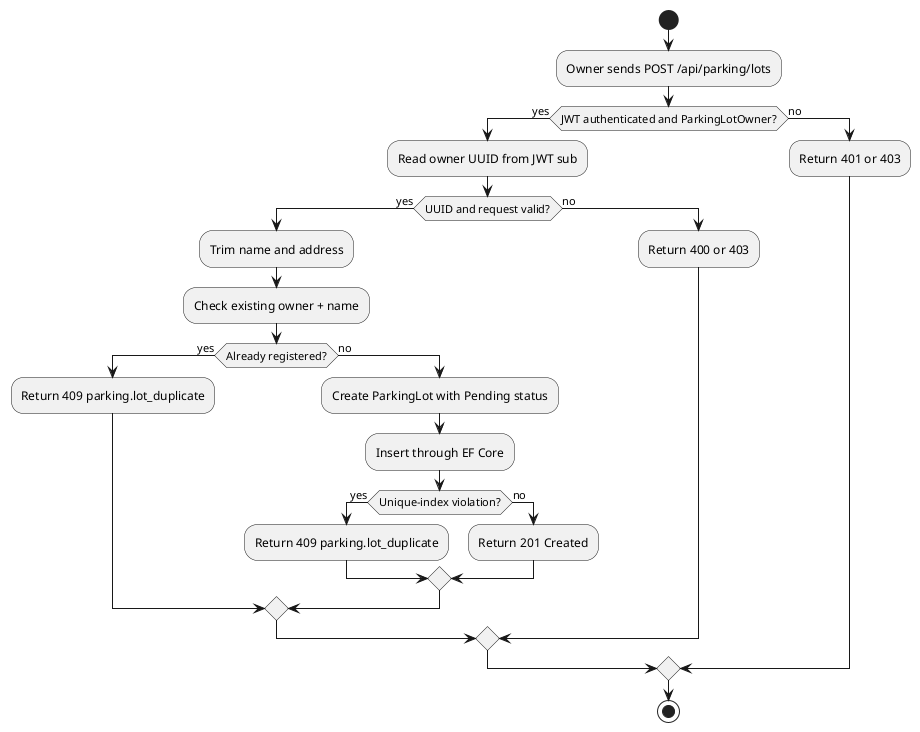
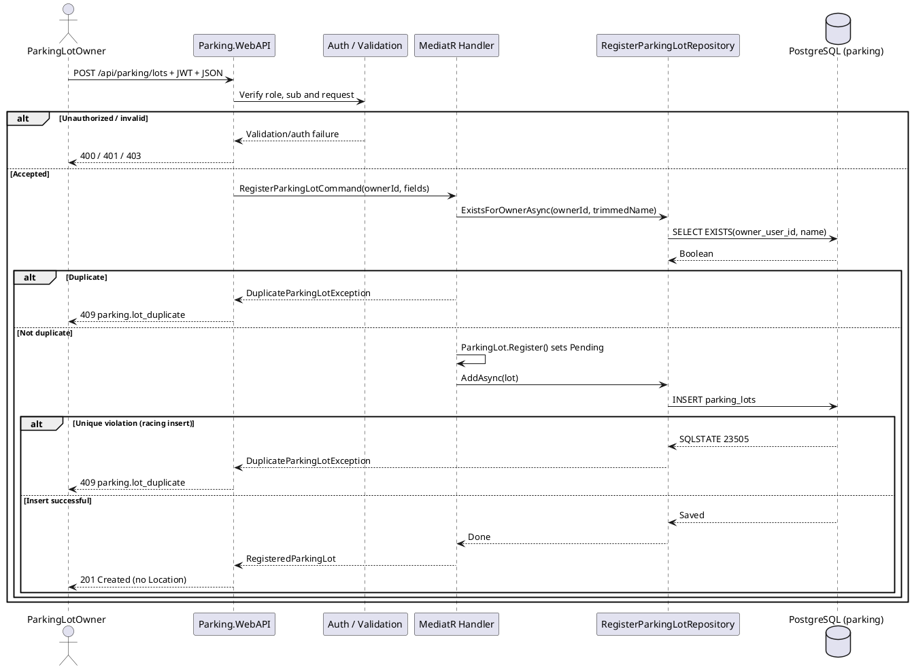

# API DESIGN — US-OWNER-001: Register Parking Lot

> **Project:** ParkWise / Smart Parking System  
> **Sprint:** 2 · **Service:** Parking · **Owner:** BE-2  
> **Document version:** 1.0 · **Prepared:** 2026-10-16  
> **Implementation status:** Implemented and locally verified on `features/Implementation_RegisterParkingLot`; PR #73 subject to review/merge. This document includes the duplicate-registration fix from that PR.  
> **Related story:** `US-ADMIN-002` — Admin approves or rejects a Pending parking lot.

[TOC]

---

## 1. Overview

`US-OWNER-001` allows an authenticated account with the `ParkingLotOwner` role to register a parking lot for administrative review.

**Business rules**

- Registration **always** creates a lot in `Pending`; the client cannot set its approval status.
- `ownerUserId` is taken from the validated JWT `sub` claim, **never from the request body**.
- Public APIs `GET /api/parking/lots` and `GET /api/parking/lots/{parkingLotId}` exclude Pending/Rejected lots. A newly registered Pending lot returns **404** on the public detail endpoint until approved.
- One owner cannot register the **same trimmed lot name** more than once, regardless of its current approval status. Duplicate submissions return **409 Conflict** with `errorCode = parking.lot_duplicate`.
- Different owners may use the same name. Name comparison is **case-sensitive**, as implemented by the PostgreSQL `(owner_user_id, name)` unique index; physical-address verification is **not** implemented.
- The endpoint checks the `ParkingLotOwner` JWT role; a separate approval status for the owner account is outside the current Identity integration.

**Architecture**

`Client / Postman → Gateway (if used) → Parking.WebAPI (Minimal API) → MediatR / Application → Parking.Domain → EF Core / PostgreSQL (parking schema)`.

For local direct API testing: `http://localhost:5002`. The gateway path is the same `/api/parking/lots` when routed through the gateway.

## 2. API Specification

| Property | Value |
|---|---|
| API ID | `US-OWNER-001` |
| Method | **POST** |
| URL | `/api/parking/lots` |
| Local URL | `http://localhost:5002/api/parking/lots` |
| Authentication | Required — `Authorization: Bearer <JWT>` |
| Permission | `role = ParkingLotOwner`; `sub` must be a nonempty valid UUID |
| Content-Type | `application/json` |
| Request DTO | `RegisterParkingLotRequest` |
| Success DTO | `RegisteredParkingLot` |
| Success HTTP status | **201 Created** |
| Expected failures | **400**, **401**, **403**, **409** |

**HTTP request example**

```http
POST /api/parking/lots HTTP/1.1
Host: localhost:5002
Authorization: Bearer <parking-lot-owner-jwt>
Content-Type: application/json
```

## 3. Request Sample

```json
{
  "name": "Bai xe Nguyen Hue",
  "address": "10 Nguyen Hue, Quan 1, TP HCM",
  "latitude": 10.774251,
  "longitude": 106.703612,
  "type": "Outdoor"
}
```

| Field | Type | Required | Validation / Description | Example |
|---|---|---|---|---|
| `name` | string | Yes | Nonblank after trim; length 1–200 characters. Stored trimmed. | `Bai xe Nguyen Hue` |
| `address` | string | Yes | Nonblank after trim; length 1–500 characters. Stored trimmed. | `10 Nguyen Hue, Quan 1, TP HCM` |
| `latitude` | decimal number | Yes | Range **−90 to 90**, inclusive. | `10.774251` |
| `longitude` | decimal number | Yes | Range **−180 to 180**, inclusive. | `106.703612` |
| `type` | string | Yes | `MultiStorey`, `Underground`, `Outdoor`; enum name input is case-insensitive. Numeric enum values are rejected. | `Outdoor` |

**Do not send** `id`, `ownerUserId`, or `approvalStatus`. The server generates/resolves them independently; sending such extra properties does **not** authorize the caller to override server-owned fields.

## 4. Response Sample

### 4.1 Success — 201 Created

*Illustrative UUIDs only; runtime values are generated by the server.*

```json
{
  "id": "4ac3c98c-8050-48e1-93e3-888ad27d3b66",
  "ownerUserId": "d7c4a8c1-83cf-4b32-870f-b3ec09ead1cd",
  "name": "Bai xe Nguyen Hue",
  "address": "10 Nguyen Hue, Quan 1, TP HCM",
  "latitude": 10.774251,
  "longitude": 106.703612,
  "type": "Outdoor",
  "approvalStatus": "Pending"
}
```

| Field | Type | Notes |
|---|---|---|
| `id` | UUID string | New server-generated ParkingLot ID. |
| `ownerUserId` | UUID string | Parsed from authenticated JWT `sub`. |
| `name` | string | Trimmed lot name. |
| `address` | string | Trimmed address. |
| `latitude`, `longitude` | numbers | Submitted coordinates. |
| `type` | string | Canonical enum name (`Outdoor`, etc.). |
| `approvalStatus` | string | Always `Pending` at registration. |

**Important:** `201 Created` is returned **without a `Location` header** because the public detail route intentionally returns 404 for Pending lots.

### 4.2 Failure — duplicate registration, 409 Conflict

```json
{
  "title": "Parking lot already registered.",
  "status": 409,
  "detail": "This owner already has a parking lot with this name.",
  "errorCode": "parking.lot_duplicate"
}
```

The actual ProblemDetails response can contain additional standardized fields (for example `type` or `traceId`).

### 4.3 Failure — invalid request, 400 Bad Request

The shared validation handler produces a validation ProblemDetails response, with errors grouped by property. Representative fields:

```json
{
  "title": "Dữ liệu không hợp lệ.",
  "status": 400,
  "errors": {
    "Name": ["Name must contain 1-200 characters."]
  },
  "errorCode": "request.validation_failed"
}
```

## 5. Validation and Error Matrix

| HTTP | Case | Expected behavior |
|---|---|---|
| **201** | Valid authenticated owner, new `(owner, trimmed name)` | Insert row with `Pending` and return `RegisteredParkingLot`. |
| **400** | Empty/whitespace or overly long `name` or `address` | Validation ProblemDetails; no insert. |
| **400** | Missing/out-of-range coordinates; invalid/numeric `type` | Validation ProblemDetails; no insert. |
| **400** | Invalid JSON | Request parsing error; no insert. |
| **401** | No/invalid/expired authentication token | Reject before registration. |
| **403** | `Customer`, `Staff`, `SystemAdmin` or malformed/non-UUID subject | Authorization forbidden; no insert. |
| **409** | Same owner submits same trimmed, case-sensitive name twice | `parking.lot_duplicate`; no second row. |
| **409** | Two concurrent requests race to register same owner + name | PostgreSQL unique index enforces uniqueness; loser receives duplicate conflict. |

**Acceptance/negative scenarios**

1. First owner registration → 201, status Pending, valid owner ID from JWT.
2. Same owner, same name (even with extra surrounding spaces) → 409; record count unchanged.
3. Different owners, same lot name → allowed; separate records.
4. New Pending lot queried through public detail → 404; not in public catalog.
5. Invalid fields and non-owner/no-token requests → appropriate 400/401/403 response.

## 6. Persistence, Security and Dependencies

- Table: `parking.parking_lots`.
- Owner migration: `20261013140000_AddParkingLotOwnerRegistration` adds nullable `owner_user_id uuid` and supporting index. Nullable is intentional for legacy Sprint 1/seed records.
- Duplicate protection migration: `20261016021857_AddOwnerParkingLotNameUniqueness` creates unique index `ux_parking_lots_owner_user_id_name` on `(owner_user_id, name)`.
- Duplicate guard consists of an Application existence check **and** a database unique constraint for concurrent requests. PostgreSQL treats `NULL` owner IDs as distinct by default; legacy records are not forced to conflict.
- Identity account ID is referenced by UUID without a cross-service database foreign key.
- The client must not control `ownerUserId` or `approvalStatus`.
- Pending/Rejected records are private by design. Resubmission and approval/rejection are separate workflows.
- Current constraint is name-based and case-sensitive; it does not detect equivalent physical addresses or different capitalization.

## 7. Activity Diagram



## 8. Sequence Diagram



## 9. Verification and Source References

**Reported local verification (2026-10-16):** 37/37 unit tests, 9/9 integration tests, Parking WebAPI build succeeded; PostgreSQL index verified; manual same-owner duplicate POST returned 409, and row count remained one.

Implementation references:

- `src/Services/Parking/Parking.WebAPI/Endpoints/ParkingLotEndpoints.cs`
- `src/Services/Parking/Parking.Application/ParkingLots/RegisterParkingLot/RegisterParkingLotCommand.cs`
- `src/Services/Parking/Parking.Application/ParkingLots/RegisterParkingLot/DuplicateParkingLotException.cs`
- `src/Services/Parking/Parking.Persistence/ParkingLots/RegisterParkingLotRepository.cs`
- `src/Services/Parking/Parking.Persistence/ParkingLots/ParkingLotConfiguration.cs`
- `docs/api/Parking-Registration.md`

> **Review caveat:** The behavior described here is from the owner-registration feature branch (including the P1 fix). It must not be treated as merged into `develop` until PR #73 is merged.
