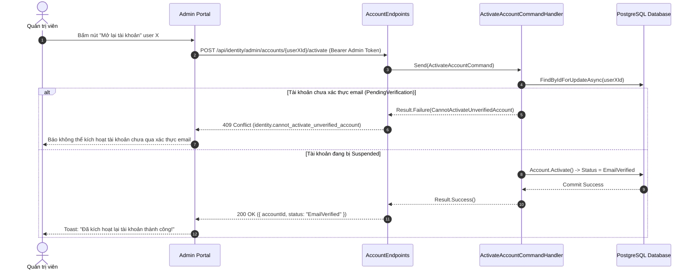

# Kích Hoạt Lại Tài Khoản Bị Đình Chỉ (Admin Activate Account) — US-ADMIN-003

## 1. Overview (Tổng quan)

Cho phép Quản trị viên hệ thống (`SystemAdmin`) khôi phục lại trạng thái hoạt động bình thường cho một tài khoản trước đó bị đình chỉ (`status = "Suspended"` $\rightarrow$ `"EmailVerified"`).  
Sau khi kích hoạt lại, người dùng có thể đăng nhập bình thường vào hệ thống.

### 🛡️ Quy Tắc Ràng Buộc Nghiệp Vụ Chặt Chẽ:
- **Tuyệt đối không kích hoạt thay tài khoản chưa xác thực email (`PendingVerification`):**  
  Nếu tài khoản đang ở trạng thái `PendingVerification`, Backend sẽ từ chối với mã lỗi `409 Conflict (identity.cannot_activate_unverified_account)`. Lý do: Người dùng bắt buộc phải tự chứng minh quyền sở hữu hộp thư email của mình qua mã OTP, Admin không được phép kích hoạt tắt nhằm tránh rủi ro tài khoản ma/email giả mạo.

### Traceability (Tính truy vết):
- **Requirement:** `FR-ADMIN-001`
- **User Story:** `US-ADMIN-003 — Kích hoạt lại tài khoản người dùng`
- **Main Flow:** `MF-06 — Quản trị người dùng & phân quyền hệ thống`
- **Owner:** Identity Service / BE-1

---

## 2. API Specification (Thông số API)

| Thuộc tính | Chi tiết |
| :--- | :--- |
| **HTTP Method** | `POST` |
| **API URL** | `/api/identity/admin/accounts/{accountId}/activate` |
| **Permission** | 🔴 **Bearer JWT — Policy `AdminPolicy`** (Yêu cầu vai trò `SystemAdmin`) |
| **Content-Type** | `application/json` |
| **Accept** | `application/json` |

---

## 3. Request Sample & Schema (Yêu cầu đầu vào)

### 3.1. Request Headers & Route Parameters

| Tham số / Header | Phân loại | Vị trí | Kiểu dữ liệu | Giải thích |
| :--- | :---: | :---: | :---: | :--- |
| `Authorization` | 🔴 **BẮT BUỘC** | Header | `string` | `Bearer <admin_jwt_token>` |
| `accountId` | 🔴 **BẮT BUỘC** | Path | `string (UUID)` | ID của tài khoản đang bị đình chỉ cần kích hoạt lại |

### 3.2. Request Body: ❌ **KHÔNG CÓ BODY (Request POST không kèm payload)**

---

## 4. Response Sample & Schema (Dữ liệu trả về)

### 4.1. HTTP Status: `200 OK`

```json
{
  "accountId": "a3bb108e-17d4-4a6c-9f87-2a54e9912345",
  "status": "EmailVerified",
  "message": "Đã mở khóa và kích hoạt lại tài khoản thành công. Người dùng có thể đăng nhập bình thường."
}
```

### 4.2. Bảng Thuộc Tính Phản Hồi (Response Schema)

| Trường (Field) | Kiểu dữ liệu | Phân loại | Ý nghĩa & Giá trị |
| :--- | :---: | :---: | :--- |
| `accountId` | `string (UUID)` | 🟢 **LUÔN CÓ** | ID của tài khoản vừa được kích hoạt lại |
| `status` | `string` | 🟢 **LUÔN CÓ** | Trạng thái mới: `"EmailVerified"` |
| `message` | `string` | 🟢 **LUÔN CÓ** | Thông điệp: `"Đã mở khóa và kích hoạt lại tài khoản thành công..."` |

---

## 5. Validation & Testcase Scenarios (Ma trận Kiểm thử Đầy Đủ)

Đối soát trực tiếp từ bộ kiểm thử `SessionsAndAdminAccountsTests.cs`:

| Mã Test Case | HTTP Status | Mã lỗi (`errorCode`) | Điều kiện kích hoạt (Given - When) | Phản hồi thực tế (Then) |
| :--- | :---: | :--- | :--- | :--- |
| `TC-ACT-01` | `200 OK` | *None* | Tài khoản mục tiêu đang ở trạng thái `Suspended`. Admin gửi lệnh activate. | Chuyển `status` sang `EmailVerified`; trả về `200 OK`. Người dùng đăng nhập được bình thường. |
| `TC-ACT-02` | `409 Conflict` | `identity.cannot_activate_unverified_account` | Tài khoản mục tiêu đang ở trạng thái `PendingVerification` (vừa đăng ký nhưng chưa chịu nhập mã OTP email). | `"Không thể kích hoạt tài khoản chưa qua xác thực email. Người dùng phải tự hoàn thành xác thực mã OTP."` |
| `TC-ERR-01` | `400 Bad Request` | `identity.account_already_active` | Tài khoản mục tiêu đã ở trạng thái `EmailVerified` (đang hoạt động bình thường). | `"Tài khoản này đang ở trạng thái hoạt động bình thường."` |
| `TC-ERR-02` | `404 Not Found` | `identity.account_not_found` | `accountId` không tồn tại trong hệ thống. | `"Tài khoản không tồn tại."` |
| `TC-ERR-03` | `403 Forbidden` | *Standard HTTP 403* | Người gọi API không có vai trò `SystemAdmin`. | `"Forbidden"` |

---

## 6. Activity Diagram (Sơ đồ luồng hoạt động)

```mermaid
flowchart TD
    A([Admin nhấn Mở lại tài khoản]) --> B[POST /api/identity/admin/accounts/{accountId}/activate]
    B --> C{Xác thực quyền SystemAdmin?}
    C -->|Không có quyền| D[Trả về 403 Forbidden]
    C -->|Hợp lệ| E[Tìm Account theo accountId trong DB]
    E -->|Không tìm thấy| F[Trả về 404 identity.account_not_found]
    E -->|Tìm thấy| G{Kiểm tra trạng thái tài khoản?}
    G -->|Đang PendingVerification| H[Trả về 409 identity.cannot_activate_unverified_account]
    G -->|Đang EmailVerified / Active| I[Trả về 400 identity.account_already_active]
    G -->|Đang Suspended| J[Cập nhật Account.Status = EmailVerified]
    J --> K[(Commit Transaction PostgreSQL)]
    K --> L[Trả về 200 OK]
    L --> M([Admin Portal cập nhật status badge màu xanh])
```

---

## 7. Sequence Diagram (Sơ đồ tuần tự tương tác)



---

## 8. Frontend Integration Guide (Hướng dẫn Tích hợp)

```typescript
export interface ActivateAccountResponse {
  accountId: string;
  status: 'EmailVerified';
  message: string;
}

export const activateAccount = async (accountId: string): Promise<ActivateAccountResponse> => {
  const response = await api.post<ActivateAccountResponse>(
    `/api/identity/admin/accounts/${accountId}/activate`
  );
  return response.data;
};
```
