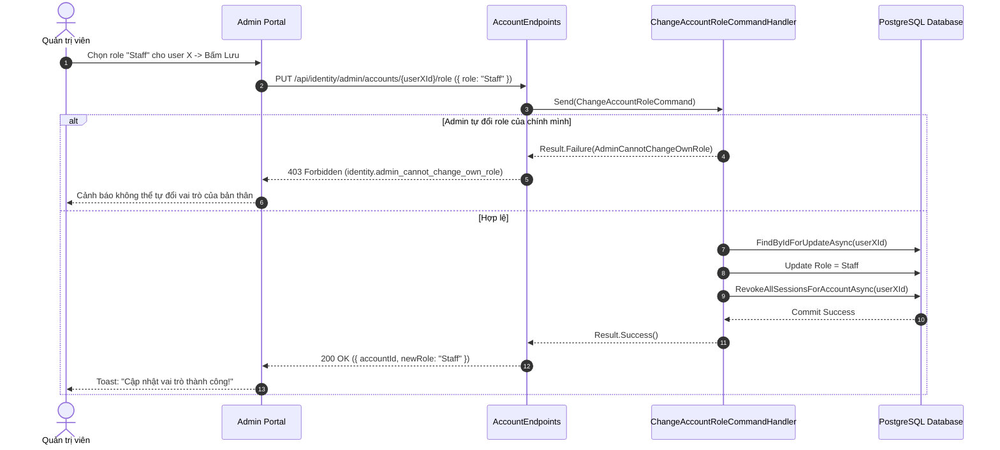

# Phân Quyền / Đổi Vai Trò Người Dùng (Admin Change Role) — US-ADMIN-003

## 1. Overview (Tổng quan)

Cho phép Quản trị viên hệ thống (`SystemAdmin`) nâng cấp hoặc thay đổi vai trò của một tài khoản người dùng (`Customer` $\leftrightarrow$ `Staff` $\leftrightarrow$ `ParkingLotOwner` $\leftrightarrow$ `SystemAdmin`).  
Sau khi thay đổi vai trò thành công, hệ thống **tự động thu hồi toàn bộ các phiên làm việc và Refresh Token hiện có** của người dùng đó. Điều này bắt buộc người dùng phải đăng nhập lại để nhận Access Token JWT mới mang claim `role` cập nhật, ngăn chặn lỗ hổng dùng quyền cũ.

### 🛡️ Nguyên Tắc An Toàn Cốt Lõi (Safety Safeguard):
- **Admin không được phép tự đổi vai trò của chính mình (`identity.admin_cannot_change_own_role`):** Ngăn chặn trường hợp quản trị viên vô tình hạ quyền của mình xuống Customer dẫn đến hệ thống bị mất tài khoản Admin duy nhất.

### Traceability (Tính truy vết):
- **Requirement:** `FR-ADMIN-001`
- **User Story:** `US-ADMIN-003 — Phân quyền vai trò tài khoản`
- **Main Flow:** `MF-06 — Quản trị người dùng & phân quyền hệ thống`
- **Owner:** Identity Service / BE-1

---

## 2. API Specification (Thông số API)

| Thuộc tính | Chi tiết |
| :--- | :--- |
| **HTTP Method** | `PUT` |
| **API URL** | `/api/identity/admin/accounts/{accountId}/role` |
| **Permission** | 🔴 **Bearer JWT — Policy `AdminPolicy`** (Yêu cầu vai trò `SystemAdmin`) |
| **Content-Type** | `application/json` |
| **Accept** | `application/json` |

---

## 3. Request Sample & Schema (Yêu cầu đầu vào)

### 3.1. Request Headers & Route Parameters

| Tham số / Header | Phân loại | Vị trí | Kiểu dữ liệu | Giải thích |
| :--- | :---: | :---: | :---: | :--- |
| `Authorization` | 🔴 **BẮT BUỘC** | Header | `string` | `Bearer <admin_jwt_token>` |
| `accountId` | 🔴 **BẮT BUỘC** | Path | `string (UUID)` | ID của tài khoản cần đổi vai trò |

### 3.2. Request Body Mẫu
```json
{
  "role": "ParkingLotOwner"
}
```

### 3.3. Bảng Đặc Tả Chi Tiết Từng Trường (Request Body Schema)

| Tên trường (Field) | Kiểu dữ liệu | Phân loại | Giá trị mặc định | Ràng buộc Validation & Quy tắc kiểm tra (Source of Truth) |
| :--- | :---: | :---: | :---: | :--- |
| `role` | `string` | 🔴 **BẮT BUỘC** | *Không có* | - Vai trò mới gán cho tài khoản.<br>- Không được để trống hoặc `null`.<br>- Bắt buộc phải là một trong 4 giá trị chuẩn:<br>&nbsp;&nbsp;1. `"Customer"` (Khách hàng vãng lai/đặt xe)<br>&nbsp;&nbsp;2. `"Staff"` (Nhân viên soát vé)<br>&nbsp;&nbsp;3. `"ParkingLotOwner"` (Chủ bãi đỗ xe đối tác)<br>&nbsp;&nbsp;4. `"SystemAdmin"` (Quản trị viên hệ thống)<br>- *Thông báo lỗi:* `"Vai trò mới không hợp lệ. Chỉ chấp nhận: Customer, Staff, ParkingLotOwner, SystemAdmin."` |

---

## 4. Response Sample & Schema (Dữ liệu trả về)

### 4.1. HTTP Status: `200 OK`

```json
{
  "accountId": "a3bb108e-17d4-4a6c-9f87-2a54e9912345",
  "newRole": "ParkingLotOwner",
  "message": "Thay đổi vai trò tài khoản thành công. Toàn bộ phiên làm việc cũ đã được thu hồi."
}
```

### 4.2. Bảng Thuộc Tính Phản Hồi (Response Schema)

| Trường (Field) | Kiểu dữ liệu | Phân loại | Ý nghĩa & Giá trị |
| :--- | :---: | :---: | :--- |
| `accountId` | `string (UUID)` | 🟢 **LUÔN CÓ** | ID của tài khoản được phân quyền |
| `newRole` | `string` | 🟢 **LUÔN CÓ** | Vai trò mới đã được áp dụng |
| `message` | `string` | 🟢 **LUÔN CÓ** | Thông điệp: `"Thay đổi vai trò tài khoản thành công..."` |

---

## 5. Validation & Testcase Scenarios (Ma trận Kiểm thử Đầy Đủ)

Đối soát trực tiếp từ bộ kiểm thử `ChangeAccountRoleIntegrationTests.cs` và `ChangeAccountRoleValidatorTests.cs`:

| Mã Test Case | HTTP Status | Mã lỗi (`errorCode`) | Điều kiện kích hoạt (Given - When) | Phản hồi thực tế (Then) |
| :--- | :---: | :--- | :--- | :--- |
| `TC-ROLE-01` | `200 OK` | *None* | Admin đổi role của người dùng khác từ `Customer` sang `ParkingLotOwner`. | Đổi vai trò thành công; thu hồi toàn bộ phiên và token cũ của người dùng đó; trả về `200 OK`. |
| `TC-ROLE-02` | `403 Forbidden` | `identity.admin_cannot_change_own_role` | Quản trị viên tự gửi `accountId` là ID của chính bản thân mình để đổi vai trò. | `"Quản trị viên không được phép tự thay đổi vai trò của chính mình để tránh mất quyền quản trị hệ thống."` |
| `TC-VAL-01` | `400 Bad Request` | `validation_error` | Truyền `role` không thuộc 4 giá trị quy định (VD: `"SuperAdmin"`, `"Manager"`). | `"Vai trò mới không hợp lệ. Chỉ chấp nhận: Customer, Staff, ParkingLotOwner, SystemAdmin."` |
| `TC-ERR-01` | `404 Not Found` | `identity.account_not_found` | `accountId` trên đường dẫn URL không tồn tại trong hệ thống. | `"Tài khoản không tồn tại."` |
| `TC-ERR-02` | `403 Forbidden` | *Standard HTTP 403* | Người gọi API không có vai trò `SystemAdmin`. | `"Forbidden"` |

---

## 6. Activity Diagram (Sơ đồ luồng hoạt động)

```mermaid
flowchart TD
    A([Admin chọn vai trò mới -> Bấm Lưu]) --> B[PUT /api/identity/admin/accounts/{accountId}/role]
    B --> C{Xác thực quyền SystemAdmin?}
    C -->|Không phải Admin| D[Trả về 403 Forbidden]
    C -->|Hợp lệ| E{accountId == AdminId hiện tại?}
    E -->|Trùng Admin hiện tại| F[Trả về 403 identity.admin_cannot_change_own_role]
    E -->|Khác Admin| G{Kiểm tra role nằm trong 4 giá trị chuẩn?}
    G -->|Không hợp lệ| H[Trả về 400 validation_error]
    G -->|Hợp lệ| I[Tìm Account theo accountId trong DB]
    I -->|Không tìm thấy| J[Trả về 404 identity.account_not_found]
    I -->|Tìm thấy| K[Cập nhật Account.Role = newRole]
    K --> L[Thu hồi TOÀN BỘ AuthSession và RefreshToken của accountId]
    L --> M[(Commit Transaction PostgreSQL)]
    M --> N[Trả về 200 OK kèm thông báo]
    N --> O([Admin Portal cập nhật badge Role mới trên bảng])
```

---

## 7. Sequence Diagram (Sơ đồ tuần tự tương tác)



---

## 8. Frontend Integration Guide (Hướng dẫn Tích hợp)

```typescript
export interface ChangeRoleRequest {
  role: 'Customer' | 'Staff' | 'ParkingLotOwner' | 'SystemAdmin';
}

export interface ChangeRoleResponse {
  accountId: string;
  newRole: string;
  message: string;
}

export const changeAccountRole = async (
  accountId: string,
  payload: ChangeRoleRequest
): Promise<ChangeRoleResponse> => {
  const response = await api.put<ChangeRoleResponse>(
    `/api/identity/admin/accounts/${accountId}/role`,
    payload
  );
  return response.data;
};
```
