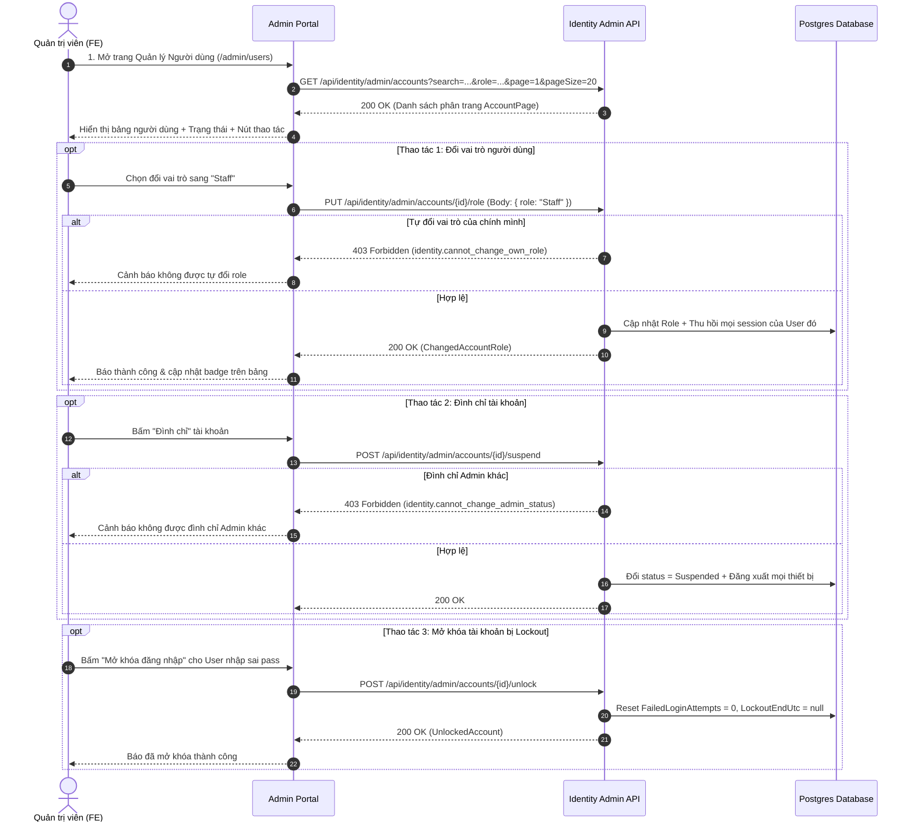

# Đặc Tả Giao Diện API: Quản Trị Tài Khoản Người Dùng (Admin User Management)

> **Dịch vụ:** Identity Service (`ParkWise.Identity.WebAPI`)  
> **Phiên bản:** v1.0.0 (Chuẩn hóa tường minh cho Frontend - Đối soát 100% Backend)  
> **Trạng thái:** Sẵn sàng tích hợp (Production-Ready)  
> **Đối tượng sử dụng:** Frontend Web Portal Quản trị (`/admin/users`), QA/Tester  
> **Base URL:** `/api/identity/admin/accounts` (Trực tiếp: `http://localhost:5001/api/identity/admin/accounts` | Qua Gateway: `http://localhost:5000/api/identity/admin/accounts`)

---

## 1. 📌 Bối Cảnh & Ma Trận Phân Quyền (RBAC & Administrative Rules)

Phân hệ này cung cấp các công cụ quản trị dành riêng cho **Quản trị viên hệ thống (`SystemAdmin`)** nhằm kiểm soát vòng đời tài khoản người dùng, phân bổ vai trò và xử lý sự cố đăng nhập:

1. **Quyền hạn truy cập (Authorization Policy)**:
   - Tất cả các endpoint trong phân hệ này đều yêu cầu chính sách bảo vệ `AdminPolicy` (`RequireAuthorization(IdentityAuthorization.AdminPolicy)`).
   - Người gọi bắt buộc phải có Access Token chứa Claim: `role: "SystemAdmin"`.
   - Bất kỳ vai trò nào khác (`Customer`, `Staff`, `ParkingLotOwner`) hoặc gọi không kèm token sẽ nhận ngay mã phản hồi:
     - `401 Unauthorized`: Nếu thiếu token hoặc token hết hạn.
     - `403 Forbidden`: Nếu có token nhưng không phải vai trò `SystemAdmin`.
2. **Quy tắc an toàn chống chiếm quyền / Triệt tiêu lẫn nhau (Anti-Deadlock & Anti-Abuse Rules)**:
   - **Không tự đổi vai trò của chính mình:** Quản trị viên không thể tự hạ cấp hoặc thay đổi vai trò của mình (`identity.cannot_change_own_role`).
   - **Không tự đình chỉ chính mình:** Quản trị viên không thể tự khóa tài khoản của mình (`identity.cannot_change_own_status`).
   - **Không đình chỉ Admin khác:** Một SystemAdmin không được phép trực tiếp đình chỉ một SystemAdmin khác (`identity.cannot_change_admin_status`). Nếu muốn khóa, phải hạ vai trò của họ xuống trước.
   - **Không kích hoạt bỏ qua OTP:** Tài khoản chưa hoàn tất xác thực email (`PendingEmailVerification`) không thể được kích hoạt bởi Admin (`identity.account_not_verified`) để ngăn chặn việc tạo tài khoản giả mạo.
3. **Thu hồi phiên khi thay đổi quyền (Immediate Session Invalidation)**:
   - Khi một tài khoản bị đổi vai trò (`role`) hoặc bị đình chỉ (`suspend`), toàn bộ phiên làm việc (`AuthSession`) và `RefreshToken` của tài khoản đó sẽ bị Backend hủy bỏ ngay lập tức trên mọi thiết bị.



---

## 2. 🌐 Đặc Tả Chi Tiết Từng Endpoint

---

### 2.1. Tìm Kiếm & Phân Trang Danh Sách Tài Khoản (Search Accounts)

Tìm kiếm tài khoản người dùng theo email hoặc họ tên, hỗ trợ lọc theo vai trò, trạng thái và phân trang.

- **HTTP Method:** `GET`
- **URL Path:** `/api/identity/admin/accounts`
- **Quyền truy cập (Auth):** 🔴 **BẮT BUỘC SYSTEM ADMIN** (`AdminPolicy`)

#### 📋 Request Headers

| Header | Trạng thái | Giá trị mẫu | Giải thích |
| :--- | :---: | :--- | :--- |
| `Authorization` | 🔴 **BẮT BUỘC** | `Bearer eyJhbGciOiJSUz...` | Access Token của Quản trị viên |
| `Accept` | 🟢 **KHUYẾN NGHỊ** | `application/json` | Định dạng phản hồi mong muốn |

#### 🔍 Query Parameters (Phân Định Rõ Ràng)

| Tham số (Param) | Kiểu dữ liệu | Phân loại | Giá trị mặc định | Ràng buộc Validation & Ý nghĩa |
| :--- | :---: | :---: | :---: | :--- |
| `search` | `string` | 🟡 **TÙY CHỌN** | `null` | Từ khóa tìm kiếm theo email hoặc họ tên (không phân biệt hoa thường). Tối đa **254 ký tự**. |
| `role` | `string` | 🟡 **TÙY CHỌN** | `null` | Lọc theo vai trò. Một trong các giá trị:<br>`"Customer"`, `"Staff"`, `"ParkingLotOwner"`, `"SystemAdmin"`. |
| `status` | `string` | 🟡 **TÙY CHỌN** | `null` | Lọc theo trạng thái. Một trong các giá trị:<br>`"PendingEmailVerification"`, `"EmailVerified"`, `"Suspended"`, `"Disabled"`. |
| `page` | `integer` | 🟡 **TÙY CHỌN** | `1` | Số thứ tự trang cần lấy (bắt đầu từ 1 trở lên). |
| `pageSize` | `integer` | 🟡 **TÙY CHỌN** | `20` | Số lượng bản ghi trên một trang (tối thiểu 1, tối đa **100**). |

#### 📝 Ví Dụ URL Gọi API
```http
GET /api/identity/admin/accounts?search=nguyen&role=Customer&status=EmailVerified&page=1&pageSize=20
```

#### 📤 Phản Hồi Thành Công (`200 OK`)

##### 📦 Response Body Schema (`AccountPage`)

| Trường (Field) | Kiểu dữ liệu | Phân loại | Ý nghĩa & Giá trị mẫu |
| :--- | :---: | :---: | :--- |
| `items` | `AccountSummary[]` | 🟢 **LUÔN CÓ** | Danh sách các tài khoản thỏa mãn bộ lọc |
| `page` | `integer` | 🟢 **LUÔN CÓ** | Trang hiện tại (VD: `1`) |
| `pageSize` | `integer` | 🟢 **LUÔN CÓ** | Số bản ghi mỗi trang (VD: `20`) |
| `totalCount` | `integer` | 🟢 **LUÔN CÓ** | Tổng số bản ghi thỏa mãn điều kiện tìm kiếm (dùng để tính tổng số trang trên UI) |

##### Chi tiết từng phần tử trong `items` (`AccountSummary`):

| Trường con | Kiểu dữ liệu | Phân loại | Ý nghĩa |
| :--- | :---: | :---: | :--- |
| `id` | `string (UUID)` | 🟢 **LUÔN CÓ** | ID duy nhất của tài khoản |
| `email` | `string` | 🟢 **LUÔN CÓ** | Địa chỉ email |
| `fullName` | `string` hoặc `null` | ⚪ **CÓ THỂ NULL** | Họ và tên (nếu người dùng chưa cập nhật thì trả `null`) |
| `role` | `string` | 🟢 **LUÔN CÓ** | `"Customer"`, `"Staff"`, `"ParkingLotOwner"`, `"SystemAdmin"` |
| `status` | `string` | 🟢 **LUÔN CÓ** | `"PendingEmailVerification"`, `"EmailVerified"`, `"Suspended"`, `"Disabled"` |
| `isLocked` | `boolean` | 🟢 **LUÔN CÓ** | `true` nếu tài khoản đang bị khóa tạm thời do nhập sai mật khẩu 3 lần |
| `lockoutEndUtc` | `string` hoặc `null` | ⚪ **CÓ THỂ NULL** | Thời điểm hết hạn khóa (`"2026-10-13T14:45:00Z"`). Trả `null` nếu không bị khóa |
| `createdAtUtc` | `string (ISO-8601)` | 🟢 **LUÔN CÓ** | Ngày giờ tạo tài khoản |

```json
{
  "items": [
    {
      "id": "a3bb108e-17d4-4a6c-9f87-2a54e9912345",
      "email": "user@example.com",
      "fullName": "Nguyễn Văn A",
      "role": "Customer",
      "status": "EmailVerified",
      "isLocked": false,
      "lockoutEndUtc": null,
      "createdAtUtc": "2026-10-10T08:00:00Z"
    },
    {
      "id": "b7cc219f-28e5-5b7d-af98-3b65fa023456",
      "email": "locked_user@example.com",
      "fullName": null,
      "role": "Customer",
      "status": "EmailVerified",
      "isLocked": true,
      "lockoutEndUtc": "2026-10-13T14:45:00Z",
      "createdAtUtc": "2026-10-12T10:30:00Z"
    }
  ],
  "page": 1,
  "pageSize": 20,
  "totalCount": 42
}
```

#### ⚠️ Danh Sách Mã Lỗi Chi Tiết

| HTTP Status | Error Code (`errorCode`) | Nguyên nhân cụ thể | Hành động gợi ý cho Frontend |
| :---: | :--- | :--- | :--- |
| `400 Bad Request` | `validation_error` | `page < 1`, `pageSize > 100`, hoặc giá trị `role` / `status` không nằm trong enum cho phép. | Kiểm tra lại giá trị param trên thanh URL. |
| `401 Unauthorized` | *Standard HTTP 401* | Thiếu token hoặc token đã hết hạn. | Chuyển hướng về `/login`. |
| `403 Forbidden` | *Standard HTTP 403* | Token không có vai trò `SystemAdmin`. | Hiển thị màn hình 403: *"Bạn không có quyền truy cập trang quản trị."* |

---

### 2.2. Thay Đổi Vai Trò Tài Khoản (Change Account Role)

Gán vai trò mới cho tài khoản. Khi thay đổi thành công, tài khoản đó sẽ tự động bị đăng xuất khỏi mọi thiết bị.

- **HTTP Method:** `PUT`
- **URL Path:** `/api/identity/admin/accounts/{accountId}/role`
- **Quyền truy cập (Auth):** 🔴 **BẮT BUỘC SYSTEM ADMIN**

#### 📋 Request Headers & Route Params

| Tham số / Header | Trạng thái | Vị trí | Kiểu dữ liệu | Giải thích |
| :--- | :---: | :---: | :---: | :--- |
| `Authorization` | 🔴 **BẮT BUỘC** | Header | `string` | `Bearer <admin_access_token>` |
| `accountId` | 🔴 **BẮT BUỘC** | Path | `string (UUID)` | ID của tài khoản cần đổi vai trò |

#### 📥 Request Body Schema

| Tên trường (Field) | Kiểu dữ liệu | Phân loại | Ràng buộc Validation & Giá trị hợp lệ |
| :--- | :---: | :---: | :--- |
| `role` | `string` | 🔴 **BẮT BUỘC** | Vai trò mới. Bắt buộc là một trong 4 giá trị (không phân biệt hoa thường):<br>`"Customer"`, `"Staff"`, `"ParkingLotOwner"`, `"SystemAdmin"`. |

#### 📝 Request Body Mẫu
```json
{
  "role": "Staff"
}
```

#### 📤 Phản Hồi Thành Công (`200 OK`)

| Trường (Field) | Kiểu dữ liệu | Phân loại | Ý nghĩa & Giá trị |
| :--- | :---: | :---: | :--- |
| `accountId` | `string (UUID)` | 🟢 **LUÔN CÓ** | ID tài khoản vừa cập nhật |
| `role` | `string` | 🟢 **LUÔN CÓ** | Vai trò mới đã được gán |
| `message` | `string` | 🟢 **LUÔN CÓ** | `"Đã đổi vai trò tài khoản thành công. Người dùng đã bị đăng xuất khỏi mọi thiết bị."` |

```json
{
  "accountId": "a3bb108e-17d4-4a6c-9f87-2a54e9912345",
  "role": "Staff",
  "message": "Đã đổi vai trò tài khoản thành công. Người dùng đã bị đăng xuất khỏi mọi thiết bị."
}
```

#### ⚠️ Danh Sách Mã Lỗi Chi Tiết

| HTTP Status | Error Code (`errorCode`) | Nguyên nhân cụ thể | Hành động gợi ý cho Frontend |
| :---: | :--- | :--- | :--- |
| `403 Forbidden` | `identity.cannot_change_own_role` | Quản trị viên đang cố gắng tự đổi vai trò của chính mình. | Vô hiệu hóa nút đổi vai trò cho chính tài khoản Admin đang đăng nhập. |
| `404 NotFound` | `identity.account_not_found` | `accountId` không tồn tại trong hệ thống. | Báo lỗi và tải lại danh sách. |

---

### 2.3. Mở Khóa Đăng Nhập Tài Khoản (Unlock Account)

Gỡ bỏ trạng thái khóa đăng nhập tạm thời do người dùng nhập sai mật khẩu 3 lần liên tiếp.

- **HTTP Method:** `POST`
- **URL Path:** `/api/identity/admin/accounts/{accountId}/unlock`
- **Quyền truy cập (Auth):** 🔴 **BẮT BUỘC SYSTEM ADMIN**

#### 📋 Request Headers & Route Params

| Tham số / Header | Trạng thái | Vị trí | Kiểu dữ liệu | Giải thích |
| :--- | :---: | :---: | :---: | :--- |
| `Authorization` | 🔴 **BẮT BUỘC** | Header | `string` | `Bearer <admin_access_token>` |
| `accountId` | 🔴 **BẮT BUỘC** | Path | `string (UUID)` | ID tài khoản cần mở khóa |

#### 📥 Request Body: ❌ **KHÔNG CÓ BODY**

#### 📤 Phản Hồi Thành Công (`200 OK`)

```json
{
  "accountId": "b7cc219f-28e5-5b7d-af98-3b65fa023456",
  "message": "Đã mở khóa tài khoản thành công. Người dùng có thể đăng nhập lại ngay lập tức."
}
```

#### ⚠️ Danh Sách Mã Lỗi Chi Tiết

| HTTP Status | Error Code (`errorCode`) | Nguyên nhân cụ thể |
| :---: | :--- | :--- |
| `404 NotFound` | `identity.account_not_found` | Không tìm thấy tài khoản với ID tương ứng. |

---

### 2.4. Đình Chỉ Tài Khoản (Suspend Account)

Tạm dừng hoạt động của tài khoản. Thu hồi toàn bộ phiên và token trên mọi thiết bị.

- **HTTP Method:** `POST`
- **URL Path:** `/api/identity/admin/accounts/{accountId}/suspend`
- **Quyền truy cập (Auth):** 🔴 **BẮT BUỘC SYSTEM ADMIN**

#### 📥 Request Body: ❌ **KHÔNG CÓ BODY**

#### 📤 Phản Hồi Thành Công (`200 OK`)
```json
{
  "accountId": "a3bb108e-17d4-4a6c-9f87-2a54e9912345",
  "status": "Suspended",
  "message": "Đã đình chỉ tài khoản và đăng xuất người dùng khỏi mọi thiết bị."
}
```

#### ⚠️ Danh Sách Mã Lỗi Chi Tiết

| HTTP Status | Error Code (`errorCode`) | Nguyên nhân cụ thể | Hành động gợi ý cho Frontend |
| :---: | :--- | :--- | :--- |
| `403 Forbidden` | `identity.admin_cannot_suspend_self` | Admin tự đình chỉ tài khoản của chính mình. | Ẩn nút "Đình chỉ" với dòng tài khoản của chính Admin. |
| `403 Forbidden` | `identity.cannot_suspend_admin` | Cố gắng đình chỉ một tài khoản SystemAdmin khác. | Ẩn nút "Đình chỉ" cho các tài khoản có `role === 'SystemAdmin'`. |
| `404 NotFound` | `identity.account_not_found` | Tài khoản không tồn tại. | Tải lại danh sách. |

---

### 2.5. Kích Hoạt Lại Tài Khoản (Activate Account)

Mở lại hoạt động cho tài khoản đang bị trạng thái `Suspended`.

- **HTTP Method:** `POST`
- **URL Path:** `/api/identity/admin/accounts/{accountId}/activate`
- **Quyền truy cập (Auth):** 🔴 **BẮT BUỘC SYSTEM ADMIN**

#### 📥 Request Body: ❌ **KHÔNG CÓ BODY**

#### 📤 Phản Hồi Thành Công (`200 OK`)
```json
{
  "accountId": "a3bb108e-17d4-4a6c-9f87-2a54e9912345",
  "status": "EmailVerified",
  "message": "Đã kích hoạt lại tài khoản. Người dùng có thể đăng nhập."
}
```

#### ⚠️ Danh Sách Mã Lỗi Chi Tiết

| HTTP Status | Error Code (`errorCode`) | Nguyên nhân cụ thể | Hành động gợi ý cho Frontend |
| :---: | :--- | :--- | :--- |
| `400 Bad Request` | `identity.account_not_suspended` | Tài khoản không đang ở trạng thái `Suspended` (chỉ tài khoản bị đình chỉ mới được kích hoạt lại). | Ẩn nút "Kích hoạt" cho các tài khoản không ở trạng thái Suspended. |

---

## 3. 💻 Khai Báo TypeScript & Axios Service Mẫu (Frontend SDK)

### 3.1. TypeScript Interface Definitions

```typescript
// ==========================================
// 1. FILTER & REQUEST TYPES
// ==========================================

export type AccountRole = 'Customer' | 'Staff' | 'ParkingLotOwner' | 'SystemAdmin';
export type AccountStatus = 'PendingEmailVerification' | 'EmailVerified' | 'Suspended' | 'Disabled';

export interface SearchAccountsParams {
  search?: string;     // [TÙY CHỌN] Max 254 ký tự
  role?: AccountRole;  // [TÙY CHỌN]
  status?: AccountStatus; // [TÙY CHỌN]
  page?: number;       // [TÙY CHỌN] Mặc định 1
  pageSize?: number;   // [TÙY CHỌN] Mặc định 20, max 100
}

export interface ChangeRoleRequest {
  role: AccountRole;   // [BẮT BUỘC]
}

// ==========================================
// 2. RESPONSE TYPES
// ==========================================

export interface AccountSummary {
  id: string;                 // 🟢 [LUÔN CÓ] UUID
  email: string;              // 🟢 [LUÔN CÓ]
  fullName: string | null;    // ⚪ [CÓ THỂ NULL]
  role: AccountRole;          // 🟢 [LUÔN CÓ]
  status: AccountStatus;      // 🟢 [LUÔN CÓ]
  isLocked: boolean;          // 🟢 [LUÔN CÓ]
  lockoutEndUtc: string | null; // ⚪ [CÓ THỂ NULL] ISO-8601
  createdAtUtc: string;       // 🟢 [LUÔN CÓ] ISO-8601
}

export interface AccountPageResponse {
  items: AccountSummary[];    // 🟢 [LUÔN CÓ]
  page: number;               // 🟢 [LUÔN CÓ]
  pageSize: number;           // 🟢 [LUÔN CÓ]
  totalCount: number;         // 🟢 [LUÔN CÓ]
}

export interface ChangedAccountRoleResponse {
  accountId: string;          // 🟢 [LUÔN CÓ]
  role: AccountRole;          // 🟢 [LUÔN CÓ]
  message: string;            // 🟢 [LUÔN CÓ]
}

export interface AccountActionResponse {
  accountId: string;          // 🟢 [LUÔN CÓ]
  status?: AccountStatus;     // ⚪ [CÓ THỂ CÓ]
  message: string;            // 🟢 [LUÔN CÓ]
}
```

### 3.2. Axios Service Functions

```typescript
import { api } from './auth';

export const adminAccountService = {
  /**
   * 1. Tìm kiếm và phân trang danh sách tài khoản
   */
  async searchAccounts(params: SearchAccountsParams): Promise<AccountPageResponse> {
    const response = await api.get<AccountPageResponse>('/api/identity/admin/accounts', { params });
    return response.data;
  },

  /**
   * 2. Thay đổi vai trò người dùng (Role)
   */
  async changeRole(accountId: string, role: AccountRole): Promise<ChangedAccountRoleResponse> {
    const response = await api.put<ChangedAccountRoleResponse>(`/api/identity/admin/accounts/${accountId}/role`, { role });
    return response.data;
  },

  /**
   * 3. Mở khóa tài khoản bị Lockout
   */
  async unlockAccount(accountId: string): Promise<AccountActionResponse> {
    const response = await api.post<AccountActionResponse>(`/api/identity/admin/accounts/${accountId}/unlock`);
    return response.data;
  },

  /**
   * 4. Đình chỉ tài khoản
   */
  async suspendAccount(accountId: string): Promise<AccountActionResponse> {
    const response = await api.post<AccountActionResponse>(`/api/identity/admin/accounts/${accountId}/suspend`);
    return response.data;
  },

  /**
   * 5. Kích hoạt lại tài khoản
   */
  async activateAccount(accountId: string): Promise<AccountActionResponse> {
    const response = await api.post<AccountActionResponse>(`/api/identity/admin/accounts/${accountId}/activate`);
    return response.data;
  },
};
```

---

## 4. 🎯 Checklist UI/UX Frontend Màn Hình Quản Trị Người Dùng (`/admin/users`)

- [ ] **Bảo vệ hiển thị thao tác (UI Guard Rails):**
  - **Với tài khoản của chính Admin đang đăng nhập:** Ẩn hoặc disable nút *"Đổi vai trò"* và nút *"Đình chỉ"*.
  - **Với các tài khoản có `role === 'SystemAdmin'` khác:** Ẩn nút *"Đình chỉ"*. Nếu muốn đình chỉ Admin khác, bắt buộc Admin phải hạ vai trò trước.
  - **Với tài khoản có `status === 'PendingEmailVerification'`:** Ẩn nút *"Kích hoạt"* để tránh bấm lỗi `409 Conflict`.
- [ ] **Hiển thị Badge trạng thái trực quan:**
  - `🟢 EmailVerified` (Hoạt động)
  - `🟡 PendingEmailVerification` (Chờ xác thực OTP)
  - `🔴 Suspended` (Bị đình chỉ)
  - `🔒 Tạm khóa (isLocked === true)`: Hiển thị icon ổ khóa màu cam kèm tooltip đếm ngược thời gian `lockoutEndUtc`. Bên cạnh có nút bấm thao tác nhanh: **"Mở khóa ngay"**.
- [ ] **Bộ lọc và Tìm kiếm (Filter & Search Toolbar):**
  - Ô tìm kiếm có cơ chế **Debounce 400ms** khi gõ text để tránh bắn request liên tục làm quá tải API.
  - Dropdown chọn `Role` và `Status` có tùy chọn *"Tất cả vai trò"* và *"Tất cả trạng thái"*.
  - Component phân trang (Pagination): Tính tổng số trang bằng công thức `Math.ceil(totalCount / pageSize)`.
- [ ] **Xác nhận hành động nguy hiểm (Confirmation Dialog):**
  - Mở Dialog xác nhận trước khi Đình chỉ hoặc Đổi vai trò: *"Hành động này sẽ đăng xuất người dùng khỏi tất cả các thiết bị. Bạn có chắc chắn muốn tiếp tục?"*.
