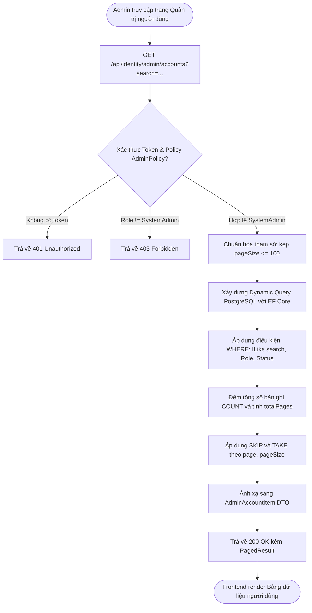
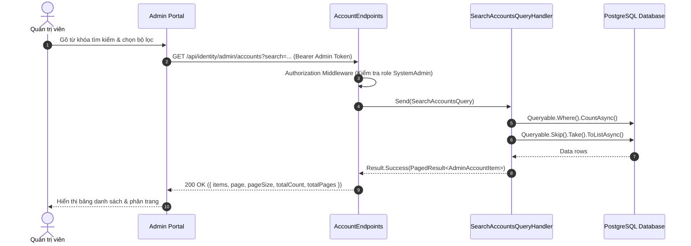

# Tìm Kiếm & Phân Trang Danh Sách Tài Khoản (Admin Search Accounts) — US-ADMIN-003

## 1. Overview (Tổng quan)

Cung cấp danh sách tài khoản người dùng cho màn hình Quản trị Người Dùng (`/admin/users`) của Hệ thống Smart Parking.  
Hỗ trợ tìm kiếm nhanh theo từ khóa (Email, Họ tên, Số điện thoại), lọc theo vai trò (`role`), lọc theo trạng thái tài khoản (`status`), và phân trang linh hoạt (mặc định 20 bản ghi, tối đa 100 bản ghi/trang).

### Traceability (Tính truy vết):
- **Requirement:** `FR-ADMIN-001`
- **User Story:** `US-ADMIN-003 — Quản lý danh sách tài khoản người dùng`
- **Main Flow:** `MF-06 — Quản trị người dùng & phân quyền hệ thống`
- **Owner:** Identity Service / BE-1

---

## 2. API Specification (Thông số API)

| Thuộc tính | Chi tiết |
| :--- | :--- |
| **HTTP Method** | `GET` |
| **API URL** | `/api/identity/admin/accounts` |
| **Permission** | 🔴 **Bearer JWT — Policy `AdminPolicy`** (Yêu cầu vai trò `SystemAdmin`) |
| **Accept** | `application/json` |

---

## 3. Request Sample & Schema (Yêu cầu đầu vào)

### 3.1. Request Headers

| Header | Phân loại | Giá trị mẫu | Giải thích |
| :--- | :---: | :--- | :--- |
| `Authorization` | 🔴 **BẮT BUỘC** | `Bearer eyJhbGciOiJSUzI1Ni...` | Access Token của tài khoản có role `SystemAdmin` |

### 3.2. Query Parameters (Tham số đường dẫn URL)

```http
GET /api/identity/admin/accounts?search=nguyen&role=Customer&status=EmailVerified&page=1&pageSize=20
```

| Tên tham số (Query Param) | Kiểu dữ liệu | Phân loại | Giá trị mặc định | Ràng buộc Validation & Mô tả chi tiết |
| :--- | :---: | :---: | :---: | :--- |
| `search` | `string` | 🟡 **TÙY CHỌN** | `null` | Từ khóa tìm kiếm không phân biệt hoa thường. Tìm kiếm mờ (Like/ILike) trên: `Email`, `FullName`, `PhoneNumber`. |
| `role` | `string` | 🟡 **TÙY CHỌN** | `null` | Bộ lọc vai trò: `"Customer"`, `"Staff"`, `"ParkingLotOwner"`, `"SystemAdmin"`. |
| `status` | `string` | 🟡 **TÙY CHỌN** | `null` | Bộ lọc trạng thái: `"PendingVerification"`, `"EmailVerified"`, `"Suspended"`, `"Disabled"`. |
| `page` | `integer` | 🟡 **TÙY CHỌN** | `1` | Số thứ tự trang hiện tại (tối thiểu là `1`). |
| `pageSize` | `integer` | 🟡 **TÙY CHỌN** | `20` | Số lượng bản ghi trên một trang (tối thiểu `1`, tối đa `100`). Nếu truyền `> 100`, Backend tự giới hạn về `100`. |

---

## 4. Response Sample & Schema (Dữ liệu trả về)

### 4.1. HTTP Status: `200 OK`

```json
{
  "items": [
    {
      "id": "a3bb108e-17d4-4a6c-9f87-2a54e9912345",
      "email": "user@example.com",
      "fullName": "Nguyễn Văn An",
      "phoneNumber": "+84901234567",
      "role": "Customer",
      "status": "EmailVerified",
      "isLocked": false,
      "lockoutEndUtc": null,
      "createdAtUtc": "2026-10-10T08:00:00Z"
    }
  ],
  "page": 1,
  "pageSize": 20,
  "totalCount": 156,
  "totalPages": 8
}
```

### 4.2. Bảng Thuộc Tính Phản Hồi (Response Schema)

| Trường (Field) | Kiểu dữ liệu | Phân loại | Ý nghĩa & Giá trị |
| :--- | :---: | :---: | :--- |
| `items` | `array` | 🟢 **LUÔN CÓ** | Danh sách các tài khoản thỏa mãn bộ lọc |
| `items[].id` | `string (UUID)` | 🟢 **LUÔN CÓ** | Định danh tài khoản |
| `items[].email` | `string` | 🟢 **LUÔN CÓ** | Email người dùng |
| `items[].fullName` | `string` hoặc `null` | ⚪ **CÓ THỂ NULL** | Họ và tên |
| `items[].phoneNumber` | `string` hoặc `null` | ⚪ **CÓ THỂ NULL** | Số điện thoại |
| `items[].role` | `string` | 🟢 **LUÔN CÓ** | Vai trò hiện tại |
| `items[].status` | `string` | 🟢 **LUÔN CÓ** | Trạng thái hoạt động |
| `items[].isLocked` | `boolean` | 🟢 **LUÔN CÓ** | `true` nếu tài khoản đang bị khóa tạm thời 15 phút do nhập sai pass |
| `items[].lockoutEndUtc` | `string (ISO-8601)` hoặc `null` | ⚪ **CÓ THỂ NULL** | Thời điểm hết khóa nếu đang bị khóa |
| `page` | `integer` | 🟢 **LUÔN CÓ** | Số trang hiện tại |
| `pageSize` | `integer` | 🟢 **LUÔN CÓ** | Kích thước trang |
| `totalCount` | `integer` | 🟢 **LUÔN CÓ** | Tổng số bản ghi tìm được |
| `totalPages` | `integer` | 🟢 **LUÔN CÓ** | Tổng số trang |

---

## 5. Validation & Testcase Scenarios (Ma trận Kiểm thử Đầy Đủ)

Đối soát trực tiếp từ bộ kiểm thử `SessionsAndAdminAccountsTests.cs`:

| Mã Test Case | HTTP Status | Mã lỗi (`errorCode`) | Điều kiện kích hoạt (Given - When) | Phản hồi thực tế (Then) |
| :--- | :---: | :--- | :--- | :--- |
| `TC-ADM-01` | `200 OK` | *None* | Tài khoản Admin gửi request, truyền `search="an"`, `page=1`, `pageSize=10`. | Trả về `PagedResult` danh sách người dùng có tên/email chứa `"an"`. |
| `TC-ADM-02` | `200 OK` | *None* | Truyền `pageSize=500` (vượt quá mức trần). | Backend tự động kẹp về `pageSize=100` và trả kết quả bình thường. |
| `TC-ADM-03` | `200 OK` | *None* | Không có tài khoản nào khớp với bộ lọc tìm kiếm. | Trả về `items: []`, `totalCount: 0`, `totalPages: 0`. |
| `TC-ERR-01` | `401 Unauthorized` | *Standard HTTP 401* | Không gửi Bearer Token hoặc Token đã hết hạn. | `"Unauthorized"` |
| `TC-ERR-02` | `403 Forbidden` | *Standard HTTP 403* | Token hợp lệ nhưng tài khoản có role `Customer` hoặc `Staff` (Không có quyền Admin). | `"Forbidden"` |

---

## 6. Activity Diagram (Sơ đồ luồng hoạt động)



---

## 7. Sequence Diagram (Sơ đồ tuần tự tương tác)



---

## 8. Frontend Integration Guide (Hướng dẫn Tích hợp)

```typescript
export interface AdminAccountItem {
  id: string;
  email: string;
  fullName: string | null;
  phoneNumber: string | null;
  role: 'Customer' | 'Staff' | 'ParkingLotOwner' | 'SystemAdmin';
  status: 'PendingVerification' | 'EmailVerified' | 'Suspended' | 'Disabled';
  isLocked: boolean;
  lockoutEndUtc: string | null;
  createdAtUtc: string;
}

export interface PagedResult<T> {
  items: T[];
  page: number;
  pageSize: number;
  totalCount: number;
  totalPages: number;
}

export const searchAdminAccounts = async (params: {
  search?: string;
  role?: string;
  status?: string;
  page?: number;
  pageSize?: number;
}): Promise<PagedResult<AdminAccountItem>> => {
  const response = await api.get<PagedResult<AdminAccountItem>>('/api/identity/admin/accounts', { params });
  return response.data;
};
```
