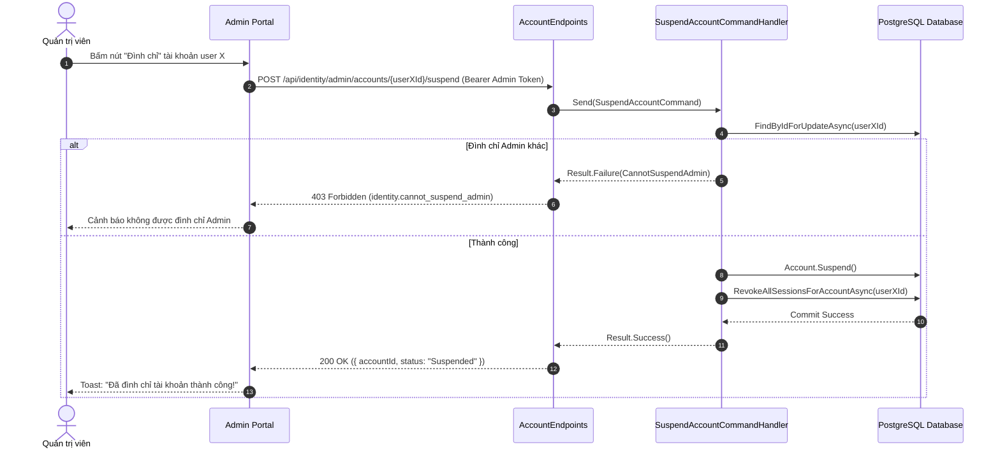

# Tạm Đình Chỉ Tài Khoản Người Dùng (Admin Suspend Account) — US-ADMIN-003

## 1. Overview (Tổng quan)

Cho phép Quản trị viên hệ thống (`SystemAdmin`) tạm thời đình chỉ hoạt động của một tài khoản vi phạm chính sách hoặc gian lận (`status = "Suspended"`).  
Khi tài khoản bị đình chỉ:
1. **Hủy toàn bộ phiên làm việc ngay lập tức:** Toàn bộ `AuthSession` và Refresh Token của người dùng đó trên mọi thiết bị đều bị thu hồi lập tức.
2. **Chặn đăng nhập:** Người dùng không thể đăng nhập lại và sẽ nhận lỗi `403 identity.account_suspended`.

### 🛡️ Nguyên Tắc An Toàn (Safeguards):
- **Không được tự đình chỉ chính mình:** Admin không được phép tự suspend tài khoản của bản thân (`identity.admin_cannot_suspend_self`).
- **Không được đình chỉ Admin khác:** Không thể đình chỉ tài khoản có vai trò `SystemAdmin` (`identity.cannot_suspend_admin`).

### Traceability (Tính truy vết):
- **Requirement:** `FR-ADMIN-001`
- **User Story:** `US-ADMIN-003 — Tạm đình chỉ tài khoản người dùng`
- **Main Flow:** `MF-06 — Quản trị người dùng & phân quyền hệ thống`
- **Owner:** Identity Service / BE-1

---

## 2. API Specification (Thông số API)

| Thuộc tính | Chi tiết |
| :--- | :--- |
| **HTTP Method** | `POST` |
| **API URL** | `/api/identity/admin/accounts/{accountId}/suspend` |
| **Permission** | 🔴 **Bearer JWT — Policy `AdminPolicy`** (Yêu cầu vai trò `SystemAdmin`) |
| **Content-Type** | `application/json` |
| **Accept** | `application/json` |

---

## 3. Request Sample & Schema (Yêu cầu đầu vào)

### 3.1. Request Headers & Route Parameters

| Tham số / Header | Phân loại | Vị trí | Kiểu dữ liệu | Giải thích |
| :--- | :---: | :---: | :---: | :--- |
| `Authorization` | 🔴 **BẮT BUỘC** | Header | `string` | `Bearer <admin_jwt_token>` |
| `accountId` | 🔴 **BẮT BUỘC** | Path | `string (UUID)` | ID của tài khoản cần đình chỉ |

### 3.2. Request Body: ❌ **KHÔNG CÓ BODY (Request POST không kèm payload)**

---

## 4. Response Sample & Schema (Dữ liệu trả về)

### 4.1. HTTP Status: `200 OK`

```json
{
  "accountId": "a3bb108e-17d4-4a6c-9f87-2a54e9912345",
  "status": "Suspended",
  "message": "Đã đình chỉ tài khoản thành công. Toàn bộ phiên đăng nhập đã bị thu hồi."
}
```

### 4.2. Bảng Thuộc Tính Phản Hồi (Response Schema)

| Trường (Field) | Kiểu dữ liệu | Phân loại | Ý nghĩa & Giá trị |
| :--- | :---: | :---: | :--- |
| `accountId` | `string (UUID)` | 🟢 **LUÔN CÓ** | ID của tài khoản vừa bị đình chỉ |
| `status` | `string` | 🟢 **LUÔN CÓ** | Trạng thái mới: `"Suspended"` |
| `message` | `string` | 🟢 **LUÔN CÓ** | Thông điệp: `"Đã đình chỉ tài khoản thành công..."` |

---

## 5. Validation & Testcase Scenarios (Ma trận Kiểm thử Đầy Đủ)

Đối soát trực tiếp từ bộ kiểm thử `SessionsAndAdminAccountsTests.cs`:

| Mã Test Case | HTTP Status | Mã lỗi (`errorCode`) | Điều kiện kích hoạt (Given - When) | Phản hồi thực tế (Then) |
| :--- | :---: | :--- | :--- | :--- |
| `TC-SUS-01` | `200 OK` | *None* | Admin đình chỉ một tài khoản người dùng bình thường (`Customer`/`Staff`) đang hoạt động. | Chuyển status sang `Suspended`; thu hồi mọi session và token; trả về `200 OK`. |
| `TC-SUS-02` | `403 Forbidden` | `identity.admin_cannot_suspend_self` | Quản trị viên tự gửi `accountId` là ID của chính bản thân mình. | `"Quản trị viên không được phép tự đình chỉ tài khoản của chính mình."` |
| `TC-SUS-03` | `403 Forbidden` | `identity.cannot_suspend_admin` | Quản trị viên cố gắng đình chỉ một tài khoản Admin khác. | `"Không thể đình chỉ tài khoản có vai trò Quản trị viên hệ thống (SystemAdmin)."` |
| `TC-ERR-01` | `400 Bad Request` | `identity.account_already_suspended` | Tài khoản mục tiêu đã ở trạng thái `Suspended` từ trước. | `"Tài khoản này đã bị đình chỉ trước đó."` |
| `TC-ERR-02` | `404 Not Found` | `identity.account_not_found` | `accountId` không tồn tại trong hệ thống. | `"Tài khoản không tồn tại."` |
| `TC-ERR-03` | `403 Forbidden` | *Standard HTTP 403* | Người gọi API không có vai trò `SystemAdmin`. | `"Forbidden"` |

---

## 6. Activity Diagram (Sơ đồ luồng hoạt động)

```mermaid
flowchart TD
    A([Admin nhấn Đình chỉ tài khoản]) --> B[POST /api/identity/admin/accounts/{accountId}/suspend]
    B --> C{Xác thực quyền SystemAdmin?}
    C -->|Không có quyền| D[Trả về 403 Forbidden]
    C -->|Hợp lệ| E{accountId == AdminId hiện tại?}
    E -->|Trùng chính mình| F[Trả về 403 identity.admin_cannot_suspend_self]
    E -->|Khác mình| G[Tìm Account theo accountId trong DB]
    G -->|Không tìm thấy| H[Trả về 404 identity.account_not_found]
    G -->|Tìm thấy| I{Tài khoản mục tiêu có Role == SystemAdmin?}
    I -->|Là Admin khác| J[Trả về 403 identity.cannot_suspend_admin]
    I -->|Không phải Admin| K{Tài khoản đã ở trạng thái Suspended?}
    K -->|Đã Suspended rồi| L[Trả về 400 identity.account_already_suspended]
    K -->|Chưa Suspended| M[Cập nhật Account.Status = Suspended]
    M --> N[Thu hồi TOÀN BỘ AuthSession và RefreshToken]
    N --> O[(Commit Transaction PostgreSQL)]
    O --> P[Trả về 200 OK]
    P --> Q([Admin Portal cập nhật status badge màu đỏ])
```

---

## 7. Sequence Diagram (Sơ đồ tuần tự tương tác)



---

## 8. Frontend Integration Guide (Hướng dẫn Tích hợp)

```typescript
export interface SuspendAccountResponse {
  accountId: string;
  status: 'Suspended';
  message: string;
}

export const suspendAccount = async (accountId: string): Promise<SuspendAccountResponse> => {
  const response = await api.post<SuspendAccountResponse>(
    `/api/identity/admin/accounts/${accountId}/suspend`
  );
  return response.data;
};
```
