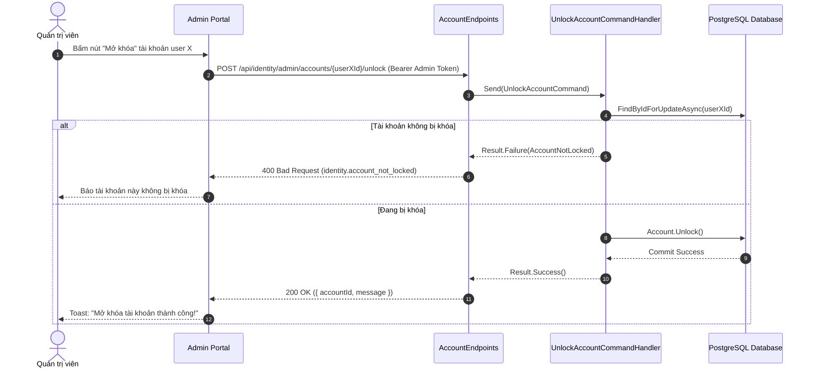

# Mở Khóa Tài Khoản Bị Khóa Tạm Thời (Admin Unlock Account) — US-AUTH-008

## 1. Overview (Tổng quan)

Cho phép Quản trị viên (`SystemAdmin`) can thiệp mở khóa thủ công cho tài khoản người dùng đang bị tạm khóa 15 phút do nhập sai mật khẩu 3 lần liên tiếp (`isLocked: true`).  
Khi mở khóa thành công, hệ thống đặt lại số lần thử sai `FailedLoginAttempts = 0` và xóa mốc thời gian khóa `LockoutEndUtc = null`, cho phép người dùng đăng nhập lại ngay lập tức mà không cần phải chờ hết 15 phút.

### Traceability (Tính truy vết):
- **Requirement:** `FR-AUTH-003`
- **User Story:** `US-AUTH-008 — Quản trị viên mở khóa tài khoản người dùng`
- **Main Flow:** `MF-06 — Quản trị người dùng & phân quyền hệ thống`
- **Owner:** Identity Service / BE-1

---

## 2. API Specification (Thông số API)

| Thuộc tính | Chi tiết |
| :--- | :--- |
| **HTTP Method** | `POST` |
| **API URL** | `/api/identity/admin/accounts/{accountId}/unlock` |
| **Permission** | 🔴 **Bearer JWT — Policy `AdminPolicy`** (Yêu cầu vai trò `SystemAdmin`) |
| **Content-Type** | `application/json` |
| **Accept** | `application/json` |

---

## 3. Request Sample & Schema (Yêu cầu đầu vào)

### 3.1. Request Headers & Route Parameters

| Tham số / Header | Phân loại | Vị trí | Kiểu dữ liệu | Giải thích |
| :--- | :---: | :---: | :---: | :--- |
| `Authorization` | 🔴 **BẮT BUỘC** | Header | `string` | `Bearer <admin_jwt_token>` |
| `accountId` | 🔴 **BẮT BUỘC** | Path | `string (UUID)` | ID của tài khoản đang bị khóa cần mở |

### 3.2. Request Body: ❌ **KHÔNG CÓ BODY (Request POST không kèm payload)**

---

## 4. Response Sample & Schema (Dữ liệu trả về)

### 4.1. HTTP Status: `200 OK`

```json
{
  "accountId": "a3bb108e-17d4-4a6c-9f87-2a54e9912345",
  "message": "Mở khóa tài khoản thành công. Người dùng có thể đăng nhập ngay."
}
```

### 4.2. Bảng Thuộc Tính Phản Hồi (Response Schema)

| Trường (Field) | Kiểu dữ liệu | Phân loại | Ý nghĩa & Giá trị |
| :--- | :---: | :---: | :--- |
| `accountId` | `string (UUID)` | 🟢 **LUÔN CÓ** | ID của tài khoản vừa được mở khóa |
| `message` | `string` | 🟢 **LUÔN CÓ** | Thông điệp: `"Mở khóa tài khoản thành công. Người dùng có thể đăng nhập ngay."` |

---

## 5. Validation & Testcase Scenarios (Ma trận Kiểm thử Đầy Đủ)

Đối soát trực tiếp từ bộ kiểm thử `ChangePasswordAndUnlockIntegrationTests.cs`:

| Mã Test Case | HTTP Status | Mã lỗi (`errorCode`) | Điều kiện kích hoạt (Given - When) | Phản hồi thực tế (Then) |
| :--- | :---: | :--- | :--- | :--- |
| `TC-UNL-01` | `200 OK` | *None* | Tài khoản mục tiêu đang trong thời gian bị khóa (`isLocked == true`). Admin gửi lệnh unlock. | `FailedLoginAttempts` reset về 0; `LockoutEndUtc` xóa về `null`; trả về `200 OK`. Người dùng đăng nhập được ngay. |
| `TC-ERR-01` | `400 Bad Request` | `identity.account_not_locked` | Tài khoản mục tiêu hiện đang hoạt động bình thường, **không hề bị khóa**. | `"Tài khoản này hiện không bị khóa."` |
| `TC-ERR-02` | `404 Not Found` | `identity.account_not_found` | `accountId` trên đường dẫn URL không tồn tại trong DB. | `"Tài khoản không tồn tại."` |
| `TC-ERR-03` | `403 Forbidden` | *Standard HTTP 403* | Người gọi API không có vai trò `SystemAdmin`. | `"Forbidden"` |

---

## 6. Activity Diagram (Sơ đồ luồng hoạt động)

```mermaid
flowchart TD
    A([Admin nhấn nút Mở Khóa trên dòng tài khoản]) --> B[POST /api/identity/admin/accounts/{accountId}/unlock]
    B --> C{Xác thực quyền SystemAdmin?}
    C -->|Không có quyền| D[Trả về 403 Forbidden]
    C -->|Hợp lệ| E[Tìm Account theo accountId trong DB]
    E -->|Không tìm thấy| F[Trả về 404 identity.account_not_found]
    E -->|Tìm thấy| G{Tài khoản có đang bị khóa IsLockedOut?}
    G -->|Không bị khóa| H[Trả về 400 identity.account_not_locked]
    G -->|Đang bị khóa| I[Gỡ bỏ LockoutEndUtc = null]
    I --> J[Đặt lại FailedLoginAttempts = 0]
    J --> K[(Commit Transaction PostgreSQL)]
    K --> L[Trả về 200 OK]
    L --> M([Admin Portal cập nhật trạng thái isLocked = false])
```

---

## 7. Sequence Diagram (Sơ đồ tuần tự tương tác)



---

## 8. Frontend Integration Guide (Hướng dẫn Tích hợp)

```typescript
export interface UnlockAccountResponse {
  accountId: string;
  message: string;
}

export const unlockAccount = async (accountId: string): Promise<UnlockAccountResponse> => {
  const response = await api.post<UnlockAccountResponse>(
    `/api/identity/admin/accounts/${accountId}/unlock`
  );
  return response.data;
};
```
