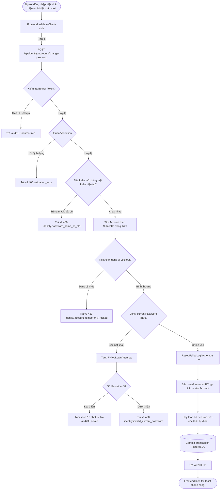
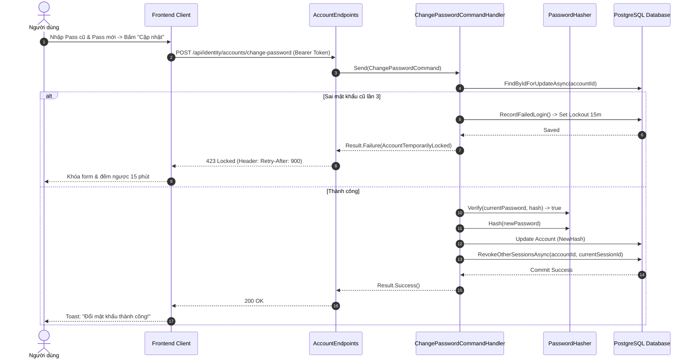

# Đổi Mật Khẩu Chủ Động (Change Password) — US-AUTH-009

## 1. Overview (Tổng quan)

Cho phép người dùng đã đăng nhập thay đổi mật khẩu hiện tại trong trang Cài đặt bảo mật (`/settings/security`).  
Để bảo vệ tài khoản khỏi các phần mềm gián điệp hoặc người khác thao tác lén trên máy tính đang mở:
1. **Kiểm tra mật khẩu hiện tại:** Bắt buộc nhập chính xác mật khẩu đang sử dụng.
2. **Khóa 15 phút nếu nhập sai 3 lần:** Nếu nhập sai mật khẩu hiện tại 3 lần liên tiếp, tài khoản lập tức bị tạm khóa 15 phút (`423 Locked`).
3. **Cấm trùng mật khẩu cũ:** Mật khẩu mới không được trùng với mật khẩu cũ.
4. **Đăng xuất các thiết bị khác:** Khi đổi mật khẩu thành công, toàn bộ các phiên làm việc trên các thiết bị khác đều bị hủy bỏ ngay lập tức. Thiết bị đang thực hiện đổi mật khẩu được giữ lại hoặc yêu cầu đăng nhập lại.

### Traceability (Tính truy vết):
- **Requirement:** `FR-AUTH-005`
- **User Story:** `US-AUTH-009 — Đổi mật khẩu tài khoản trong trang cài đặt`
- **Main Flow:** `MF-04 — Quản lý tài khoản cá nhân`
- **Owner:** Identity Service / BE-1

---

## 2. API Specification (Thông số API)

| Thuộc tính | Chi tiết |
| :--- | :--- |
| **HTTP Method** | `POST` |
| **API URL** | `/api/identity/accounts/change-password` |
| **Permission** | 🔴 **Bearer JWT** (Yêu cầu Access Token của tài khoản) |
| **Content-Type** | `application/json` |
| **Accept** | `application/json` |

---

## 3. Request Sample & Schema (Yêu cầu đầu vào)

### 3.1. Request Headers

| Header | Phân loại | Giá trị mẫu | Giải thích |
| :--- | :---: | :--- | :--- |
| `Authorization` | 🔴 **BẮT BUỘC** | `Bearer eyJhbGciOiJSUzI1Ni...` | Access Token của tài khoản |
| `Content-Type` | 🔴 **BẮT BUỘC** | `application/json` | Định dạng payload |

### 3.2. Request Body Mẫu
```json
{
  "currentPassword": "SecurePassword@123",
  "newPassword": "NewSuperPassword#2026"
}
```

### 3.3. Bảng Đặc Tả Chi Tiết Từng Trường (Request Body Schema)

| Tên trường (Field) | Kiểu dữ liệu | Phân loại | Giá trị mặc định | Ràng buộc Validation & Quy tắc kiểm tra (Source of Truth) |
| :--- | :---: | :---: | :---: | :--- |
| `currentPassword` | `string` | 🔴 **BẮT BUỘC** | *Không có* | - Mật khẩu hiện tại của tài khoản.<br>- Không được để trống hoặc `null`.<br>- Tối đa **72 bytes UTF-8**.<br>- *Thông báo lỗi:* `"Mật khẩu hiện tại là bắt buộc, không được để trống."` |
| `newPassword` | `string` | 🔴 **BẮT BUỘC** | *Không có* | - Mật khẩu mới mong muốn.<br>- Độ dài: **Tối thiểu 8 ký tự**, **Tối đa 72 bytes UTF-8**.<br>- Bắt buộc đủ 4 tiêu chí: chữ hoa, chữ thường, chữ số và ký tự đặc biệt.<br>- **Không được trùng với mật khẩu hiện tại**.<br>- *Thông báo lỗi:* `"Mật khẩu mới không được trùng với mật khẩu hiện tại."` |

---

## 4. Response Sample & Schema (Dữ liệu trả về)

### 4.1. HTTP Status: `200 OK`

```json
{
  "message": "Đổi mật khẩu thành công. Bạn đã được đăng xuất khỏi tất cả các thiết bị khác."
}
```

### 4.2. Bảng Thuộc Tính Phản Hồi (Response Schema)

| Trường (Field) | Kiểu dữ liệu | Phân loại | Ý nghĩa & Giá trị |
| :--- | :---: | :---: | :--- |
| `message` | `string` | 🟢 **LUÔN CÓ** | Thông điệp: `"Đổi mật khẩu thành công. Bạn đã được đăng xuất khỏi tất cả các thiết bị khác."` |

---

## 5. Validation & Testcase Scenarios (Ma trận Kiểm thử Đầy Đủ)

Đối soát trực tiếp từ bộ kiểm thử `ChangePasswordValidatorTests.cs` và `ChangePasswordAndUnlockIntegrationTests.cs`:

| Mã Test Case | HTTP Status | Mã lỗi (`errorCode`) | Header đính kèm | Điều kiện kích hoạt (Given - When) | Phản hồi thực tế (Then) |
| :--- | :---: | :--- | :---: | :--- | :--- |
| `TC-CHG-01` | `200 OK` | *None* | *None* | `currentPassword` chính xác, `newPassword` đạt chuẩn và khác mật khẩu cũ. | Cập nhật hash mới; hủy toàn bộ session trên thiết bị khác; trả về `200 OK`. |
| `TC-VAL-01` | `400 Bad Request` | `validation_error` | *None* | `currentPassword` để trống `""`. | `"Mật khẩu hiện tại là bắt buộc, không được để trống."` |
| `TC-VAL-02` | `400 Bad Request` | `validation_error` | *None* | `newPassword` ngắn hơn 8 ký tự hoặc thiếu tiêu chí phức tạp. | Thông báo lỗi tiêu chí mật khẩu tương ứng. |
| `TC-VAL-03` | `400 Bad Request` | `validation_error` | *None* | `newPassword` dài hơn 72 bytes UTF-8. | `"Mật khẩu quá dài: tối đa 72 ký tự không dấu..."` |
| `TC-ERR-01` | `400 Bad Request` | `identity.password_same_as_old` | *None* | `newPassword` nhập vào trùng với `currentPassword`. | `"Mật khẩu mới không được trùng với mật khẩu hiện tại."` |
| `TC-ERR-02` | `400 Bad Request` | `identity.invalid_current_password` | *None* | Nhập sai `currentPassword` lần 1 hoặc lần 2. | `"Mật khẩu hiện tại không chính xác. Bạn còn X lần thử trước khi tài khoản bị tạm khóa 15 phút."` |
| `TC-ERR-03` | `423 Locked` | `identity.account_temporarily_locked` | `Retry-After: 900` | Nhập sai `currentPassword` liên tiếp **3 lần**. | `"Tài khoản tạm thời bị khóa 15 phút do nhập sai mật khẩu 3 lần liên tiếp."` |
| `TC-ERR-04` | `401 Unauthorized` | *Standard HTTP 401* | *None* | Thiếu Bearer Token hoặc Token đã hết hạn. | `"Unauthorized"` |

---

## 6. Activity Diagram (Sơ đồ luồng hoạt động)



---

## 7. Sequence Diagram (Sơ đồ tuần tự tương tác)



---

## 8. Frontend Integration Guide (Hướng dẫn Tích hợp)

```typescript
export interface ChangePasswordRequest {
  // 🔴 [BẮT BUỘC]
  currentPassword: string;
  newPassword: string;
}

export const changePassword = async (payload: ChangePasswordRequest): Promise<void> => {
  await api.post('/api/identity/accounts/change-password', payload);
};
```
