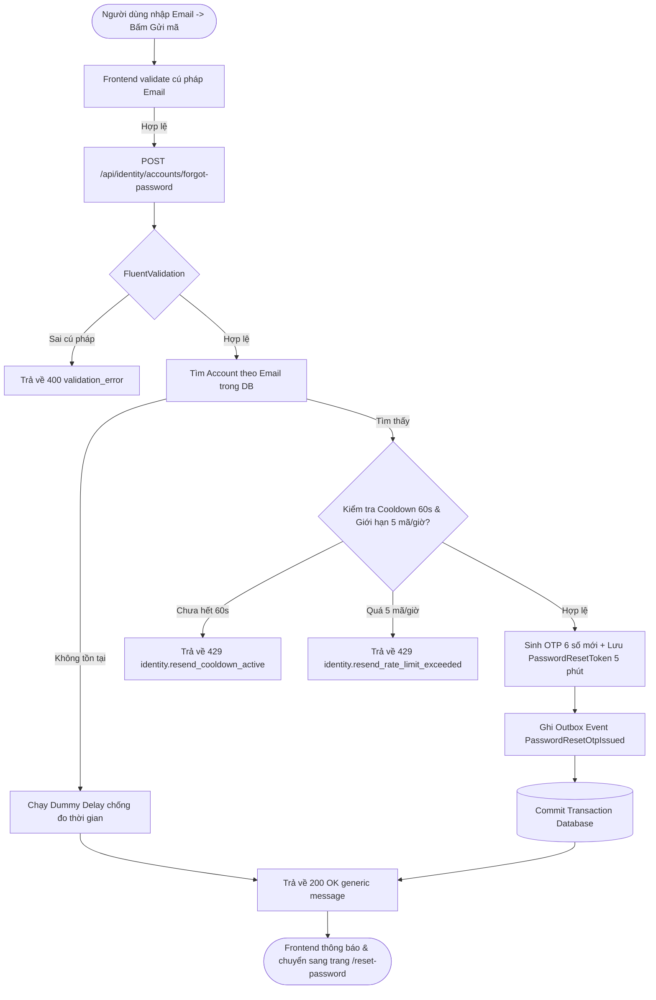
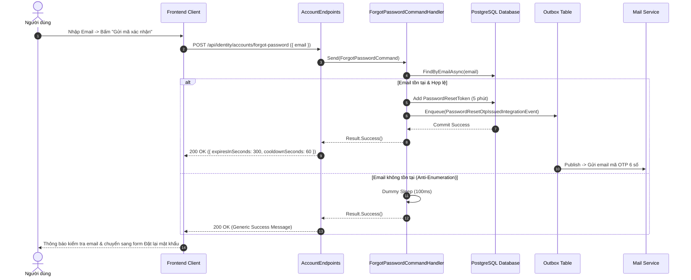

# Yêu Cầu Quên Mật Khẩu & Gửi OTP (Forgot Password) — US-AUTH-006

## 1. Overview (Tổng quan)

Gửi yêu cầu khôi phục mật khẩu khi người dùng không nhớ mật khẩu đăng nhập.  
Hệ thống phát hành mã OTP khôi phục 6 chữ số gửi qua email (hiệu lực 5 phút).

### 🛡️ Cơ Chế Bảo Mật Chống Dò Quét Email (Anti-Email Enumeration):
Để ngăn chặn hacker lợi dụng API này để dò xem một email có tồn tại trong hệ thống hay không:
- **Hệ thống LUÔN TRẢ VỀ `200 OK`** cho bất kỳ email nào có cú pháp hợp lệ, kể cả khi email đó chưa từng đăng ký.
- Nếu email có trong DB: Hệ thống gửi OTP thật qua email.
- Nếu email không có trong DB: Hệ thống chạy giả lập độ trễ (Dummy Hash/Delay) rồi trả về `200 OK` y hệt như bình thường.

### Traceability (Tính truy vết):
- **Requirement:** `FR-AUTH-004`
- **User Story:** `US-AUTH-006 — Yêu cầu đặt lại mật khẩu bằng mã OTP`
- **Main Flow:** `MF-03 — Quên mật khẩu & Tự phục hồi`
- **Owner:** Identity Service / BE-1

---

## 2. API Specification (Thông số API)

| Thuộc tính | Chi tiết |
| :--- | :--- |
| **HTTP Method** | `POST` |
| **API URL** | `/api/identity/accounts/forgot-password` |
| **Permission** | `N/A — Public / Anonymous` (Không yêu cầu đăng nhập) |
| **Content-Type** | `application/json` |
| **Accept** | `application/json` |

---

## 3. Request Sample & Schema (Yêu cầu đầu vào)

### 3.1. Request Body Mẫu
```json
{
  "email": "user@example.com"
}
```

### 3.2. Bảng Đặc Tả Chi Tiết Từng Trường (Request Body Schema)

| Tên trường (Field) | Kiểu dữ liệu | Phân loại | Giá trị mặc định | Ràng buộc Validation & Quy tắc kiểm tra (Source of Truth) |
| :--- | :---: | :---: | :---: | :--- |
| `email` | `string` | 🔴 **BẮT BUỘC** | *Không có* | - Địa chỉ email cần nhận mã OTP đặt lại mật khẩu.<br>- Không được để trống hoặc `null`.<br>- Tối đa **254 ký tự**.<br>- Hệ thống tự động `Trim().ToLowerInvariant()`.<br>- *Thông báo lỗi:* `"Email là bắt buộc, không được để trống."` / `"Email không đúng định dạng hợp lệ."` |

---

## 4. Response Sample & Schema (Dữ liệu trả về)

### 4.1. HTTP Status: `200 OK`

```json
{
  "email": "user@example.com",
  "expiresInSeconds": 300,
  "cooldownSeconds": 60,
  "message": "Nếu email tồn tại trong hệ thống, mã OTP đặt lại mật khẩu đã được gửi đến hộp thư của bạn (hiệu lực 5 phút).",
  "otpSent": true
}
```

### 4.2. Bảng Thuộc Tính Phản Hồi (Response Schema)

| Trường (Field) | Kiểu dữ liệu | Phân loại | Ý nghĩa & Giá trị |
| :--- | :---: | :---: | :--- |
| `email` | `string` | 🟢 **LUÔN CÓ** | Email người dùng gửi lên |
| `expiresInSeconds` | `integer` | 🟢 **LUÔN CÓ** | Thời gian OTP có hiệu lực: `300` (giây) = 5 phút |
| `cooldownSeconds` | `integer` | 🟢 **LUÔN CÓ** | Thời gian chờ tối thiểu trước lần gửi kế tiếp: `60` (giây) |
| `message` | `string` | 🟢 **LUÔN CÓ** | Thông điệp chung chống dò email: `"Nếu email tồn tại trong hệ thống, mã OTP đặt lại mật khẩu đã được gửi..."` |
| `otpSent` | `boolean` | 🟢 **LUÔN CÓ** | Luôn mang giá trị `true` |

---

## 5. Validation & Testcase Scenarios (Ma trận Kiểm thử Đầy Đủ)

Đối soát trực tiếp từ bộ kiểm thử `PasswordResetIntegrationTests.cs`:

| Mã Test Case | HTTP Status | Mã lỗi (`errorCode`) | Header đính kèm | Điều kiện kích hoạt (Given - When) | Phản hồi thực tế (Then) |
| :--- | :---: | :--- | :---: | :--- | :--- |
| `TC-FORGOT-01` | `200 OK` | *None* | *None* | `email` tồn tại trong hệ thống, chưa quá 5 mã/giờ, đã qua 60s cooldown. | Sinh OTP 6 số lưu bảng `PasswordResetToken` (5 phút); đẩy event Outbox; trả về `200 OK`. |
| `TC-FORGOT-02` | `200 OK` | *None* | *None* | `email` **KHÔNG TỒN TẠI** trong hệ thống (Hacker dò quét email). | Hệ thống vẫn trả về `200 OK` y hệt như trường hợp email có thật (Bảo mật Anti-Enumeration). |
| `TC-VAL-01` | `400 Bad Request` | `validation_error` | *None* | `email` để trống hoặc sai định dạng RFC 5322. | `"Email là bắt buộc, không được để trống."` / `"Email không đúng định dạng hợp lệ."` |
| `TC-ERR-01` | `429 Too Many Requests` | `identity.resend_cooldown_active` | `Retry-After: <giây>` | Người dùng bấm gửi lại khi chưa hết thời gian chờ 60 giây (Cooldown). | `"Vui lòng đợi XX giây trước khi yêu cầu mã mới..."` |
| `TC-ERR-02` | `429 Too Many Requests` | `identity.resend_rate_limit_exceeded` | `Retry-After: <giây>` | Email đã nhận đủ **5 mã OTP trong vòng 1 giờ** (`MaxHourlyOtpIssued = 5`). | `"Email này đã nhận tối đa 5 mã OTP trong 1 giờ để bảo đảm an toàn. Vui lòng thử lại sau XX phút."` |

---

## 6. Activity Diagram (Sơ đồ luồng hoạt động)



---

## 7. Sequence Diagram (Sơ đồ tuần tự tương tác)



---

## 8. Frontend Integration Guide (Hướng dẫn Tích hợp)

```typescript
export interface ForgotPasswordRequest {
  // 🔴 [BẮT BUỘC]
  email: string;
}

export interface ForgotPasswordResponse {
  email: string;              // 🟢 [LUÔN CÓ]
  expiresInSeconds: number;   // 🟢 [LUÔN CÓ: 300]
  cooldownSeconds: number;    // 🟢 [LUÔN CÓ: 60]
  message: string;            // 🟢 [LUÔN CÓ]
  otpSent: boolean;           // 🟢 [LUÔN CÓ: true]
}

export const forgotPassword = async (payload: ForgotPasswordRequest): Promise<ForgotPasswordResponse> => {
  const response = await axios.post<ForgotPasswordResponse>(
    `${process.env.NEXT_PUBLIC_API_URL || 'http://localhost:5000'}/api/identity/accounts/forgot-password`,
    payload
  );
  return response.data;
};
```
