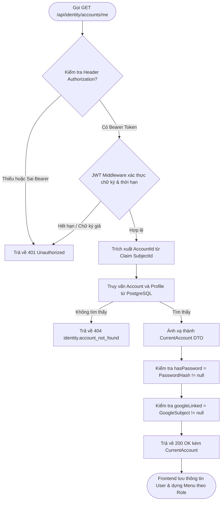
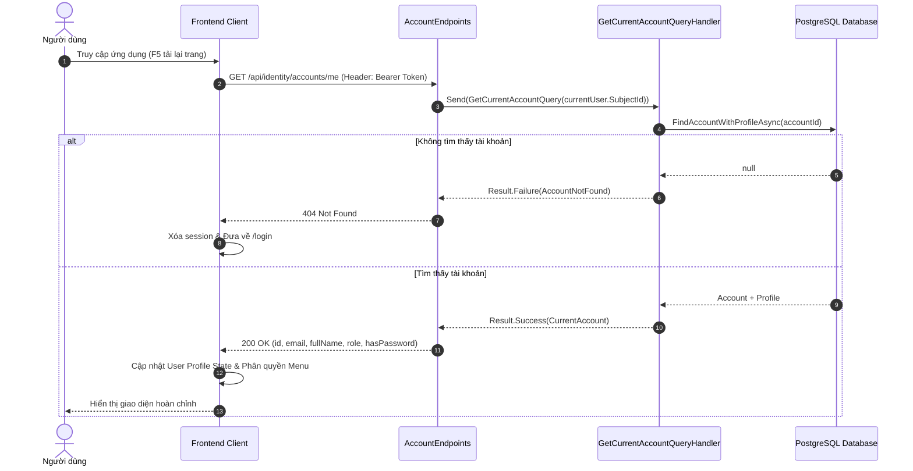

# Lấy Thông Tin Tài Khoản Hiện Tại (Get Current Account) — US-AUTH-004

## 1. Overview (Tổng quan)

Lấy thông tin hồ sơ chi tiết của tài khoản đang đăng nhập dựa trên Access Token được gửi kèm trong header `Authorization`.  
Frontend sử dụng API này sau khi đăng nhập hoặc sau khi tải lại trang (F5) để hiển thị thông tin người dùng, điều hướng giao diện theo vai trò (`role`), và xác định trạng thái liên kết bảo mật (`hasPassword`, `googleLinked`).

### Traceability (Tính truy vết):
- **Requirement:** `FR-AUTH-003`
- **User Story:** `US-AUTH-004 — Đăng nhập & Lấy thông tin tài khoản`
- **Main Flow:** `MF-02 — Đăng nhập & Duy trì phiên làm việc`
- **Owner:** Identity Service / BE-1

---

## 2. API Specification (Thông số API)

| Thuộc tính | Chi tiết |
| :--- | :--- |
| **HTTP Method** | `GET` |
| **API URL** | `/api/identity/accounts/me` |
| **Permission** | 🔴 **Bearer JWT** (Yêu cầu đăng nhập, mọi vai trò đều được gọi) |
| **Accept** | `application/json` |

---

## 3. Request Sample & Schema (Yêu cầu đầu vào)

### 3.1. Request Headers

| Header | Phân loại | Giá trị mẫu | Giải thích |
| :--- | :---: | :--- | :--- |
| `Authorization` | 🔴 **BẮT BUỘC** | `Bearer eyJhbGciOiJSUzI1Ni...` | Access Token JWT còn hiệu lực |
| `Accept` | 🟢 **KHUYẾN NGHỊ** | `application/json` | Định dạng phản hồi mong muốn |

### 3.2. Request Body: ❌ **KHÔNG CÓ BODY (Request GET)**

---

## 4. Response Sample & Schema (Dữ liệu trả về)

### 4.1. HTTP Status: `200 OK`

```json
{
  "id": "a3bb108e-17d4-4a6c-9f87-2a54e9912345",
  "email": "user@example.com",
  "phoneNumber": "+84901234567",
  "fullName": "Nguyễn Văn An",
  "role": "Customer",
  "status": "EmailVerified",
  "hasPassword": true,
  "googleLinked": false,
  "createdAtUtc": "2026-10-10T08:00:00Z"
}
```

### 4.2. Bảng Thuộc Tính Phản Hồi (Response Schema)

| Trường (Field) | Kiểu dữ liệu | Phân loại | Ý nghĩa & Giá trị |
| :--- | :---: | :---: | :--- |
| `id` | `string (UUID)` | 🟢 **LUÔN CÓ** | Định danh duy nhất của tài khoản (`"a3bb108e-17d4-4a6c-9f87-2a54e9912345"`) |
| `email` | `string` | 🟢 **LUÔN CÓ** | Địa chỉ email của tài khoản (`"user@example.com"`) |
| `phoneNumber` | `string` hoặc `null` | ⚪ **CÓ THỂ NULL** | Số điện thoại định dạng quốc tế (`"+84901234567"`), hoặc `null` nếu chưa cập nhật |
| `fullName` | `string` hoặc `null` | ⚪ **CÓ THỂ NULL** | Họ và tên người dùng, hoặc `null` nếu người dùng chưa cập nhật |
| `role` | `string` | 🟢 **LUÔN CÓ** | Vai trò tài khoản: `"Customer"`, `"Staff"`, `"ParkingLotOwner"`, `"SystemAdmin"` |
| `status` | `string` | 🟢 **LUÔN CÓ** | Trạng thái tài khoản: `"EmailVerified"`, `"Suspended"`, `"Disabled"` |
| `hasPassword` | `boolean` | 🟢 **LUÔN CÓ** | `true` nếu tài khoản có mật khẩu truyền thống; `false` nếu tạo qua Google chưa đặt mật khẩu |
| `googleLinked` | `boolean` | 🟢 **LUÔN CÓ** | `true` nếu tài khoản đã liên kết với Google OAuth; `false` nếu chưa liên kết |
| `createdAtUtc` | `string (ISO-8601)` | 🟢 **LUÔN CÓ** | Thời điểm tạo tài khoản (`"2026-10-10T08:00:00Z"`) |

---

## 5. Validation & Testcase Scenarios (Ma trận Kiểm thử Đầy Đủ)

Đối soát trực tiếp từ bộ kiểm thử `AccountEndpointsHttpTests.cs`:

| Mã Test Case | HTTP Status | Mã lỗi (`errorCode`) | Điều kiện kích hoạt (Given - When) | Phản hồi thực tế (Then) |
| :--- | :---: | :--- | :--- | :--- |
| `TC-ME-01` | `200 OK` | *None* | Access Token hợp lệ, tài khoản tồn tại đầy đủ thông tin profile. | Trả về thông tin `CurrentAccount` đầy đủ (`id`, `email`, `role`, `fullName`, `phoneNumber`). |
| `TC-ME-02` | `200 OK` | *None* | Tài khoản đăng ký tối giản qua email (chưa cập nhật profile). | Trả về `200 OK` với `fullName: null`, `phoneNumber: null`, `hasPassword: true`, `googleLinked: false`. |
| `TC-ME-03` | `200 OK` | *None* | Tài khoản đăng ký qua Google. | Trả về `200 OK` với `hasPassword: false`, `googleLinked: true`. |
| `TC-ERR-01` | `401 Unauthorized` | *Standard HTTP 401* | Không truyền header `Authorization` hoặc Token không đúng định dạng. | `"Unauthorized"` |
| `TC-ERR-02` | `401 Unauthorized` | *Standard HTTP 401* | Access Token đã quá thời hạn 15 phút. | `"Unauthorized"` (Frontend Interceptor bắt mã này để gọi Refresh Token). |
| `TC-ERR-03` | `404 Not Found` | `identity.account_not_found` | Token hợp lệ nhưng tài khoản tương ứng đã bị xóa khỏi cơ sở dữ liệu. | `"Tài khoản không tồn tại."` |

---

## 6. Activity Diagram (Sơ đồ luồng hoạt động)



---

## 7. Sequence Diagram (Sơ đồ tuần tự tương tác)



---

## 8. Frontend Integration Guide (Hướng dẫn Tích hợp)

### 8.1. TypeScript Interface Definitions

```typescript
export interface CurrentAccountResponse {
  id: string;                 // 🟢 [LUÔN CÓ] UUID
  email: string;              // 🟢 [LUÔN CÓ]
  phoneNumber: string | null; // ⚪ [CÓ THỂ NULL]
  fullName: string | null;    // ⚪ [CÓ THỂ NULL]
  role: 'Customer' | 'Staff' | 'ParkingLotOwner' | 'SystemAdmin'; // 🟢 [LUÔN CÓ]
  status: 'EmailVerified' | 'Suspended' | 'Disabled'; // 🟢 [LUÔN CÓ]
  hasPassword: boolean;       // 🟢 [LUÔN CÓ] true nếu có mật khẩu
  googleLinked: boolean;      // 🟢 [LUÔN CÓ] true nếu đã liên kết Google
  createdAtUtc: string;       // 🟢 [LUÔN CÓ] ISO-8601
}
```

### 8.2. Axios Calling Function Mẫu

```typescript
import { api } from './auth';

export const getCurrentAccount = async (): Promise<CurrentAccountResponse> => {
  const response = await api.get<CurrentAccountResponse>('/api/identity/accounts/me');
  return response.data;
};
```

### 8.3. UI/UX Checklist Cho Hồ Sơ Người Dùng

- [ ] **Khởi động ứng dụng (App Initialization):**
  - Khi người dùng F5 hoặc mở tab mới: Gọi ngay `/api/identity/accounts/refresh` $\rightarrow$ nhận Access Token $\rightarrow$ gọi tiếp `/api/identity/accounts/me`.
  - Hiển thị Skeleton loading cho thanh điều hướng (Navbar) trong khi đang tải dữ liệu `/me`.
- [ ] **Phân quyền Menu theo trường `role`:**
  - `Customer`: Menu Đặt chỗ bãi đỗ, Lịch sử đặt xe, Ví tiền.
  - `Staff`: Menu Soát vé vào/ra bãi, Quản lý vị trí đỗ.
  - `ParkingLotOwner`: Menu Thống kê doanh thu, Quản lý bãi đỗ.
  - `SystemAdmin`: Menu Quản trị người dùng hệ thống (`/admin/users`), Cấu hình hệ thống.
- [ ] **Mục Bảo mật tài khoản (Account Security):**
  - Nếu `hasPassword === false`: Hiển thị nút *"Thiết lập mật khẩu"* (thay vì nút *"Đổi mật khẩu"*).
  - Nếu `googleLinked === true`: Hiển thị badge xanh: *"Đã liên kết Google Account"*.
