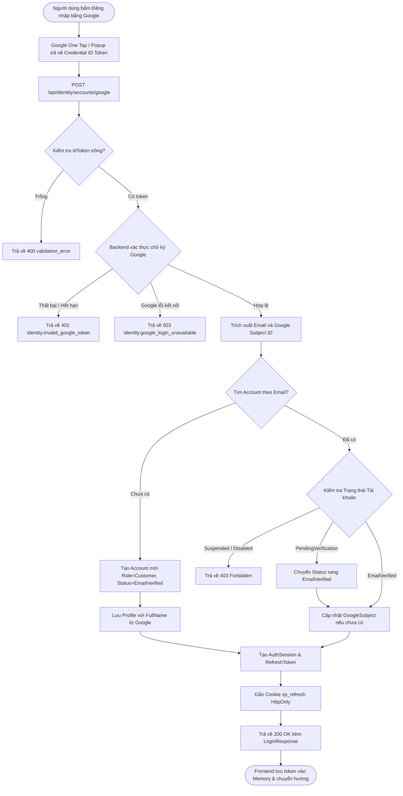

# Đăng Nhập Bằng Google (Google OAuth) — US-AUTH-002

## 1. Overview (Tổng quan)

Đăng nhập hoặc tự động đăng ký tài khoản mới bằng Google ID Token (Google Identity Services / Sign In With Google).  
- **Nếu tài khoản chưa tồn tại:** Hệ thống tự động tạo tài khoản mới với vai trò `Customer`, trạng thái `EmailVerified` (không cần nhập OTP kích hoạt), liên kết `GoogleSubject`, và lưu Họ tên / Ảnh đại diện từ Google vào Profile.
- **Nếu tài khoản đã tồn tại:** Hệ thống kiểm tra và tự động liên kết tài khoản với Google ID, tạo phiên làm việc `AuthSession` và cấp phát cặp token (JWT Access Token + Cookie `sp_refresh`).

### Traceability (Tính truy vết):
- **Requirement:** `FR-AUTH-003`
- **User Story:** `US-AUTH-002 — Đăng nhập / Đăng ký nhanh qua Google`
- **Main Flow:** `MF-02 — Đăng nhập & Duy trì phiên làm việc`
- **Owner:** Identity Service / BE-1

---

## 2. API Specification (Thông số API)

| Thuộc tính | Chi tiết |
| :--- | :--- |
| **HTTP Method** | `POST` |
| **API URL** | `/api/identity/accounts/google` |
| **Permission** | `N/A — Public / Anonymous` (Không yêu cầu đăng nhập trước) |
| **Content-Type** | `application/json` |
| **Accept** | `application/json` |

---

## 3. Request Sample & Schema (Yêu cầu đầu vào)

### 3.1. Request Body Mẫu
```json
{
  "idToken": "eyJhbGciOiJSUzI1NiIsImtpZCI6IjFhMmIzYy...sample_google_jwt_id_token"
}
```

### 3.2. Bảng Đặc Tả Chi Tiết Từng Trường (Request Body Schema)

| Tên trường (Field) | Kiểu dữ liệu | Phân loại | Giá trị mặc định | Ràng buộc Validation & Quy tắc kiểm tra (Source of Truth) |
| :--- | :---: | :---: | :---: | :--- |
| `idToken` | `string` | 🔴 **BẮT BUỘC** | *Không có* | - Chuỗi JWT ID Token hợp lệ nhận được từ Google SDK (`@react-oauth/google`).<br>- Không được để trống hoặc `null`.<br>- Backend xác thực chữ ký số với máy chủ Google (`https://oauth2.googleapis.com`), kiểm tra `audience` khớp với `Google__ClientId` và thời hạn hết hạn (`exp`).<br>- *Thông báo lỗi:* `"idToken là bắt buộc, không được để trống."` |

---

## 4. Response Sample & Schema (Dữ liệu trả về)

### 4.1. HTTP Status: `200 OK`

#### 🍪 Response Headers (Thiết Lập Cookie):
```http
Set-Cookie: sp_refresh=e7c65432-d123-4a56-8bc9-f123456789ab; Path=/api/identity/accounts; HttpOnly; SameSite=Strict; Max-Age=604800; Secure
```

#### 📦 Response Body:
```json
{
  "accessToken": "eyJhbGciOiJSUzI1NiIsInR5cCI6IkpXVCJ9...",
  "refreshToken": "e7c65432-d123-4a56-8bc9-f123456789ab",
  "tokenType": "Bearer",
  "expiresIn": 900,
  "account": {
    "id": "a3bb108e-17d4-4a6c-9f87-2a54e9912345",
    "email": "user@gmail.com",
    "status": "EmailVerified",
    "role": "Customer"
  }
}
```

### 4.2. Bảng Thuộc Tính Phản Hồi (Response Schema)

| Trường (Field) | Kiểu dữ liệu | Phân loại | Ý nghĩa & Giá trị |
| :--- | :---: | :---: | :--- |
| `accessToken` | `string (JWT)` | 🟢 **LUÔN CÓ** | Access Token JWT 15 phút. Chứa các claims: `sub`, `sid`, `email`, `role`. |
| `refreshToken` | `string (UUID)` | 🟢 **LUÔN CÓ** | Refresh Token thô dự phòng |
| `tokenType` | `string` | 🟢 **LUÔN CÓ** | Luôn mang giá trị `"Bearer"` |
| `expiresIn` | `integer` | 🟢 **LUÔN CÓ** | `900` (giây) = 15 phút |
| `account.id` | `string (UUID)` | 🟢 **LUÔN CÓ** | ID của tài khoản |
| `account.email` | `string` | 🟢 **LUÔN CÓ** | Email tài khoản Google |
| `account.status` | `string` | 🟢 **LUÔN CÓ** | Luôn là `"EmailVerified"` |
| `account.role` | `string` | 🟢 **LUÔN CÓ** | Vai trò hệ thống: `"Customer"`, `"Staff"`, `"ParkingLotOwner"`, `"SystemAdmin"` |

---

## 5. Validation & Testcase Scenarios (Ma trận Kiểm thử Đầy Đủ)

Đối soát trực tiếp từ bộ kiểm thử `GoogleLoginIntegrationTests.cs` và `GoogleIdTokenValidatorTests.cs`:

| Mã Test Case | HTTP Status | Mã lỗi (`errorCode`) | Điều kiện kích hoạt (Given - When) | Phản hồi thực tế (Then) |
| :--- | :---: | :--- | :--- | :--- |
| `TC-GGL-01` | `200 OK` | *None* | `idToken` hợp lệ, email chưa từng tồn tại trong hệ thống. | Tự động tạo Account + Profile mới, gán `GoogleSubject`, cấp token và cookie `sp_refresh`. |
| `TC-GGL-02` | `200 OK` | *None* | `idToken` hợp lệ, email đã tồn tại và đang hoạt động (`EmailVerified`). | Liên kết `GoogleSubject` nếu chưa liên kết, tạo phiên mới và trả token thành công. |
| `TC-GGL-03` | `200 OK` | *None* | `idToken` hợp lệ, tài khoản cũ đang ở trạng thái `PendingVerification`. | Tự động kích hoạt tài khoản sang `EmailVerified` (vì Google đã xác minh quyền sở hữu email), cho phép đăng nhập ngay. |
| `TC-VAL-01` | `400 Bad Request` | `validation_error` | `idToken` để trống `""` hoặc `null`. | `"idToken là bắt buộc, không được để trống."` |
| `TC-ERR-01` | `401 Unauthorized` | `identity.invalid_google_token` | `idToken` giả mạo, sai chữ ký, hết hạn `exp`, hoặc sai `audience` (ClientId). | `"Mã xác thực Google không hợp lệ hoặc đã hết hạn. Vui lòng thử lại."` |
| `TC-ERR-02` | `403 Forbidden` | `identity.account_suspended` | Tài khoản liên kết với Google này đã bị Admin đình chỉ (`Suspended`). | `"Tài khoản này đã bị tạm đình chỉ. Vui lòng liên hệ quản trị viên."` |
| `TC-ERR-03` | `403 Forbidden` | `identity.account_disabled` | Tài khoản liên kết với Google này đã bị vô hiệu hóa (`Disabled`). | `"Tài khoản này đã bị vô hiệu hóa."` |
| `TC-ERR-04` | `503 Service Unavailable` | `identity.google_login_unavailable` | Backend không kết nối được tới máy chủ xác thực của Google hoặc chưa cấu hình `Google__ClientId`. | `"Dịch vụ đăng nhập Google tạm thời không khả dụng. Vui lòng thử lại sau."` |

---

## 6. Activity Diagram (Sơ đồ luồng hoạt động)



---

## 7. Sequence Diagram (Sơ đồ tuần tự tương tác)

```mermaid
sequenceDiagram
    autonumber
    actor User as Người dùng
    participant FE as Frontend Client
    participant Google as Google OAuth Server
    participant API as AccountEndpoints
    participant MediatR as GoogleLoginCommandHandler
    participant DB as PostgreSQL Database

    User->>FE: Bấm nút "Sign in with Google"
    FE->>Google: Khởi tạo Google Popup / One Tap
    Google-->>FE: Trả về Google ID Token (JWT)
    FE->>API: POST /api/identity/accounts/google ({ idToken })
    API->>MediatR: Send(GoogleLoginCommand)
    MediatR->>Google: ValidateTokenAsync(idToken, ClientId)
    Google-->>MediatR: TokenPayload (email, sub, name)
    
    MediatR->>DB: FindByEmailAsync(email)
    alt Tài khoản chưa tồn tại
        MediatR->>DB: Add(Account - EmailVerified) & Add(Profile)
    else Tài khoản đã tồn tại
        MediatR->>DB: Link GoogleSubject & Activate nếu đang pending
    end
    
    MediatR->>DB: Add(AuthSession) & Add(RefreshToken)
    DB-->>MediatR: Commit Success
    MediatR-->>API: Result.Success(LoginResponse)
    API-->>FE: 200 OK (Set-Cookie: sp_refresh=...; HttpOnly)
    FE->>FE: Lưu accessToken vào Memory State
    FE-->>User: Đăng nhập thành công -> Vào trang chính
```

---

## 8. Frontend Integration Guide (Hướng dẫn Tích hợp)

### 8.1. TypeScript Interface Definitions

```typescript
export interface GoogleLoginRequest {
  // 🔴 [BẮT BUỘC]
  idToken: string;
}

export interface GoogleLoginResponse {
  accessToken: string;        // 🟢 [LUÔN CÓ] JWT 15 phút
  refreshToken: string;       // 🟢 [LUÔN CÓ] UUID
  tokenType: 'Bearer';        // 🟢 [LUÔN CÓ]
  expiresIn: number;          // 🟢 [LUÔN CÓ: 900]
  account: {
    id: string;               // 🟢 [LUÔN CÓ]
    email: string;            // 🟢 [LUÔN CÓ]
    status: 'EmailVerified';  // 🟢 [LUÔN CÓ]
    role: string;             // 🟢 [LUÔN CÓ]
  };
}
```

### 8.2. Cấu Hình React OAuth & Axios Calling Function

```typescript
import axios from 'axios';
import { CredentialResponse } from '@react-oauth/google';

export const handleGoogleLoginSuccess = async (credentialResponse: CredentialResponse) => {
  if (!credentialResponse.credential) {
    throw new Error('Không nhận được Google ID Token');
  }

  const response = await axios.post<GoogleLoginResponse>(
    `${process.env.NEXT_PUBLIC_API_URL || 'http://localhost:5000'}/api/identity/accounts/google`,
    { idToken: credentialResponse.credential },
    {
      headers: { 'Content-Type': 'application/json' },
      withCredentials: true, // 🔴 BẮT BUỘC để trình duyệt nhận Cookie sp_refresh
    }
  );

  return response.data;
};
```

### 8.3. UI/UX Checklist Cho Đăng Nhập Google

- [ ] Sử dụng thư viện chuẩn `@react-oauth/google` và bọc app trong `<GoogleOAuthProvider clientId="...">`.
- [ ] Render nút Google chuẩn UX: `<GoogleLogin onSuccess={handleGoogleLoginSuccess} onError={handleGoogleError} />`.
- [ ] Bật cờ loading và hiển thị overlay trong suốt thời gian API Backend đang xác thực với Google.
- [ ] Nếu gặp mã lỗi `503 identity.google_login_unavailable`: Tạm thời ẩn nút Google và hiển thị thông báo chuyển sang đăng nhập bằng email/mật khẩu truyền thống.
