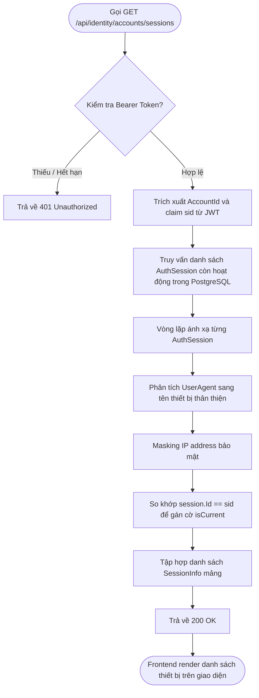
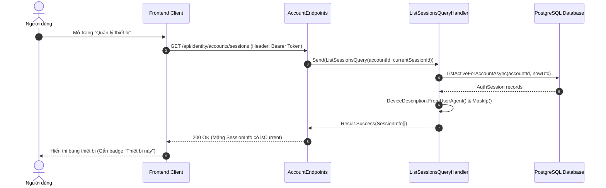

# Lấy Danh Sách Thiết Bị Đang Đăng Nhập (List Active Sessions) — US-AUTH-005

## 1. Overview (Tổng quan)

Lấy danh sách các phiên làm việc (`AuthSession`) đang hoạt động của tài khoản người dùng hiện tại trên mọi thiết bị.  
Hệ thống tích hợp các cơ chế nâng cao trải nghiệm và bảo mật:
1. **Đánh dấu thiết bị hiện tại (`isCurrent: true`):** Dựa vào claim `"sid"` (Session ID) trong Access Token của request để nhận diện chính xác thiết bị người dùng đang cầm trên tay.
2. **Nhận diện thiết bị thân thiện (Device Parsing):** Tự động phân tích User-Agent thành tên trực quan (VD: `"Chrome trên Windows"`, `"Safari trên iOS"`).
3. **Che giấu địa chỉ IP (IP Masking):** Bảo vệ quyền riêng tư người dùng bằng cách che phần host (`113.161.x.x` cho IPv4 hoặc che 4 nhóm cuối cho IPv6).

### Traceability (Tính truy vết):
- **Requirement:** `FR-AUTH-003`
- **User Story:** `US-AUTH-005 — Quản lý phiên làm việc & thiết bị đăng nhập`
- **Main Flow:** `MF-02 — Đăng nhập & Duy trì phiên làm việc`
- **Owner:** Identity Service / BE-1

---

## 2. API Specification (Thông số API)

| Thuộc tính | Chi tiết |
| :--- | :--- |
| **HTTP Method** | `GET` |
| **API URL** | `/api/identity/accounts/sessions` |
| **Permission** | 🔴 **Bearer JWT** (Yêu cầu Access Token của tài khoản) |
| **Accept** | `application/json` |

---

## 3. Request Sample & Schema (Yêu cầu đầu vào)

### 3.1. Request Headers

| Header | Phân loại | Giá trị mẫu | Giải thích |
| :--- | :---: | :--- | :--- |
| `Authorization` | 🔴 **BẮT BUỘC** | `Bearer eyJhbGciOiJSUzI1Ni...` | Access Token của tài khoản đang đăng nhập |
| `Accept` | 🟢 **KHUYẾN NGHỊ** | `application/json` | Định dạng phản hồi mong muốn |

### 3.2. Request Body: ❌ **KHÔNG CÓ BODY (Request GET)**

---

## 4. Response Sample & Schema (Dữ liệu trả về)

### 4.1. HTTP Status: `200 OK`

```json
[
  {
    "id": "c9b578e2-f472-4b2a-8bc2-a1b948f93e12",
    "device": "Chrome trên Windows",
    "ipAddress": "113.161.x.x",
    "createdAtUtc": "2026-10-12T08:30:00Z",
    "lastActivityAtUtc": "2026-10-13T06:15:00Z",
    "isCurrent": true
  },
  {
    "id": "e7c65432-d123-4a56-8bc9-f123456789ab",
    "device": "Safari trên iOS",
    "ipAddress": "14.232.x.x",
    "createdAtUtc": "2026-10-10T14:20:00Z",
    "lastActivityAtUtc": "2026-10-11T09:45:00Z",
    "isCurrent": false
  }
]
```

### 4.2. Bảng Thuộc Tính Phản Hồi (Response Schema)

| Trường (Field) | Kiểu dữ liệu | Phân loại | Ý nghĩa & Giá trị |
| :--- | :---: | :---: | :--- |
| `id` | `string (UUID)` | 🟢 **LUÔN CÓ** | Định danh duy nhất của phiên (`"c9b578e2-f472-4b2a-8bc2-a1b948f93e12"`). Dùng để truyền vào API DELETE để thu hồi phiên này. |
| `device` | `string` | 🟢 **LUÔN CÓ** | Tên thiết bị thân thiện do Backend phân tích: `"Chrome trên Windows"`, `"Safari trên iOS"`, `"Edge trên macOS"`, `"Trình duyệt khác"`. |
| `ipAddress` | `string` hoặc `null` | ⚪ **CÓ THỂ NULL** | Địa chỉ IP đã được che giấu (`"113.161.x.x"`). Trả `null` nếu không xác định được IP. |
| `createdAtUtc` | `string (ISO-8601)` | 🟢 **LUÔN CÓ** | Thời điểm bắt đầu đăng nhập phiên này (`"2026-10-12T08:30:00Z"`). |
| `lastActivityAtUtc` | `string (ISO-8601)` | 🟢 **LUÔN CÓ** | Thời điểm hoạt động / refresh gần nhất (`"2026-10-13T06:15:00Z"`). |
| `isCurrent` | `boolean` | 🟢 **LUÔN CÓ** | `true` nếu đây là thiết bị đang gửi request; `false` nếu là thiết bị khác. |

---

## 5. Validation & Testcase Scenarios (Ma trận Kiểm thử Đầy Đủ)

Đối soát trực tiếp từ bộ kiểm thử `SessionsAndAdminAccountsTests.cs`:

| Mã Test Case | HTTP Status | Mã lỗi (`errorCode`) | Điều kiện kích hoạt (Given - When) | Phản hồi thực tế (Then) |
| :--- | :---: | :--- | :--- | :--- |
| `TC-SES-01` | `200 OK` | *None* | Access Token hợp lệ, tài khoản có 1 hoặc nhiều phiên đang hoạt động. | Trả về danh sách `SessionInfo[]`; phiên khớp với claim `sid` mang `isCurrent = true`; các phiên khác mang `isCurrent = false`. |
| `TC-SES-02` | `200 OK` | *None* | Thiết bị gửi chuỗi User-Agent của Windows, macOS, iOS, Android, Linux. | `device` trả về chuỗi trực quan tương ứng (VD: `"Chrome trên Windows"`). |
| `TC-SES-03` | `200 OK` | *None* | Thiết bị truy cập từ địa chỉ IPv4 hoặc IPv6. | `ipAddress` được tự động che giấu bảo mật (VD: `"113.161.x.x"` hoặc `"2001:db8:x:x:x:x"`). |
| `TC-ERR-01` | `401 Unauthorized` | *Standard HTTP 401* | Thiếu Bearer Token hoặc Token đã hết hạn. | `"Unauthorized"` |

---

## 6. Activity Diagram (Sơ đồ luồng hoạt động)



---

## 7. Sequence Diagram (Sơ đồ tuần tự tương tác)



---

## 8. Frontend Integration Guide (Hướng dẫn Tích hợp)

```typescript
export interface SessionInfo {
  id: string;                 // 🟢 [LUÔN CÓ] UUID
  device: string;             // 🟢 [LUÔN CÓ]
  ipAddress: string | null;   // ⚪ [CÓ THỂ NULL]
  createdAtUtc: string;       // 🟢 [LUÔN CÓ]
  lastActivityAtUtc: string;  // 🟢 [LUÔN CÓ]
  isCurrent: boolean;         // 🟢 [LUÔN CÓ]
}

export const getSessions = async (): Promise<SessionInfo[]> => {
  const response = await api.get<SessionInfo[]>('/api/identity/accounts/sessions');
  return response.data;
};
```
