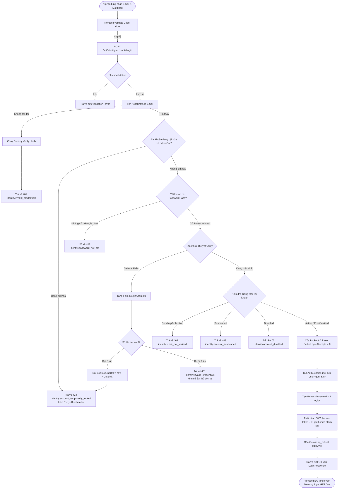

# Đăng Nhập Tài Khoản (Login) — US-AUTH-004

## 1. Overview (Tổng quan)

Xác thực danh tính người dùng bằng email và mật khẩu.  
Khi thông tin đăng nhập chính xác và tài khoản đã kích hoạt email, hệ thống sẽ:
1. Cấp phát **Access Token** (JWT, thời hạn 15 phút) trong response body để Frontend lưu tạm vào bộ nhớ (Memory/State).
2. Tạo bản ghi phiên làm việc `AuthSession` lưu `User-Agent` (DeviceInfo) và địa chỉ IP.
3. Cấp phát **Refresh Token** (thời hạn 7 ngày) được tự động ghi vào trình duyệt dưới dạng HttpOnly Cookie `sp_refresh` (Path `/api/identity/accounts`, SameSite Strict).

### Traceability (Tính truy vết):
- **Requirement:** `FR-AUTH-003`
- **User Story:** `US-AUTH-004 — Đăng nhập bằng email và mật khẩu`
- **Main Flow:** `MF-02 — Đăng nhập & Duy trì phiên làm việc`
- **Owner:** Identity Service / BE-1

---

## 2. API Specification (Thông số API)

| Thuộc tính | Chi tiết |
| :--- | :--- |
| **HTTP Method** | `POST` |
| **API URL** | `/api/identity/accounts/login` |
| **Permission** | `N/A — Public / Anonymous` (Không yêu cầu đăng nhập trước) |
| **Content-Type** | `application/json` |
| **Accept** | `application/json` |

---

## 3. Request Sample & Schema (Yêu cầu đầu vào)

### 3.1. Request Headers

| Header | Phân loại | Giá trị | Ý nghĩa |
| :--- | :---: | :--- | :--- |
| `Content-Type` | 🔴 **BẮT BUỘC** | `application/json` | Định dạng payload gửi lên |
| `User-Agent` | 🟢 **KHUYẾN NGHỊ** | Trình duyệt tự gửi | Backend đọc chuỗi này để nhận diện thiết bị lưu vào `AuthSession.DeviceInfo` |
| `X-Forwarded-For` | 🟡 **TÙY CHỌN** | IP client | Reverse proxy / Gateway gửi IP của người dùng để lưu vào `AuthSession.IpAddress` |

### 3.2. Request Body Mẫu
```json
{
  "email": "user@example.com",
  "password": "SecurePassword@123"
}
```

### 3.3. Bảng Đặc Tả Chi Tiết Từng Trường (Request Body Schema)

| Tên trường (Field) | Kiểu dữ liệu | Phân loại | Giá trị mặc định | Ràng buộc Validation & Quy tắc kiểm tra (Source of Truth) |
| :--- | :---: | :---: | :---: | :--- |
| `email` | `string` | 🔴 **BẮT BUỘC** | *Không có* | - Địa chỉ email đăng nhập.<br>- Không được để trống hoặc `null`.<br>- Tối đa **254 ký tự**.<br>- Hệ thống tự động `Trim().ToLowerInvariant()`.<br>- *Thông báo lỗi:* `"Email là bắt buộc, không được để trống."` / `"Email không đúng định dạng hợp lệ."` |
| `password` | `string` | 🔴 **BẮT BUỘC** | *Không có* | - Mật khẩu tài khoản.<br>- Không được để trống hoặc `null`.<br>- Tối đa **72 bytes UTF-8**.<br>- *Lưu ý:* Khi đăng nhập không kiểm tra độ phức tạp mật khẩu (chỉ kiểm tra khớp hash).<br>- *Thông báo lỗi:* `"Mật khẩu là bắt buộc, không được để trống."` / `"Mật khẩu không được vượt quá 72 ký tự."` |

---

## 4. Response Sample & Schema (Dữ liệu trả về)

### 4.1. HTTP Status: `200 OK`

#### 🍪 Response Headers (Thiết Lập Cookie):
```http
Set-Cookie: sp_refresh=c9b578e2-f472-4b2a-8bc2-a1b948f93e12; Path=/api/identity/accounts; HttpOnly; SameSite=Strict; Max-Age=604800; Secure
```

#### 📦 Response Body:
```json
{
  "accessToken": "eyJhbGciOiJSUzI1NiIsInR5cCI6IkpXVCJ9.eyJzdWIiOiJhM2JiMTA4ZS0xN2Q0LTRhNmMtOWY4Ny0yYTU0ZTk5MTIzNDUiLCJzaWQiOiJmOGZlOTIxMS1jMWE1LTQ4MTctOGM2My1mZTJkMDcwZWEwMGIiLCJlbWFpbCI6InVzZXJAZXhhbXBsZS5jb20iLCJyb2xlIjoiQ3VzdG9tZXIiLCJleHAiOjE3MjkxMjM0NTZ9...",
  "refreshToken": "c9b578e2-f472-4b2a-8bc2-a1b948f93e12",
  "tokenType": "Bearer",
  "expiresIn": 900,
  "account": {
    "id": "a3bb108e-17d4-4a6c-9f87-2a54e9912345",
    "email": "user@example.com",
    "status": "EmailVerified",
    "role": "Customer"
  }
}
```

### 4.2. Bảng Thuộc Tính Phản Hồi (Response Schema)

| Trường (Field) | Kiểu dữ liệu | Phân loại | Ý nghĩa & Giá trị mẫu |
| :--- | :---: | :---: | :--- |
| `accessToken` | `string (JWT)` | 🟢 **LUÔN CÓ** | Access Token JWT 15 phút. Chứa các claims: `sub` (AccountId), `sid` (SessionId), `email`, `role`. |
| `refreshToken` | `string (UUID)` | 🟢 **LUÔN CÓ** | Refresh Token thô (dự phòng cho mobile client). Web client dựa vào cookie `sp_refresh`. |
| `tokenType` | `string` | 🟢 **LUÔN CÓ** | Luôn mang giá trị `"Bearer"` |
| `expiresIn` | `integer` | 🟢 **LUÔN CÓ** | Thời gian sống của Access Token: `900` (giây) = 15 phút |
| `account.id` | `string (UUID)` | 🟢 **LUÔN CÓ** | ID của tài khoản |
| `account.email` | `string` | 🟢 **LUÔN CÓ** | Email tài khoản |
| `account.status` | `string` | 🟢 **LUÔN CÓ** | Trạng thái: `"EmailVerified"` |
| `account.role` | `string` | 🟢 **LUÔN CÓ** | Vai trò: `"Customer"`, `"Staff"`, `"ParkingLotOwner"`, `"SystemAdmin"` |

---

## 5. Validation & Testcase Scenarios (Ma trận Kiểm thử Đầy Đủ)

Đối soát trực tiếp từ bộ kiểm thử `LoginTests.cs` và `AccountEndpointsHttpTests.cs`:

| Mã Test Case | HTTP Status | Mã lỗi (`errorCode`) | Header đính kèm | Điều kiện kích hoạt (Given - When) | Phản hồi thực tế (Then) |
| :--- | :---: | :--- | :---: | :--- | :--- |
| `TC-LOG-01` | `200 OK` | *None* | `Set-Cookie: sp_refresh=...` | Email và mật khẩu đúng, tài khoản đã kích hoạt email (`EmailVerified`). | Trả về `LoginResponse` đầy đủ; ghi nhận `FailedLoginAttempts = 0`; tạo `AuthSession` mới; phát hành Cookie `sp_refresh`. |
| `TC-VAL-01` | `400 Bad Request` | `validation_error` | *None* | Email để trống `""` hoặc không đúng định dạng RFC 5322. | `"Email là bắt buộc, không được để trống."` / `"Email không đúng định dạng hợp lệ."` |
| `TC-VAL-02` | `400 Bad Request` | `validation_error` | *None* | Mật khẩu để trống `""`. | `"Mật khẩu là bắt buộc, không được để trống."` |
| `TC-VAL-03` | `400 Bad Request` | `validation_error` | *None* | Mật khẩu dài hơn 72 ký tự UTF-8. | `"Mật khẩu không được vượt quá 72 ký tự."` |
| `TC-ERR-01` | `401 Unauthorized` | `identity.invalid_credentials` | *None* | Email không tồn tại trong hệ thống. | `"Email hoặc mật khẩu không chính xác."` (Hệ thống chạy Dummy Hash để chống Time-based Attack). |
| `TC-ERR-02` | `401 Unauthorized` | `identity.invalid_credentials` | *None* | Mật khẩu sai lần thứ 1 hoặc thứ 2. | `"Email hoặc mật khẩu không chính xác. Bạn còn X lần thử trước khi đăng nhập bị tạm khóa 15 phút..."` (Tăng `FailedLoginAttempts`). |
| `TC-ERR-03` | `401 Unauthorized` | `identity.password_not_set` | *None* | Tài khoản đăng ký qua Google OAuth, chưa từng tạo mật khẩu truyền thống. | `"Tài khoản này chưa thiết lập mật khẩu. Vui lòng đăng nhập bằng Google hoặc dùng 'Quên mật khẩu' để đặt mật khẩu mới."` |
| `TC-ERR-04` | `403 Forbidden` | `identity.email_not_verified` | *None* | Tài khoản đúng mật khẩu nhưng đang ở trạng thái `PendingVerification` (chưa nhập OTP kích hoạt). | `"Tài khoản chưa được xác thực email. Vui lòng nhập mã OTP đã gửi tới email của bạn."` |
| `TC-ERR-05` | `403 Forbidden` | `identity.account_suspended` | *None* | Tài khoản đang bị quản trị viên đình chỉ hoạt động (`Suspended`). | `"Tài khoản này đã bị tạm đình chỉ. Vui lòng liên hệ quản trị viên."` |
| `TC-ERR-06` | `403 Forbidden` | `identity.account_disabled` | *None* | Tài khoản bị vô hiệu hóa vĩnh viễn (`Disabled`). | `"Tài khoản này đã bị vô hiệu hóa."` |
| `TC-ERR-07` | `423 Locked` | `identity.account_temporarily_locked` | `Retry-After: 900` | Nhập sai mật khẩu **3 lần liên tiếp** (`MaxFailedAttemptsBeforeLockout = 3`). | `"Tài khoản tạm thời bị khóa do nhập sai mật khẩu 3 lần liên tiếp. Vui lòng thử lại sau 15 phút hoặc dùng 'Quên mật khẩu' để mở khóa ngay."` |
| `TC-ERR-08` | `423 Locked` | `identity.account_temporarily_locked` | `Retry-After: <giây còn lại>` | Cố tình đăng nhập (kể cả gõ đúng mật khẩu) khi thời gian khóa 15 phút vẫn chưa hết. | Trả lỗi khóa tài khoản ngay lập tức mà không thèm verify mật khẩu (`passwordHasher.VerificationInvoked = false`). |

---

## 6. Activity Diagram (Sơ đồ luồng hoạt động)



---

## 7. Sequence Diagram (Sơ đồ tuần tự tương tác)

```mermaid
sequenceDiagram
    autonumber
    actor User as Người dùng
    participant FE as Frontend Client
    participant API as AccountEndpoints
    participant MediatR as LoginCommandHandler
    participant Hasher as PasswordHasher (BCrypt)
    participant DB as PostgreSQL Database

    User->>FE: Nhập Email & Mật khẩu -> Bấm Đăng nhập
    FE->>API: POST /api/identity/accounts/login (User-Agent header)
    API->>MediatR: Send(LoginCommand)
    MediatR->>DB: FindByEmailForUpdateAsync(email)
    
    alt Tài khoản đang trong thời gian Lockout 15 phút
        MediatR-->>API: Result.Failure(AccountTemporarilyLocked)
        API-->>FE: 423 Locked (Header: Retry-After: XX)
        FE-->>User: Đếm ngược thời gian mở khóa
    else Mật khẩu không chính xác
        MediatR->>Hasher: Verify(password, hash) -> false
        MediatR->>DB: RecordFailedLogin()
        DB-->>MediatR: Saved
        MediatR-->>API: Result.Failure(InvalidCredentials)
        API-->>FE: 401 Unauthorized (identity.invalid_credentials)
        FE-->>User: Báo sai thông tin & số lần thử còn lại
    else Thông tin chính xác
        MediatR->>Hasher: Verify(password, hash) -> true
        MediatR->>DB: ClearLockout()
        MediatR->>DB: Add(AuthSession) & Add(RefreshToken)
        DB-->>MediatR: Commit Success
        MediatR-->>API: Result.Success(LoginResponse)
        API-->>FE: 200 OK (Set-Cookie: sp_refresh=...; HttpOnly)
        FE->>FE: Lưu accessToken vào Memory State
        FE->>API: GET /api/identity/accounts/me (Bearer Token)
        API-->>FE: 200 OK (CurrentAccount: role, name)
        FE-->>User: Điều hướng vào Dashboard theo vai trò
    end
```

---

## 8. Frontend Integration Guide (Hướng dẫn Tích hợp)

### 8.1. TypeScript Interface Definitions

```typescript
export interface LoginRequest {
  // 🔴 [BẮT BUỘC]
  email: string;
  password: string;
}

export interface LoginAccountSummary {
  id: string;                 // 🟢 [LUÔN CÓ] UUID
  email: string;              // 🟢 [LUÔN CÓ]
  status: string;             // 🟢 [LUÔN CÓ: "EmailVerified"]
  role: 'Customer' | 'Staff' | 'ParkingLotOwner' | 'SystemAdmin'; // 🟢 [LUÔN CÓ]
}

export interface LoginResponse {
  accessToken: string;        // 🟢 [LUÔN CÓ] JWT 15 phút
  refreshToken: string;       // 🟢 [LUÔN CÓ] UUID
  tokenType: 'Bearer';        // 🟢 [LUÔN CÓ]
  expiresIn: number;          // 🟢 [LUÔN CÓ: 900]
  account: LoginAccountSummary; // 🟢 [LUÔN CÓ]
}
```

### 8.2. Axios Calling Function Mẫu

```typescript
import axios from 'axios';

export const login = async (payload: LoginRequest): Promise<LoginResponse> => {
  const response = await axios.post<LoginResponse>(
    `${process.env.NEXT_PUBLIC_API_URL || 'http://localhost:5000'}/api/identity/accounts/login`,
    payload,
    {
      headers: {
        'Content-Type': 'application/json',
      },
      withCredentials: true, // 🔴 BẮT BUỘC để trình duyệt nhận Cookie sp_refresh
    }
  );
  return response.data;
};
```

### 8.3. UI/UX Checklist Cho Màn Hình Đăng Nhập (`/login`)

- [ ] **Lưu Token an toàn:** Lưu `accessToken` vào React Context / Pinia Store (không lưu vào `localStorage`).
- [ ] **Xử lý mã lỗi `403 identity.email_not_verified`:**
  - Tự động điều hướng người dùng sang trang `/verify-otp?email=...` kèm theo email vừa gõ để họ kích hoạt ngay.
- [ ] **Xử lý mã lỗi `423 Locked`:**
  - Đọc header `error.response.headers['retry-after']` (hoặc trường `retryAfterSeconds` trong body).
  - Khóa toàn bộ form đăng nhập, hiển thị đồng hồ đếm ngược: *"Tài khoản tạm khóa do nhập sai 3 lần. Vui lòng thử lại sau MM:SS"*.
  - Hiển thị liên kết phụ: *"Quên mật khẩu? Đặt lại mật khẩu để mở khóa tài khoản ngay lập tức."*
- [ ] **Xử lý mã lỗi `401 identity.password_not_set`:**
  - Hiển thị gợi ý: *"Tài khoản của bạn được liên kết với Google. Vui lòng nhấn nút 'Đăng nhập với Google'."*
