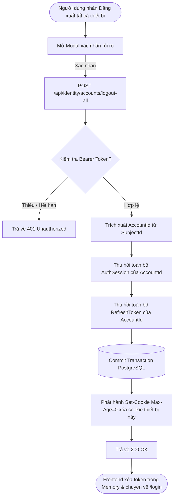

# Đăng Xuất Khỏi Tất Cả Thiết Bị (Logout All Devices) — US-AUTH-005

## 1. Overview (Tổng quan)

Thu hồi toàn bộ các phiên làm việc (`AuthSession`) và tất cả các Refresh Token đang hoạt động của tài khoản người dùng trên **mọi thiết bị** (máy tính, điện thoại, máy tính bảng).  
Đồng thời, Backend xóa sạch Cookie `sp_refresh` trên trình duyệt đang gọi. Đây là tính năng bảo mật then chốt giúp người dùng tự bảo vệ tài khoản khi nghi ngờ bị lộ mật khẩu hoặc mất thiết bị.

### Traceability (Tính truy vết):
- **Requirement:** `FR-AUTH-003`
- **User Story:** `US-AUTH-005 — Đăng xuất khỏi tất cả thiết bị`
- **Main Flow:** `MF-02 — Đăng nhập & Duy trì phiên làm việc`
- **Owner:** Identity Service / BE-1

---

## 2. API Specification (Thông số API)

| Thuộc tính | Chi tiết |
| :--- | :--- |
| **HTTP Method** | `POST` |
| **API URL** | `/api/identity/accounts/logout-all` |
| **Permission** | 🔴 **Bearer JWT** (Yêu cầu Access Token của tài khoản) |
| **Content-Type** | `application/json` |
| **Accept** | `application/json` |

---

## 3. Request Sample & Schema (Yêu cầu đầu vào)

### 3.1. Request Headers

| Header | Phân loại | Giá trị mẫu | Giải thích |
| :--- | :---: | :--- | :--- |
| `Authorization` | 🔴 **BẮT BUỘC** | `Bearer eyJhbGciOiJSUzI1Ni...` | Access Token của tài khoản |
| `Content-Type` | 🔴 **BẮT BUỘC** | `application/json` | Định dạng payload |

### 3.2. Request Body: ❌ **KHÔNG CÓ BODY**

---

## 4. Response Sample & Schema (Dữ liệu trả về)

### 4.1. HTTP Status: `200 OK`

#### 🍪 Response Headers (Xóa Cookie Trình Duyệt Hiện Tại):
```http
Set-Cookie: sp_refresh=; Path=/api/identity/accounts; Expires=Thu, 01 Jan 1970 00:00:00 GMT; Max-Age=0; HttpOnly; SameSite=Strict
```

#### 📦 Response Body:
```json
{
  "message": "Đã đăng xuất khỏi tất cả thiết bị."
}
```

---

## 5. Validation & Testcase Scenarios (Ma trận Kiểm thử Đầy Đủ)

Đối soát trực tiếp từ bộ kiểm thử `SessionsAndAdminAccountsTests.cs`:

| Mã Test Case | HTTP Status | Mã lỗi (`errorCode`) | Điều kiện kích hoạt (Given - When) | Phản hồi thực tế (Then) |
| :--- | :---: | :--- | :--- | :--- |
| `TC-OUTALL-01` | `200 OK` | *None* | Access Token hợp lệ, tài khoản đang có nhiều phiên hoạt động trên các thiết bị khác nhau. | Thu hồi toàn bộ Session và Token trong DB; xóa cookie `sp_refresh` trên thiết bị này; trả về `200 OK`. Mọi thiết bị khác khi gọi refresh sẽ nhận `401 identity.session_revoked`. |
| `TC-ERR-01` | `401 Unauthorized` | *Standard HTTP 401* | Không gửi Bearer Token hoặc Token đã hết hạn. | `"Unauthorized"` |

---

## 6. Activity Diagram (Sơ đồ luồng hoạt động)



---

## 7. Sequence Diagram (Sơ đồ tuần tự tương tác)

```mermaid
sequenceDiagram
    autonumber
    actor User as Người dùng
    participant FE as Frontend Client
    participant API as AccountEndpoints
    participant MediatR as LogoutAllCommandHandler
    participant DB as PostgreSQL Database

    User->>FE: Bấm "Đăng xuất khỏi tất cả thiết bị"
    FE->>API: POST /api/identity/accounts/logout-all (Bearer Token)
    API->>MediatR: Send(LogoutAllCommand(currentUser.SubjectId))
    MediatR->>DB: RevokeAllSessionsForAccountAsync(accountId)
    MediatR->>DB: RevokeAllRefreshTokensForAccountAsync(accountId)
    DB-->>MediatR: Done
    MediatR-->>API: Result.Success()
    API-->>FE: 200 OK (Set-Cookie: sp_refresh=; Max-Age=0)
    FE->>FE: Xóa accessToken trong Memory State
    FE-->>User: Điều hướng về màn hình /login
```

---

## 8. Frontend Integration Guide (Hướng dẫn Tích hợp)

```typescript
import { api } from './auth';

export const logoutAllDevices = async (): Promise<void> => {
  await api.post('/api/identity/accounts/logout-all');
  window.location.href = '/login';
};
```
