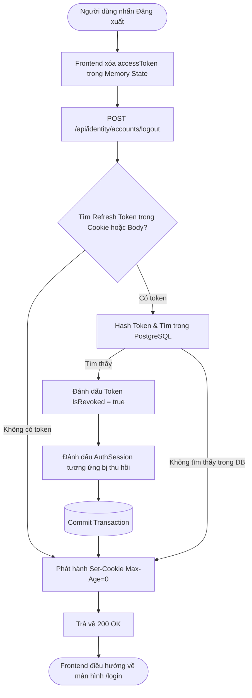

# Đăng Xuất Phiên Hiện Tại (Logout) — US-AUTH-005

## 1. Overview (Tổng quan)

Đăng xuất tài khoản trên thiết bị hiện tại, thu hồi Refresh Token và đóng phiên làm việc `AuthSession` tương ứng.  
API này được thiết kế theo nguyên tắc **Idempotent (Luôn trả về 200 OK)** để đảm bảo quá trình đăng xuất của người dùng diễn ra trơn tru, không bao giờ bị chặn lại dù Cookie đã hết hạn hoặc không tồn tại. Đồng thời, Backend phát hành chỉ thị `Set-Cookie` xóa sạch Cookie `sp_refresh` trên trình duyệt.

### Traceability (Tính truy vết):
- **Requirement:** `FR-AUTH-003`
- **User Story:** `US-AUTH-005 — Đăng xuất phiên làm việc`
- **Main Flow:** `MF-02 — Đăng nhập & Duy trì phiên làm việc`
- **Owner:** Identity Service / BE-1

---

## 2. API Specification (Thông số API)

| Thuộc tính | Chi tiết |
| :--- | :--- |
| **HTTP Method** | `POST` |
| **API URL** | `/api/identity/accounts/logout` |
| **Permission** | `Cookie-Based / Anonymous` (Không bắt buộc Bearer Token, đọc từ Cookie) |
| **Content-Type** | `application/json` |
| **Accept** | `application/json` |

---

## 3. Request Sample & Schema (Yêu cầu đầu vào)

### 3.1. Request Headers

| Header | Phân loại | Giá trị mẫu | Giải thích |
| :--- | :---: | :--- | :--- |
| `Cookie` | 🟢 **KHUYẾN NGHỊ** | `sp_refresh=c9b578e2-f472...` | Trình duyệt tự gửi khi bật `withCredentials: true` |

### 3.2. Request Body Mẫu

#### Chuẩn Web Client (Khuyến nghị: Body Rỗng)
```json
{}
```

#### Chuẩn Mobile Client (Tùy chọn)
```json
{
  "refreshToken": "c9b578e2-f472-4b2a-8bc2-a1b948f93e12"
}
```

---

## 4. Response Sample & Schema (Dữ liệu trả về)

### 4.1. HTTP Status: `200 OK`

#### 🍪 Response Headers (Chỉ Thị Xóa Sạch Cookie):
```http
Set-Cookie: sp_refresh=; Path=/api/identity/accounts; Expires=Thu, 01 Jan 1970 00:00:00 GMT; Max-Age=0; HttpOnly; SameSite=Strict
```

#### 📦 Response Body:
```json
{
  "message": "Đăng xuất thành công."
}
```

### 4.2. Bảng Thuộc Tính Phản Hồi (Response Schema)

| Trường (Field) | Kiểu dữ liệu | Phân loại | Ý nghĩa & Giá trị |
| :--- | :---: | :---: | :--- |
| `message` | `string` | 🟢 **LUÔN CÓ** | Thông điệp: `"Đăng xuất thành công."` |

---

## 5. Validation & Testcase Scenarios (Ma trận Kiểm thử Đầy Đủ)

Đối soát trực tiếp từ bộ kiểm thử `RefreshTokenAndLogoutTests.cs`:

| Mã Test Case | HTTP Status | Mã lỗi (`errorCode`) | Điều kiện kích hoạt (Given - When) | Phản hồi thực tế (Then) |
| :--- | :---: | :--- | :--- | :--- |
| `TC-OUT-01` | `200 OK` | *None* | Cookie `sp_refresh` hợp lệ, đang có phiên `AuthSession` hoạt động. | Thu hồi Token và Session; xóa Cookie `sp_refresh` khỏi trình duyệt; trả về `200 OK`. |
| `TC-OUT-02` | `200 OK` | *None* | Gọi Logout khi không có Cookie (hoặc đã đăng xuất trước đó rồi). | Backend vẫn trả về `200 OK` kèm header xóa Cookie để đảm bảo client dọn sạch state mà không gặp lỗi. |
| `TC-OUT-03` | `200 OK` | *None* | Truyền `refreshToken` qua Body thay vì Cookie (Mobile Client). | Thu hồi token thành công và trả về `200 OK`. |

---

## 6. Activity Diagram (Sơ đồ luồng hoạt động)



---

## 7. Sequence Diagram (Sơ đồ tuần tự tương tác)

```mermaid
sequenceDiagram
    autonumber
    actor User as Người dùng
    participant FE as Frontend Client
    participant API as AccountEndpoints
    participant MediatR as LogoutCommandHandler
    participant DB as PostgreSQL Database

    User->>FE: Bấm nút "Đăng xuất"
    FE->>FE: Xóa accessToken trong Memory State
    FE->>API: POST /api/identity/accounts/logout (Cookie: sp_refresh)
    API->>MediatR: Send(LogoutCommand)
    MediatR->>DB: RevokeTokenAndSessionAsync(tokenHash)
    DB-->>MediatR: Done
    MediatR-->>API: Result.Success()
    API-->>FE: 200 OK (Set-Cookie: sp_refresh=; Max-Age=0)
    FE-->>User: Điều hướng về trang /login
```

---

## 8. Frontend Integration Guide (Hướng dẫn Tích hợp)

### 8.1. Axios Calling Function Mẫu

```typescript
import axios from 'axios';

export const logout = async (): Promise<void> => {
  try {
    await axios.post(
      `${process.env.NEXT_PUBLIC_API_URL || 'http://localhost:5000'}/api/identity/accounts/logout`,
      {},
      {
        withCredentials: true, // 🔴 BẮT BUỘC để trình duyệt gửi cookie và nhận lệnh xóa cookie
      }
    );
  } finally {
    // Luôn dọn sạch bộ nhớ và chuyển trang kể cả khi network lỗi
    window.location.href = '/login';
  }
};
```
