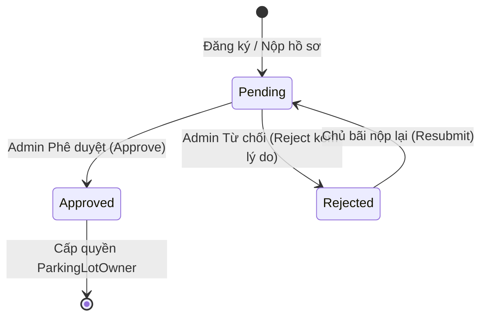

# Đặc Tả Giao Diện API: Quy Trình Xét Duyệt Chủ Bãi (Owner Application)

> **Dịch vụ:** Identity Service  
> **Phiên bản:** v1.0.0 (Phase 1 — MVP)  
> **Trạng thái:** Sẵn sàng tích hợp (`APPROVED — IN EFFECT`)  
> **User Story:** US-ADMIN-001  
> **Quy chuẩn kiến trúc:** Tuân thủ DEC-OWNER-001, DEC-OWNER-002 ([AGENTS.md](file:///f:/Ky_5/Smart_Parking_System/AGENTS.md))  
> **Owner:** BE Team (Lộc)

---

## 1. Tổng quan & Vòng đời xét duyệt (Lifecycle)

Hệ thống quản lý quy trình xét duyệt Chủ bãi theo mô hình 3 trạng thái bất biến:
* **`Pending` (Chờ duyệt):** Người dùng đăng ký tài khoản với loại `ParkingLotOwner` hoặc nộp đơn xin nâng cấp tài khoản. Vai trò ban đầu vẫn là `Customer`.
* **`Approved` (Đã duyệt):** Quản trị viên duyệt hồ sơ. Tài khoản được cấp vai trò `ParkingLotOwner`, cập nhật audit reviewer và **thu hồi toàn bộ phiên đăng nhập cũ** để client refresh nhận JWT có claim `owner_status=Approved`.
* **`Rejected` (Bị từ chối):** Quản trị viên từ chối hồ sơ kèm lý do bắt buộc (1–500 ký tự). Tài khoản giữ nguyên vai trò `Customer`, được phép chỉnh sửa thông tin và nộp lại hồ sơ (`resubmit`).



---

## 2. Danh Sách Endpoint

| Method | Endpoint | Quyền (Auth) | Mô tả |
| :---: | :--- | :---: | :--- |
| `POST` | `/api/identity/accounts` | Public | Đăng ký tài khoản (chọn `accountType = ParkingLotOwner`) |
| `GET` | `/api/identity/accounts/me/owner-application` | `Bearer <token>` | Chủ bãi xem trạng thái đơn và lý do từ chối (nếu có) |
| `POST` | `/api/identity/accounts/me/owner-application/resubmit` | `Bearer <token>` | Chủ bãi nộp lại đơn khi đang ở trạng thái `Rejected` |
| `GET` | `/api/identity/admin/owner-applications` | `Admin` | Quản trị viên tra cứu danh sách đơn phân trang |
| `POST` | `/api/identity/admin/owner-applications/{id}/approve` | `Admin` | Quản trị viên duyệt cấp quyền Chủ bãi |
| `POST` | `/api/identity/admin/owner-applications/{id}/reject` | `Admin` | Quản trị viên từ chối đơn kèm lý do |

---

## 3. Chi Tiết Từng Endpoint

### 3.1. Đăng ký tài khoản Chủ bãi (`POST /api/identity/accounts`)
* **Endpoint:** `/api/identity/accounts` (đi qua Gateway port 5000: `POST /api/identity/accounts`)
* **Request Body:**
```json
{
  "fullName": "Nguyễn Văn Chủ Bãi",
  "email": "owner@example.com",
  "password": "SecurePassword123!",
  "phoneNumber": "0912345678",
  "accountType": "ParkingLotOwner"
}
```
* **Response (`200 OK`):**
```json
{
  "accountId": "3fa85f64-5717-4562-b3fc-2c963f66afa6",
  "email": "owner@example.com",
  "fullName": "Nguyễn Văn Chủ Bãi",
  "status": "PendingEmailVerification",
  "message": "Đăng ký thành công. Mã OTP đã được gửi đến email.",
  "ownerApplicationStatus": "Pending"
}
```

---

### 3.2. Xem trạng thái hồ sơ của tôi (`GET /api/identity/accounts/me/owner-application`)
* **Auth:** `Bearer <access_token>`
* **Response (`200 OK`):**
```json
{
  "accountId": "3fa85f64-5717-4562-b3fc-2c963f66afa6",
  "email": "owner@example.com",
  "status": "Rejected",
  "rejectionReason": "Số điện thoại liên hệ không thể liên lạc được để xác minh thực địa bãi xe.",
  "reviewedAtUtc": "2026-10-20T10:30:00Z"
}
```
* **Lưu ý:** Nếu tài khoản chưa từng đăng ký chủ bãi (tài khoản Customer thông thường), trường `status` trả về `null`.

---

### 3.3. Nộp lại hồ sơ (`POST /api/identity/accounts/me/owner-application/resubmit`)
* **Auth:** `Bearer <access_token>`
* **Điều kiện:** Hồ sơ hiện tại phải ở trạng thái `Rejected`. Nếu không, hệ thống trả về lỗi `409 Conflict`.
* **Response (`200 OK`):**
```json
{
  "accountId": "3fa85f64-5717-4562-b3fc-2c963f66afa6",
  "status": "Pending",
  "message": "Đã gửi lại yêu cầu xét duyệt hồ sơ chủ bãi thành công."
}
```

---

### 3.4. Danh sách xét duyệt dành cho Admin (`GET /api/identity/admin/owner-applications`)
* **Auth:** `Bearer <admin_token>` (Chính sách: `AdminPolicy`)
* **Query Parameters:**
  * `status` *(string, optional)*: `Pending` | `Approved` | `Rejected`. Bỏ trống để lấy tất cả.
  * `page` *(int, optional, default = 1)*: Số thứ tự trang.
  * `pageSize` *(int, optional, default = 20)*: Số lượng bản ghi trên một trang (tối đa 100).
* **Response (`200 OK`):**
```json
{
  "items": [
    {
      "accountId": "3fa85f64-5717-4562-b3fc-2c963f66afa6",
      "email": "owner@example.com",
      "phoneNumber": "+84912345678",
      "fullName": "Nguyễn Văn Chủ Bãi",
      "status": "Pending",
      "rejectionReason": null,
      "reviewedAtUtc": null,
      "reviewedBy": null,
      "createdAtUtc": "2026-10-20T08:00:00Z"
    }
  ],
  "totalCount": 1,
  "page": 1,
  "pageSize": 20
}
```

---

### 3.5. Admin Phê duyệt (`POST /api/identity/admin/owner-applications/{id}/approve`)
* **Auth:** `Bearer <admin_token>`
* **Hành vi nghiệp vụ:**
  1. Chuyển `OwnerApplicationStatus` sang `Approved`.
  2. Gán vai trò tài khoản thành `ParkingLotOwner`.
  3. Ghi vết audit `OwnerReviewedBy` (Admin ID) và `OwnerReviewedAtUtc`.
  4. Thu hồi toàn bộ Refresh Tokens / Sessions của tài khoản đó để buộc client cập nhật token mới.
* **Response (`200 OK`):**
```json
{
  "accountId": "3fa85f64-5717-4562-b3fc-2c963f66afa6",
  "status": "Approved",
  "message": "Hồ sơ chủ bãi đã được phê duyệt thành công. Phiên đăng nhập cũ của người dùng đã được thu hồi."
}
```

---

### 3.6. Admin Từ chối (`POST /api/identity/admin/owner-applications/{id}/reject`)
* **Auth:** `Bearer <admin_token>`
* **Request Body:**
```json
{
  "reason": "Thiếu thông tin địa điểm hoặc không cung cấp đủ bằng chứng sở hữu."
}
```
* **Ràng buộc:** `reason` là bắt buộc, độ dài từ 1 đến 500 ký tự.
* **Response (`200 OK`):**
```json
{
  "accountId": "3fa85f64-5717-4562-b3fc-2c963f66afa6",
  "status": "Rejected",
  "message": "Hồ sơ chủ bãi đã bị từ chối."
}
```

---

## 4. Bảng Mã Lỗi (Error Codes)

| HTTP Status | Error Code | Mô tả |
| :---: | :--- | :--- |
| `400 Bad Request` | `identity.owner_reject_reason_required` | Lý do từ chối bị để trống hoặc dài quá 500 ký tự |
| `400 Bad Request` | `identity.invalid_page_size` | `pageSize` không nằm trong khoảng 1–100 |
| `401 Unauthorized` | — | Chưa truyền Bearer token hoặc token hết hạn |
| `403 Forbidden` | — | Tài khoản không có vai trò Quản trị viên (Admin) |
| `404 Not Found` | `identity.owner_application_not_found` | Không tìm thấy hồ sơ hoặc tài khoản không tồn tại |
| `409 Conflict` | `identity.owner_application_not_pending` | Đơn không ở trạng thái `Pending` khi Admin cố duyệt/từ chối |
| `409 Conflict` | `identity.owner_application_not_rejected` | Đơn không ở trạng thái `Rejected` khi chủ bãi gọi `resubmit` |
| `409 Conflict` | `identity.cannot_approve_own_application` | Admin không được tự phê duyệt đơn chủ bãi của chính mình |

---

## 5. TypeScript Interfaces Cho Frontend Tích Hợp

```typescript
export type OwnerApplicationStatus = "Pending" | "Approved" | "Rejected";

export interface RegisterOwnerRequest {
  fullName: string;
  email: string;
  password: string;
  phoneNumber: string;
  accountType: "ParkingLotOwner";
}

export interface MyOwnerApplicationResponse {
  accountId: string;
  email: string;
  status: OwnerApplicationStatus | null;
  rejectionReason: string | null;
  reviewedAtUtc: string | null;
}

export interface OwnerApplicationItem {
  accountId: string;
  email: string;
  phoneNumber: string | null;
  fullName: string | null;
  status: OwnerApplicationStatus;
  rejectionReason: string | null;
  reviewedAtUtc: string | null;
  reviewedBy: string | null;
  createdAtUtc: string;
}

export interface ListOwnerApplicationsResponse {
  items: OwnerApplicationItem[];
  totalCount: number;
  page: number;
  pageSize: number;
}

export interface RejectOwnerApplicationRequest {
  reason: string;
}

export interface OwnerApplicationActionResult {
  accountId: string;
  status: OwnerApplicationStatus;
  message: string;
}
```

---

## 6. Chiến Lược Giả Lập / Mock Cho Demo Nghiệm Thu OJT

Theo thống nhất kiến trúc:
1. **CCCD / Mã số thuế:**
   - Để tránh rủi ro pháp lý theo Nghị định 13/2023/NĐ-CP, hệ thống MVP không yêu cầu upload ảnh CCCD thật.
   - Khi nghiệm thu/demo, nếu cần trình diễn thông tin định danh mở rộng, sử dụng danh sách CCCD/Mã số thuế giả lập (Mock Sheet) từ file test fixtures hoặc điền trực tiếp vào form Profile (`citizenIdNumber`).
2. **Quy trình Tách 2 Bước:**
   - Sau khi tài khoản được duyệt sang `Approved`, Frontend chuyển hướng người dùng sang phân hệ Quản lý bãi xe (`/owner/lots/new`) để đăng ký từng bãi xe qua Parking API.
