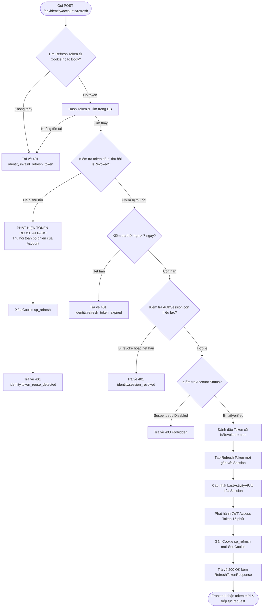

# Làm Mới Access Token (Silent Refresh & Token Rotation) — US-AUTH-005

## 1. Overview (Tổng quan)

Cấp phát Access Token mới (15 phút) mà không làm gián đoạn trải nghiệm người dùng khi Access Token cũ sắp hết hạn hoặc khi người dùng tải lại trang (F5).  
Endpoint hoạt động theo cơ chế **Token Rotation (Xoay vòng token)** và **Tự động phát hiện xâm nhập (Token Reuse Detection)**:
- Mỗi lần Refresh thành công, Refresh Token cũ bị thu hồi và thay thế bằng Refresh Token mới (tự động cập nhật vào Cookie `sp_refresh`).
- Nếu phát hiện một Refresh Token cũ đã bị xoay vòng được sử dụng lại (dấu hiệu kẻ gian đánh cắp token), hệ thống sẽ **hủy bỏ ngay lập tức toàn bộ phiên làm việc của tài khoản trên mọi thiết bị** và xóa sạch cookie.

### Traceability (Tính truy vết):
- **Requirement:** `FR-AUTH-003`
- **User Story:** `US-AUTH-005 — Duy trì phiên làm việc liên tục & Làm mới Token`
- **Main Flow:** `MF-02 — Đăng nhập & Duy trì phiên làm việc`
- **Owner:** Identity Service / BE-1

---

## 2. API Specification (Thông số API)

| Thuộc tính | Chi tiết |
| :--- | :--- |
| **HTTP Method** | `POST` |
| **API URL** | `/api/identity/accounts/refresh` |
| **Permission** | `Cookie-Based / Refresh Token` (Không yêu cầu Bearer Token) |
| **Content-Type** | `application/json` |
| **Accept** | `application/json` |

---

## 3. Request Sample & Schema (Yêu cầu đầu vào)

### 3.1. Request Headers

| Header | Phân loại | Giá trị mẫu | Giải thích |
| :--- | :---: | :--- | :--- |
| `Cookie` | 🟢 **KHUYẾN NGHỊ** | `sp_refresh=c9b578e2-f472-4b2a...` | Trình duyệt tự động đính kèm khi gọi với `withCredentials: true` |
| `Content-Type` | 🟡 **TÙY CHỌN** | `application/json` | Bắt buộc nếu có truyền body |

### 3.2. Request Body Mẫu

#### Chuẩn Web Client (Khuyến nghị: Body Rỗng)
Trình duyệt chỉ cần gửi request với Body rỗng, Backend tự động đọc `sp_refresh` từ Cookie:
```json
{}
```

#### Chuẩn Mobile Client (Tùy chọn: Truyền qua Body)
```json
{
  "refreshToken": "c9b578e2-f472-4b2a-8bc2-a1b948f93e12"
}
```

### 3.3. Bảng Đặc Tả Chi Tiết Từng Trường (Request Body Schema)

| Tên trường (Field) | Kiểu dữ liệu | Phân loại | Giá trị mặc định | Ràng buộc Validation & Quy tắc kiểm tra (Source of Truth) |
| :--- | :---: | :---: | :---: | :--- |
| `refreshToken` | `string (UUID)` hoặc `null` | 🟡 **TÙY CHỌN** | `null` | - Nếu không truyền qua Body, Backend sẽ đọc từ Cookie `sp_refresh`.<br>- Nếu truyền qua Body, phải là chuỗi UUID hợp lệ.<br>- Nếu cả Cookie và Body đều không có: Backend trả lỗi `401 identity.invalid_refresh_token`. |

---

## 4. Response Sample & Schema (Dữ liệu trả về)

### 4.1. HTTP Status: `200 OK`

#### 🍪 Response Headers (Xoay Vòng Cookie Mới):
```http
Set-Cookie: sp_refresh=f8fe9211-c1a5-4817-8c63-fe2d070ea00b; Path=/api/identity/accounts; HttpOnly; SameSite=Strict; Max-Age=604800; Secure
```

#### 📦 Response Body:
```json
{
  "accessToken": "eyJhbGciOiJSUzI1NiIsInR5cCI6IkpXVCJ9.eyJzdWIiOiJhM2JiMTA4ZS0xN2Q0LTRhNmMtOWY4Ny0yYTU0ZTk5MTIzNDUiLCJzaWQiOiJmOGZlOTIxMS1jMWE1LTQ4MTctOGM2My1mZTJkMDcwZWEwMGIiLCJlbWFpbCI6InVzZXJAZXhhbXBsZS5jb20iLCJyb2xlIjoiQ3VzdG9tZXIiLCJleHAiOjE3MjkxMjQzNTZ9...",
  "refreshToken": "f8fe9211-c1a5-4817-8c63-fe2d070ea00b",
  "tokenType": "Bearer",
  "expiresIn": 900,
  "account": {
    "id": "a3bb108e-17d4-4a6c-9f87-2a54e9912345",
    "email": "user@example.com",
    "status": "EmailVerified",
    "role": "Customer"
  }
}
```

### 4.2. Bảng Thuộc Tính Phản Hồi (Response Schema)

| Trường (Field) | Kiểu dữ liệu | Phân loại | Ý nghĩa & Giá trị |
| :--- | :---: | :---: | :--- |
| `accessToken` | `string (JWT)` | 🟢 **LUÔN CÓ** | Access Token mới (15 phút) |
| `refreshToken` | `string (UUID)` | 🟢 **LUÔN CÓ** | Refresh Token mới vừa được xoay vòng |
| `tokenType` | `string` | 🟢 **LUÔN CÓ** | `"Bearer"` |
| `expiresIn` | `integer` | 🟢 **LUÔN CÓ** | `900` (giây) |
| `account` | `object` | 🟢 **LUÔN CÓ** | Thông tin tài khoản (`id`, `email`, `status`, `role`) |

---

## 5. Validation & Testcase Scenarios (Ma trận Kiểm thử Đầy Đủ)

Đối soát trực tiếp từ bộ kiểm thử `RefreshTokenAndLogoutTests.cs` và `AccountEndpointsHttpTests.cs`:

| Mã Test Case | HTTP Status | Mã lỗi (`errorCode`) | Điều kiện kích hoạt (Given - When) | Phản hồi thực tế (Then) |
| :--- | :---: | :--- | :--- | :--- |
| `TC-REF-01` | `200 OK` | *None* | Cookie `sp_refresh` hợp lệ, chưa hết hạn 7 ngày, phiên `AuthSession` đang hoạt động. | Thu hồi token cũ, phát hành token mới, xoay cookie mới, trả về Access Token 15 phút. |
| `TC-ERR-01` | `401 Unauthorized` | `identity.invalid_refresh_token` | Cả Cookie và Body đều rỗng, hoặc Refresh Token gửi lên không tồn tại trong DB. | `"Mã làm mới phiên không hợp lệ hoặc đã hết hạn."` (Tự động xóa cookie). |
| `TC-ERR-02` | `401 Unauthorized` | `identity.refresh_token_expired` | Refresh Token đã quá thời hạn 7 ngày kể từ lúc tạo. | `"Mã làm mới phiên đã hết hạn. Vui lòng đăng nhập lại."` (Xóa cookie). |
| `TC-ERR-03` | `401 Unauthorized` | `identity.session_revoked` | Phiên làm việc `AuthSession` đã bị người dùng hoặc hệ thống đăng xuất trước đó. | `"Phiên đăng nhập đã bị đăng xuất trên thiết bị này. Vui lòng đăng nhập lại."` |
| `TC-ERR-04` | `401 Unauthorized` | `identity.session_expired` | Phiên làm việc đã quá thời hạn lưu trữ. | `"Phiên đăng nhập đã hết hạn. Vui lòng đăng nhập lại."` |
| `TC-ERR-05` | `401 Unauthorized` | `identity.token_reuse_detected` | Token gửi lên là token cũ đã từng bị xoay vòng (Token Reuse Attack). | Thu hồi toàn bộ phiên và token của tài khoản trên mọi thiết bị; xóa cookie; buộc đăng nhập lại. |
| `TC-ERR-06` | `403 Forbidden` | `identity.account_suspended` | Tài khoản đã bị quản trị viên đình chỉ hoạt động trong khi đang sử dụng. | `"Tài khoản này đã bị tạm đình chỉ. Vui lòng liên hệ quản trị viên."` |

---

## 6. Activity Diagram (Sơ đồ luồng hoạt động)



---

## 7. Sequence Diagram (Sơ đồ tuần tự tương tác)

```mermaid
sequenceDiagram
    autonumber
    actor User as Người dùng
    participant FE as Frontend Interceptor
    participant API as AccountEndpoints
    participant MediatR as RefreshTokenCommandHandler
    participant DB as PostgreSQL Database

    User->>FE: Thực hiện thao tác trên web
    FE->>API: Gọi API nghiệp vụ (Access Token đã hết hạn)
    API-->>FE: 401 Unauthorized
    
    Note over FE,API: CƠ CHẾ SILENT REFRESH NGẦM
    FE->>API: POST /api/identity/accounts/refresh (Cookie: sp_refresh)
    API->>MediatR: Send(RefreshTokenCommand)
    MediatR->>DB: FindRefreshTokenWithSessionAsync()
    
    alt Token tái sử dụng trái phép (Reuse Detection)
        MediatR->>DB: RevokeAllSessionsForAccountAsync()
        DB-->>MediatR: Revoked
        MediatR-->>API: Result.Failure(TokenReuseDetected)
        API-->>FE: 401 Unauthorized (Header: Set-Cookie: sp_refresh=; Max-Age=0)
        FE->>FE: Xóa Memory State & Chuyển sang /login
    else Hợp lệ (Token Rotation)
        MediatR->>DB: Revoke old token & Add new token
        MediatR->>DB: Update Session LastActivity
        DB-->>MediatR: Commit Success
        MediatR-->>API: Result.Success(RefreshTokenResponse)
        API-->>FE: 200 OK (Set-Cookie: sp_refresh=<new_token>)
        FE->>FE: Cập nhật accessToken mới vào Memory State
        FE->>API: Gửi lại request nghiệp vụ ban đầu với Token mới
        API-->>FE: 200 OK dữ liệu nghiệp vụ
        FE-->>User: Hiển thị kết quả mượt mà không bị văng đăng xuất
    end
```

---

## 8. Frontend Integration Guide: Axios Silent Refresh Interceptor

Mã nguồn hoàn chỉnh thiết lập Axios Interceptor xử lý hàng đợi request khi Refresh:

```typescript
import axios, { AxiosError, InternalAxiosRequestConfig } from 'axios';

let memoryAccessToken: string | null = null;
let isRefreshing = false;
let failedQueue: Array<{
  resolve: (token: string) => void;
  reject: (error: any) => void;
}> = [];

const processQueue = (error: any, token: string | null = null) => {
  failedQueue.forEach((prom) => {
    if (token) prom.resolve(token);
    else prom.reject(error);
  });
  failedQueue = [];
};

export const api = axios.create({
  baseURL: process.env.NEXT_PUBLIC_API_URL || 'http://localhost:5000',
  withCredentials: true, // 🔴 BẮT BUỘC để trình duyệt tự gửi Cookie sp_refresh
});

// Request Interceptor: Tự động gắn Bearer Token
api.interceptors.request.use((config: InternalAxiosRequestConfig) => {
  if (memoryAccessToken && config.headers) {
    config.headers.Authorization = `Bearer ${memoryAccessToken}`;
  }
  return config;
});

// Response Interceptor: Bắt 401 & Silent Refresh
api.interceptors.response.use(
  (response) => response,
  async (error: AxiosError) => {
    const originalRequest = error.config as InternalAxiosRequestConfig & { _retry?: boolean };

    if (error.response?.status === 401 && !originalRequest._retry) {
      if (originalRequest.url?.includes('/api/identity/accounts/refresh')) {
        memoryAccessToken = null;
        window.location.href = '/login';
        return Promise.reject(error);
      }

      if (isRefreshing) {
        return new Promise((resolve, reject) => {
          failedQueue.push({ resolve, reject });
        }).then((token) => {
          originalRequest.headers.Authorization = `Bearer ${token}`;
          return api(originalRequest);
        });
      }

      originalRequest._retry = true;
      isRefreshing = true;

      try {
        const { data } = await api.post('/api/identity/accounts/refresh');
        memoryAccessToken = data.accessToken;
        processQueue(null, data.accessToken);
        originalRequest.headers.Authorization = `Bearer ${data.accessToken}`;
        return api(originalRequest);
      } catch (refreshError) {
        processQueue(refreshError, null);
        memoryAccessToken = null;
        window.location.href = '/login';
        return Promise.reject(refreshError);
      } finally {
        isRefreshing = false;
      }
    }

    return Promise.reject(error);
  }
);
```
