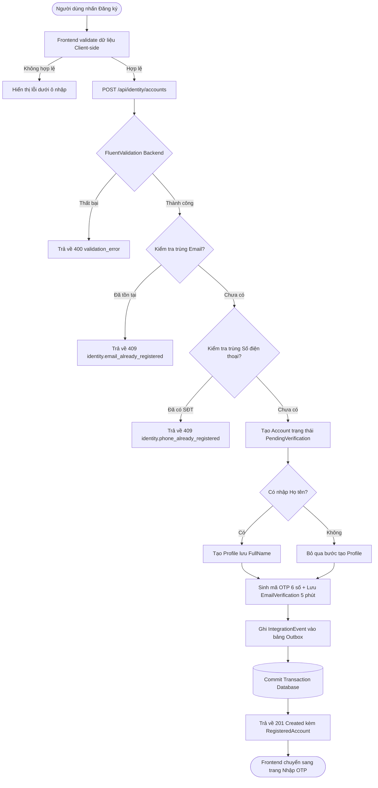
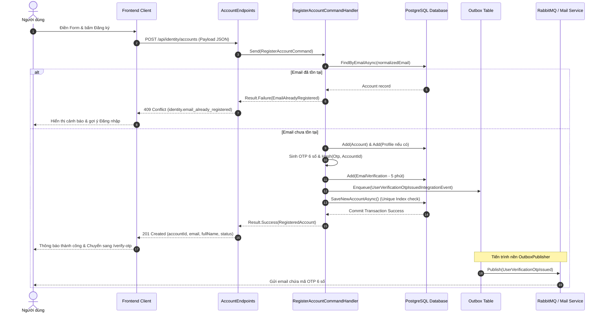

# Đăng Ký Tài Khoản Mới — US-AUTH-001

## 1. Overview (Tổng quan)

Khởi tạo tài khoản người dùng mới trong hệ thống Smart Parking với vai trò mặc định là `Customer`.  
Sau khi đăng ký thành công, hệ thống tự động lưu tài khoản ở trạng thái `PendingVerification`, đồng thời phát hành mã OTP xác thực 6 chữ số gửi qua email (hiệu lực 5 phút) để kích hoạt tài khoản.

### Traceability (Tính truy vết):
- **Requirement:** `FR-AUTH-001`
- **User Story:** `US-AUTH-001 — Đăng ký tài khoản người dùng`
- **Main Flow:** `MF-01 — Đăng ký & Kích hoạt tài khoản`
- **Owner:** Identity Service / BE-1

---

## 2. API Specification (Thông số API)

| Thuộc tính | Chi tiết |
| :--- | :--- |
| **HTTP Method** | `POST` |
| **API URL** | `/api/identity/accounts` |
| **Permission** | `N/A — Public / Anonymous` (Không yêu cầu đăng nhập) |
| **Content-Type** | `application/json` |
| **Accept** | `application/json` |

---

## 3. Request Sample & Schema (Yêu cầu đầu vào)

### 3.1. Request Body Mẫu

#### Trường hợp 1: Đầy đủ tất cả các trường (Cả bắt buộc và tùy chọn)
```json
{
  "fullName": "Nguyễn Văn An",
  "email": "user@example.com",
  "password": "Secret#123",
  "phoneNumber": "0901234567"
}
```

#### Trường hợp 2: Tối giản (Chỉ truyền các trường Bắt Buộc)
```json
{
  "email": "user@example.com",
  "password": "Secret#123"
}
```

### 3.2. Bảng Đặc Tả Chi Tiết Từng Trường (Request Body Schema)

| Tên trường (Field) | Kiểu dữ liệu | Phân loại | Giá trị mặc định | Ràng buộc Validation & Quy tắc kiểm tra (Source of Truth) |
| :--- | :---: | :---: | :---: | :--- |
| `email` | `string` | 🔴 **BẮT BUỘC** | *Không có* | - Không được để trống hoặc `null`.<br>- Định dạng email hợp lệ theo chuẩn RFC 5322.<br>- Độ dài tối đa: **254 ký tự**.<br>- Tự động chuẩn hóa: `Trim()` và chuyển thành chữ thường (`ToLowerInvariant`).<br>- *Thông báo lỗi:* `"Email là bắt buộc, không được để trống."` / `"Email không đúng định dạng hợp lệ."` |
| `password` | `string` | 🔴 **BẮT BUỘC** | *Không có* | - Không được để trống hoặc `null`.<br>- Độ dài: **Tối thiểu 8 ký tự** và **Tối đa 72 bytes UTF-8** (giới hạn an toàn thuật toán BCrypt).<br>- Bắt buộc phải có đủ 4 yếu tố:<br>&nbsp;&nbsp;1. Ít nhất 1 chữ hoa (`[A-Z]`)<br>&nbsp;&nbsp;2. Ít nhất 1 chữ thường (`[a-z]`)<br>&nbsp;&nbsp;3. Ít nhất 1 chữ số (`[0-9]`)<br>&nbsp;&nbsp;4. Ít nhất 1 ký tự đặc biệt (`[^A-Za-z0-9]`)<br>- *Thông báo lỗi:* `"Mật khẩu phải có ít nhất 8 ký tự."` / `"Mật khẩu quá dài: tối đa 72 ký tự không dấu..."` |
| `fullName` | `string` hoặc `null` | 🟡 **TÙY CHỌN** | `null` | - Cho phép bỏ qua, truyền `null` hoặc chuỗi rỗng `""`.<br>- **Nếu có truyền giá trị:** Độ dài từ **2 đến 100 ký tự**; Regex: `^[\p{L}]+(?:[ '-][\p{L}]+)*$` (Chỉ chứa chữ cái tiếng Việt có dấu, chữ cái tiếng Anh, khoảng trắng, gạch nối `-`, nháy đơn `'`). Không chứa số hoặc ký tự đặc biệt khác.<br>- *Hành vi khi bỏ qua:* Tài khoản vẫn tạo thành công, người dùng có thể cập nhật sau ở trang Hồ sơ cá nhân (Profile). |
| `phoneNumber` | `string` hoặc `null` | 🟡 **TÙY CHỌN** | `null` | - Cho phép bỏ qua, truyền `null` hoặc chuỗi rỗng `""`.<br>- **Nếu có truyền giá trị:** Phải là số di động Việt Nam: Regex `^\s*(0|\+84)[35789][0-9]{8}\s*$` (10 chữ số, bắt đầu bằng `0` hoặc `+84`, chữ số tiếp theo là `3, 5, 7, 8, 9`).<br>- Backend tự động chuẩn hóa về định dạng quốc tế `+84xxxxxxxxx`.<br>- *Thông báo lỗi:* `"Số điện thoại phải là số di động Việt Nam: 0xxxxxxxxx (10 chữ số) hoặc +84xxxxxxxxx..."` |

---

## 4. Response Sample & Schema (Dữ liệu trả về)

### 4.1. HTTP Status: `201 Created`

```json
{
  "accountId": "a3bb108e-17d4-4a6c-9f87-2a54e9912345",
  "email": "user@example.com",
  "fullName": "Nguyễn Văn An",
  "status": "PendingVerification",
  "message": "Đăng ký thành công. Mã OTP đã được gửi đến user@example.com, có hiệu lực 5 phút."
}
```

### 4.2. Bảng Thuộc Tính Phản Hồi (Response Schema)

| Trường (Field) | Kiểu dữ liệu | Phân loại | Ý nghĩa & Ví dụ |
| :--- | :---: | :---: | :--- |
| `accountId` | `string (UUID)` | 🟢 **LUÔN CÓ** | Định danh duy nhất của tài khoản vừa tạo (`"a3bb108e-17d4-4a6c-9f87-2a54e9912345"`) |
| `email` | `string` | 🟢 **LUÔN CÓ** | Email chuẩn hóa đã đăng ký (`"user@example.com"`) |
| `fullName` | `string` hoặc `null` | ⚪ **CÓ THỂ NULL** | Họ tên người dùng nếu có truyền, hoặc `null` nếu người dùng bỏ qua |
| `status` | `string` | 🟢 **LUÔN CÓ** | Trạng thái ban đầu: `"PendingVerification"` |
| `message` | `string` | 🟢 **LUÔN CÓ** | Thông điệp thông báo hướng dẫn (`"Đăng ký thành công. Mã OTP đã được gửi đến..."`) |

---

## 5. Validation & Testcase Scenarios (Ma trận Kiểm thử Đầy Đủ)

Đối soát trực tiếp từ bộ kiểm thử `RegisterAccountTests.cs` và `AccountEndpointsHttpTests.cs`:

| Mã Test Case | HTTP Status | Mã lỗi (`errorCode`) | Điều kiện kích hoạt (Given - When) | Phản hồi thực tế (Then) |
| :--- | :---: | :--- | :--- | :--- |
| `TC-REG-01` | `201 Created` | *None* | Đầy đủ `email`, `password` mạnh, `fullName` hợp lệ, `phoneNumber` hợp lệ. | Trả về `RegisteredAccount` đầy đủ; sinh OTP 6 số; đẩy Event Outbox `identity.user-verification-otp-issued.v1`. |
| `TC-REG-02` | `201 Created` | *None* | Chỉ truyền `email` và `password`, bỏ qua `fullName` và `phoneNumber`. | Trả về `201 Created`, trường `fullName: null`. Tài khoản tạo thành công nhưng chưa tạo bản ghi Profile. |
| `TC-REG-03` | `201 Created` | *None* | `fullName` chứa chữ cái tiếng Việt có dấu (`"Trần Thị Bích Ngọc"`), gạch nối (`"Anne-Marie"`), hoặc nháy đơn (`"O'Connor"`). | Regex khớp hợp lệ, tạo tài khoản thành công. |
| `TC-VAL-01` | `400 Bad Request` | `validation_error` | `email` bị để trống `""`, `null` hoặc chỉ chứa khoảng trắng. | `"Email là bắt buộc, không được để trống."` |
| `TC-VAL-02` | `400 Bad Request` | `validation_error` | `email` không đúng định dạng (VD: `"not-an-email"`, `"user@"`). | `"Email không đúng định dạng hợp lệ."` |
| `TC-VAL-03` | `400 Bad Request` | `validation_error` | `password` ngắn hơn 8 ký tự (VD: `"Sh#1a"`). | `"Mật khẩu phải có ít nhất 8 ký tự."` |
| `TC-VAL-04` | `400 Bad Request` | `validation_error` | `password` thiếu 1 trong 4 yếu tố: thiếu hoa (`"secret#123"`), thiếu thường (`"SECRET#123"`), thiếu số (`"Secret#abc"`), thiếu ký tự đặc biệt (`"Secret1234"`). | Thông báo lỗi tương ứng với tiêu chí bị thiếu. |
| `TC-VAL-05` | `400 Bad Request` | `validation_error` | `password` dài quá 72 bytes UTF-8 (VD: chuỗi tiếng Việt 29 ký tự nhưng chiếm 79 bytes). | `"Mật khẩu quá dài: tối đa 72 ký tự không dấu (ký tự có dấu chiếm nhiều chỗ hơn)."` |
| `TC-VAL-06` | `400 Bad Request` | `validation_error` | `fullName` có 1 ký tự (`"A"`), chứa số (`"John123"`), chứa ký tự đặc biệt (`"John @Doe"`), hoặc gạch nối đôi (`"Anne--Marie"`). | `"Họ và tên phải có ít nhất 2 ký tự."` hoặc `"Họ và tên chỉ được chứa chữ cái, khoảng trắng..."` |
| `TC-VAL-07` | `400 Bad Request` | `validation_error` | `phoneNumber` sai đầu số mạng Việt Nam (VD: `"0123456789"`, `"0212345678"`), hoặc sai độ dài (9 số, 11 số). | `"Số điện thoại phải là số di động Việt Nam: 0xxxxxxxxx (10 chữ số) hoặc +84xxxxxxxxx..."` |
| `TC-ERR-01` | `409 Conflict` | `identity.email_already_registered` | `email` đã tồn tại trong DB (kể cả tài khoản đang ở trạng thái `PendingVerification` hoặc `Active`). | `"Email này đã được đăng ký. Vui lòng đăng nhập, hoặc dùng 'Quên mật khẩu' nếu bạn không nhớ mật khẩu."` |
| `TC-ERR-02` | `409 Conflict` | `identity.phone_already_registered` | `phoneNumber` đã được một tài khoản khác liên kết trước đó. | `"Số điện thoại này đã được đăng ký cho một tài khoản khác."` |

---

## 6. Activity Diagram (Sơ đồ luồng hoạt động)



---

## 7. Sequence Diagram (Sơ đồ tuần tự tương tác)



---

## 8. Frontend Integration Guide (Hướng dẫn Tích hợp)

### 8.1. TypeScript Interface Definitions

```typescript
export interface RegisterAccountRequest {
  // 🔴 [BẮT BUỘC]
  email: string;
  password: string;

  // 🟡 [TÙY CHỌN]
  fullName?: string | null;
  phoneNumber?: string | null;
}

export interface RegisteredAccountResponse {
  accountId: string;          // 🟢 [LUÔN CÓ] UUID
  email: string;              // 🟢 [LUÔN CÓ]
  fullName: string | null;    // ⚪ [CÓ THỂ NULL]
  status: 'PendingVerification'; // 🟢 [LUÔN CÓ]
  message: string;            // 🟢 [LUÔN CÓ]
}
```

### 8.2. Axios Calling Function Mẫu

```typescript
import axios from 'axios';

export const registerAccount = async (payload: RegisterAccountRequest): Promise<RegisteredAccountResponse> => {
  const response = await axios.post<RegisteredAccountResponse>(
    `${process.env.NEXT_PUBLIC_API_URL || 'http://localhost:5000'}/api/identity/accounts`,
    payload,
    {
      headers: {
        'Content-Type': 'application/json',
      },
    }
  );
  return response.data;
};
```

### 8.3. UI/UX Checklist Cho Màn Hình Đăng Ký (`/register`)

- [ ] Đánh dấu hoa thị đỏ `*` bắt buộc cho 2 ô: `Email *` và `Mật khẩu *`.
- [ ] Ghi chú mờ `(Tùy chọn)` cho 2 ô: `Họ và tên` và `Số điện thoại`.
- [ ] Realtime Password Checklist: Hiển thị 4 tích xanh khi gõ mật khẩu (Đủ 8 ký tự, 1 hoa, 1 thường, 1 số/ký tự đặc biệt).
- [ ] Bắt lỗi `409 Conflict`:
  - `identity.email_already_registered`: Hiển thị Toast cảnh báo kèm nút liên kết nhanh *"Đăng nhập ngay"* hoặc *"Quên mật khẩu"*.
  - `identity.phone_already_registered`: Tô đỏ ô Số điện thoại và báo lỗi trùng lặp.
- [ ] Đăng ký thành công (`201 Created`): Lưu `email` vào State/Query param và điều hướng ngay sang trang `/verify-otp?email=...`.
