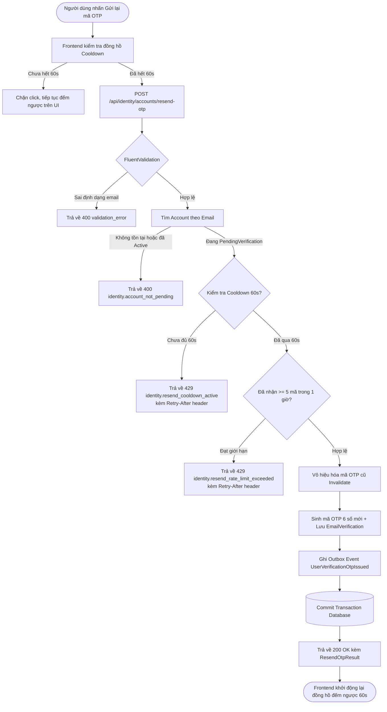
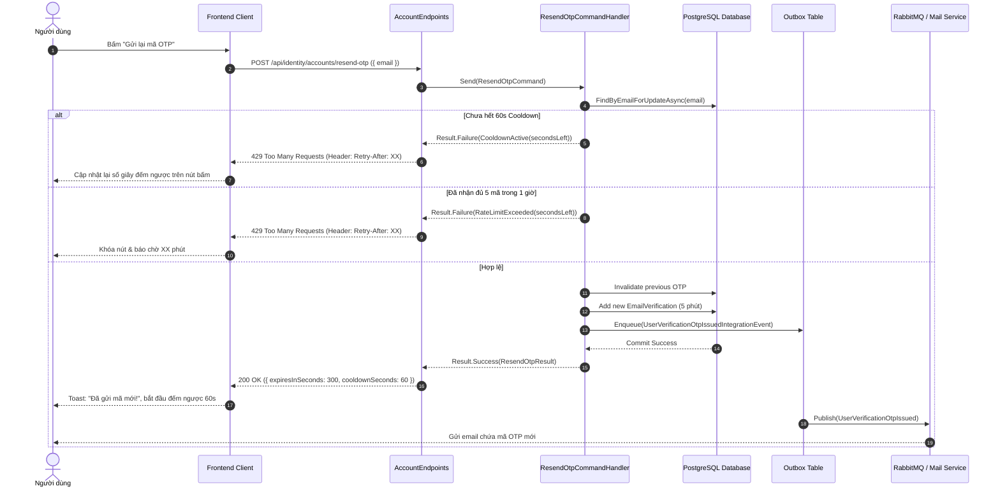

# Gửi Lại Mã OTP Xác Thực Email — US-AUTH-003

## 1. Overview (Tổng quan)

Cấp phát lại mã OTP 6 chữ số mới khi người dùng bị hết hạn mã cũ (quá 5 phút), nhập sai quá 3 lần, hoặc không nhận được email ban đầu.  
Hệ thống tự động vô hiệu hóa (Invalidate) mã OTP trước đó, sinh mã mới và bảo vệ hệ thống bằng cơ chế chờ 60 giây (Cooldown) và giới hạn 5 mã/giờ (Rate Limit).

### Traceability (Tính truy vết):
- **Requirement:** `FR-AUTH-002`
- **User Story:** `US-AUTH-003 — Xác thực email bằng OTP`
- **Main Flow:** `MF-01 — Đăng ký & Kích hoạt tài khoản`
- **Owner:** Identity Service / BE-1

---

## 2. API Specification (Thông số API)

| Thuộc tính | Chi tiết |
| :--- | :--- |
| **HTTP Method** | `POST` |
| **API URL** | `/api/identity/accounts/resend-otp` |
| **Permission** | `N/A — Public / Anonymous` (Không yêu cầu đăng nhập) |
| **Content-Type** | `application/json` |
| **Accept** | `application/json` |

---

## 3. Request Sample & Schema (Yêu cầu đầu vào)

### 3.1. Request Body Mẫu
```json
{
  "email": "user@example.com"
}
```

### 3.2. Bảng Đặc Tả Chi Tiết Từng Trường (Request Body Schema)

| Tên trường (Field) | Kiểu dữ liệu | Phân loại | Giá trị mặc định | Ràng buộc Validation & Quy tắc kiểm tra (Source of Truth) |
| :--- | :---: | :---: | :---: | :--- |
| `email` | `string` | 🔴 **BẮT BUỘC** | *Không có* | - Địa chỉ email của tài khoản đang ở trạng thái `PendingVerification`.<br>- Không được để trống hoặc `null`.<br>- Tối đa **254 ký tự**.<br>- Hệ thống tự động chuẩn hóa `Trim().ToLowerInvariant()`.<br>- *Thông báo lỗi:* `"Email là bắt buộc, không được để trống."` / `"Email không đúng định dạng hợp lệ."` |

---

## 4. Response Sample & Schema (Dữ liệu trả về)

### 4.1. HTTP Status: `200 OK`

```json
{
  "email": "user@example.com",
  "expiresInSeconds": 300,
  "cooldownSeconds": 60,
  "message": "Đã gửi mã OTP mới đến user@example.com. Mã có hiệu lực 5 phút; bạn có thể yêu cầu gửi lại sau 60 giây.",
  "otpSent": true
}
```

### 4.2. Bảng Thuộc Tính Phản Hồi (Response Schema)

| Trường (Field) | Kiểu dữ liệu | Phân loại | Ý nghĩa & Giá trị mẫu |
| :--- | :---: | :---: | :--- |
| `email` | `string` | 🟢 **LUÔN CÓ** | Email vừa nhận mã mới (`"user@example.com"`) |
| `expiresInSeconds` | `integer` | 🟢 **LUÔN CÓ** | Thời gian OTP có hiệu lực: `300` (giây) = 5 phút |
| `cooldownSeconds` | `integer` | 🟢 **LUÔN CÓ** | Thời gian chờ tối thiểu trước lần gửi kế tiếp: `60` (giây) |
| `message` | `string` | 🟢 **LUÔN CÓ** | Thông điệp thông báo: `"Đã gửi mã OTP mới đến user@example.com..."` |
| `otpSent` | `boolean` | 🟢 **LUÔN CÓ** | Luôn mang giá trị `true` khi gửi thành công |

---

## 5. Validation & Testcase Scenarios (Ma trận Kiểm thử Đầy Đủ)

Đối soát trực tiếp từ bộ kiểm thử `EmailOtpTests.cs` và `AccountEndpointsHttpTests.cs`:

| Mã Test Case | HTTP Status | Mã lỗi (`errorCode`) | Header đính kèm | Điều kiện kích hoạt (Given - When) | Phản hồi thực tế (Then) |
| :--- | :---: | :--- | :---: | :--- | :--- |
| `TC-RES-01` | `200 OK` | *None* | *None* | `email` hợp lệ, tài khoản đang `PendingVerification`, đã qua 60s kể từ lần gửi trước, chưa quá 5 mã/giờ. | Vô hiệu hóa mã cũ (`Invalidate`), tạo mã OTP 6 số mới, đẩy event Outbox, trả về `200 OK` với `cooldownSeconds: 60`. |
| `TC-VAL-01` | `400 Bad Request` | `validation_error` | *None* | `email` để trống hoặc sai định dạng RFC 5322. | `"Email là bắt buộc, không được để trống."` / `"Email không đúng định dạng hợp lệ."` |
| `TC-ERR-01` | `429 Too Many Requests` | `identity.resend_cooldown_active` | `Retry-After: <giây>` | Người dùng bấm "Gửi lại mã OTP" khi chưa hết thời gian chờ 60 giây (Cooldown). | `"Vui lòng đợi XX giây trước khi yêu cầu mã mới. Mã đã gửi trước đó vẫn dùng được nếu chưa hết hạn."` |
| `TC-ERR-02` | `429 Too Many Requests` | `identity.resend_rate_limit_exceeded` | `Retry-After: <giây>` | Email đã nhận đủ **5 mã OTP trong vòng 1 giờ** (`MaxHourlyOtpIssued = 5`). | `"Email này đã nhận tối đa 5 mã OTP trong 1 giờ để bảo đảm an toàn. Vui lòng thử lại sau XX phút."` |
| `TC-ERR-03` | `400 Bad Request` | `identity.account_not_pending` | *None* | `email` không tồn tại trong hệ thống, hoặc tài khoản đã ở trạng thái `EmailVerified` (Active). | `"Email này chưa được đăng ký hoặc tài khoản đã được xác thực trước đó."` |

---

## 6. Activity Diagram (Sơ đồ luồng hoạt động)



---

## 7. Sequence Diagram (Sơ đồ tuần tự tương tác)



---

## 8. Frontend Integration Guide (Hướng dẫn Tích hợp)

### 8.1. TypeScript Interface Definitions

```typescript
export interface ResendOtpRequest {
  // 🔴 [BẮT BUỘC]
  email: string;
}

export interface ResendOtpResponse {
  email: string;              // 🟢 [LUÔN CÓ]
  expiresInSeconds: number;   // 🟢 [LUÔN CÓ: 300]
  cooldownSeconds: number;    // 🟢 [LUÔN CÓ: 60]
  message: string;            // 🟢 [LUÔN CÓ]
  otpSent: boolean;           // 🟢 [LUÔN CÓ: true]
}
```

### 8.2. Axios Calling Function Mẫu

```typescript
import axios from 'axios';

export const resendVerificationOtp = async (payload: ResendOtpRequest): Promise<ResendOtpResponse> => {
  const response = await axios.post<ResendOtpResponse>(
    `${process.env.NEXT_PUBLIC_API_URL || 'http://localhost:5000'}/api/identity/accounts/resend-otp`,
    payload,
    {
      headers: {
        'Content-Type': 'application/json',
      },
    }
  );
  return response.data;
};
```

### 8.3. UI/UX Checklist Cho Nút Gửi Lại Mã (Resend Button)

- [ ] **Đồng hồ đếm ngược Cooldown (Countdown Timer):**
  - Khởi tạo `60s` ngay khi người dùng từ trang Đăng ký chuyển sang.
  - Trong thời gian đếm ngược: Vô hiệu hóa (disable) nút bấm và hiển thị text: *"Gửi lại mã sau (XXs)"*.
  - Khi đếm về `0s`: Nút chuyển sang trạng thái active với nhãn: *"Gửi lại mã OTP"*.
- [ ] **Xử lý phản hồi `429 Too Many Requests`:**
  - Luôn đọc header `error.response.headers['retry-after']` để lấy chính xác số giây còn lại từ server (tránh lệch đồng hồ giữa client và server).
  - Cập nhật lại state đếm ngược bằng số giây nhận được.
- [ ] **Xử lý khi thành công (`200 OK`):**
  - Hiển thị Toast thông báo: *"Mã OTP mới đã được gửi tới email của bạn!"*.
  - Reset lại đồng hồ đếm ngược về `60s`.
  - Xóa trắng 6 ô nhập mã OTP trên màn hình để người dùng nhập mã mới.
