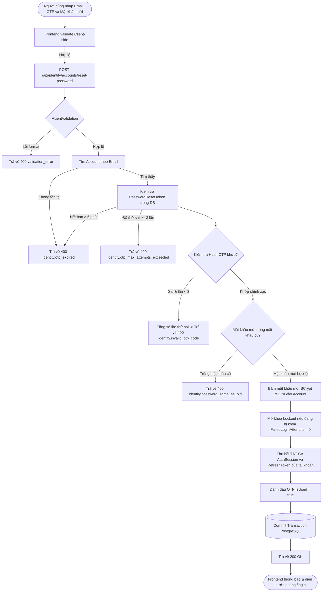
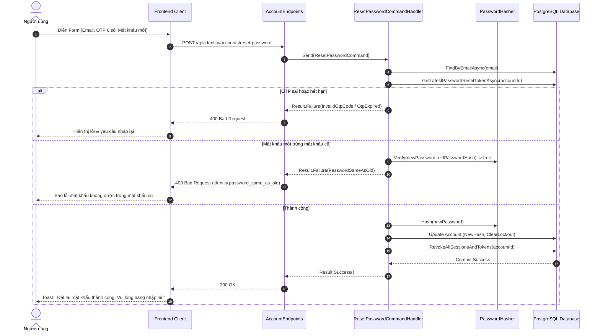

# Đặt Lại Mật Khẩu Bằng Mã OTP (Reset Password) — US-AUTH-006

## 1. Overview (Tổng quan)

Đặt lại mật khẩu mới cho tài khoản người dùng bằng cách xác thực mã OTP 6 chữ số đã được gửi qua email.  
Khi đặt lại mật khẩu thành công, hệ thống thực thi 3 hành động bảo mật cốt lõi:
1. **Mở khóa tài khoản ngay lập tức (Auto-Unlock):** Nếu tài khoản trước đó đang bị tạm khóa 15 phút do nhập sai mật khẩu 3 lần (`Lockout`), hệ thống sẽ gỡ bỏ trạng thái khóa ngay lập tức.
2. **Thu hồi phiên toàn diện (Global Session Revocation):** Hủy toàn bộ các phiên làm việc (`AuthSession`) và tất cả các Refresh Token đang hoạt động trên **mọi thiết bị** để đá văng bất kỳ kẻ xâm nhập nào ra khỏi tài khoản.
3. **Cấm trùng mật khẩu cũ:** Mật khẩu mới không được phép trùng với mật khẩu đang sử dụng trước đó (`identity.password_same_as_old`).

### Traceability (Tính truy vết):
- **Requirement:** `FR-AUTH-004`
- **User Story:** `US-AUTH-006 — Đặt lại mật khẩu bằng mã OTP`
- **Main Flow:** `MF-03 — Quên mật khẩu & Tự phục hồi`
- **Owner:** Identity Service / BE-1

---

## 2. API Specification (Thông số API)

| Thuộc tính | Chi tiết |
| :--- | :--- |
| **HTTP Method** | `POST` |
| **API URL** | `/api/identity/accounts/reset-password` |
| **Permission** | `N/A — Public / Anonymous` (Không yêu cầu đăng nhập) |
| **Content-Type** | `application/json` |
| **Accept** | `application/json` |

---

## 3. Request Sample & Schema (Yêu cầu đầu vào)

### 3.1. Request Body Mẫu
```json
{
  "email": "user@example.com",
  "otpCode": "654321",
  "newPassword": "NewSecurePassword#999"
}
```

### 3.2. Bảng Đặc Tả Chi Tiết Từng Trường (Request Body Schema)

| Tên trường (Field) | Kiểu dữ liệu | Phân loại | Giá trị mặc định | Ràng buộc Validation & Quy tắc kiểm tra (Source of Truth) |
| :--- | :---: | :---: | :---: | :--- |
| `email` | `string` | 🔴 **BẮT BUỘC** | *Không có* | - Địa chỉ email tài khoản.<br>- Không được để trống hoặc `null`.<br>- Tối đa **254 ký tự**.<br>- Hệ thống tự động `Trim().ToLowerInvariant()`.<br>- *Thông báo lỗi:* `"Email là bắt buộc, không được để trống."` / `"Email không đúng định dạng hợp lệ."` |
| `otpCode` | `string` | 🔴 **BẮT BUỘC** | *Không có* | - Chuỗi mã gồm **đúng 6 chữ số ASCII** (`^[0-9]{6}$`).<br>- Không được để trống, không chứa chữ cái hoặc ký tự đặc biệt.<br>- *Thông báo lỗi:* `"Mã OTP phải là một dãy số gồm đúng 6 chữ số."` |
| `newPassword` | `string` | 🔴 **BẮT BUỘC** | *Không có* | - Mật khẩu mới.<br>- Độ dài: **Tối thiểu 8 ký tự**, **Tối đa 72 bytes UTF-8**.<br>- Bắt buộc đủ 4 tiêu chí: chữ hoa, chữ thường, chữ số và ký tự đặc biệt.<br>- **Không được trùng với mật khẩu hiện tại**.<br>- *Thông báo lỗi:* `"Mật khẩu mới không được trùng với mật khẩu cũ."` |

---

## 4. Response Sample & Schema (Dữ liệu trả về)

### 4.1. HTTP Status: `200 OK`

```json
{
  "message": "Đặt lại mật khẩu thành công. Vui lòng đăng nhập lại bằng mật khẩu mới."
}
```

### 4.2. Bảng Thuộc Tính Phản Hồi (Response Schema)

| Trường (Field) | Kiểu dữ liệu | Phân loại | Ý nghĩa & Giá trị |
| :--- | :---: | :---: | :--- |
| `message` | `string` | 🟢 **LUÔN CÓ** | Thông điệp: `"Đặt lại mật khẩu thành công. Vui lòng đăng nhập lại bằng mật khẩu mới."` |

---

## 5. Validation & Testcase Scenarios (Ma trận Kiểm thử Đầy Đủ)

Đối soát trực tiếp từ bộ kiểm thử `PasswordResetValidatorTests.cs` và `PasswordResetIntegrationTests.cs`:

| Mã Test Case | HTTP Status | Mã lỗi (`errorCode`) | Điều kiện kích hoạt (Given - When) | Phản hồi thực tế (Then) |
| :--- | :---: | :--- | :--- | :--- |
| `TC-RST-01` | `200 OK` | *None* | `email`, `otpCode` và `newPassword` hợp lệ; tài khoản đang bị khóa tạm thời 15 phút. | Đổi hash mật khẩu; xóa Lockout ngay lập tức; đăng xuất mọi thiết bị; trả về `200 OK`. |
| `TC-VAL-01` | `400 Bad Request` | `validation_error` | `email` để trống hoặc sai định dạng RFC 5322. | `"Email là bắt buộc, không được để trống."` / `"Email không đúng định dạng hợp lệ."` |
| `TC-VAL-02` | `400 Bad Request` | `validation_error` | `otpCode` không đúng 6 chữ số (VD: `"12345"`, `"abcdef"`). | `"Mã OTP phải là một dãy số gồm đúng 6 chữ số."` |
| `TC-VAL-03` | `400 Bad Request` | `validation_error` | `newPassword` ngắn hơn 8 ký tự hoặc thiếu 1 trong 4 tiêu chí phức tạp. | Thông báo lỗi tiêu chí mật khẩu tương ứng. |
| `TC-VAL-04` | `400 Bad Request` | `validation_error` | `newPassword` dài hơn 72 bytes UTF-8. | `"Mật khẩu quá dài: tối đa 72 ký tự không dấu..."` |
| `TC-ERR-01` | `400 Bad Request` | `identity.password_same_as_old` | `newPassword` nhập vào trùng khớp với mật khẩu cũ của tài khoản. | `"Mật khẩu mới không được trùng với mật khẩu cũ."` |
| `TC-ERR-02` | `400 Bad Request` | `identity.invalid_otp_code` | Mã OTP nhập vào không khớp và số lần thử sai < 3. | `"Mã OTP không chính xác. Vui lòng kiểm tra lại."` |
| `TC-ERR-03` | `400 Bad Request` | `identity.otp_expired` | Mã OTP đã quá thời hạn 5 phút kể từ lúc gửi, hoặc tài khoản không tồn tại. | `"Mã OTP đã hết hạn hoặc không còn hiệu lực. Vui lòng yêu cầu mã OTP mới."` |
| `TC-ERR-04` | `400 Bad Request` | `identity.otp_max_attempts_exceeded` | Người dùng đã nhập sai liên tiếp **3 lần** (`MaxAttempts = 3`). Mã bị hủy ngay lập tức. | `"Bạn đã nhập sai mã OTP 3 lần nên mã này không còn dùng được. Vui lòng yêu cầu mã mới."` |

---

## 6. Activity Diagram (Sơ đồ luồng hoạt động)



---

## 7. Sequence Diagram (Sơ đồ tuần tự tương tác)



---

## 8. Frontend Integration Guide (Hướng dẫn Tích hợp)

```typescript
export interface ResetPasswordRequest {
  // 🔴 [BẮT BUỘC]
  email: string;
  otpCode: string;   // Đúng 6 số ASCII
  newPassword: string; // Tối thiểu 8 ký tự, đủ hoa/thường/số/đặc biệt
}

export const resetPassword = async (payload: ResetPasswordRequest): Promise<void> => {
  await axios.post(
    `${process.env.NEXT_PUBLIC_API_URL || 'http://localhost:5000'}/api/identity/accounts/reset-password`,
    payload
  );
  window.location.href = '/login';
};
```
