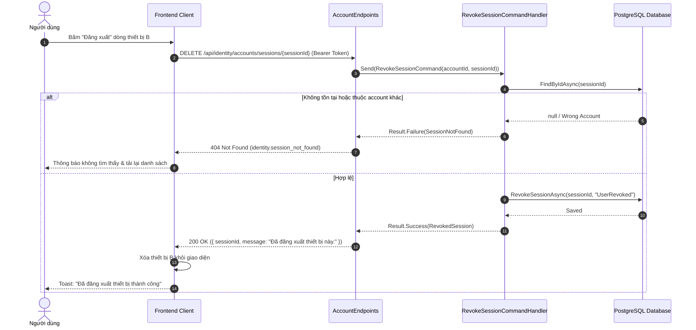

# Thu Hồi Phiên / Đăng Xuất Thiết Bị Từ Xa (Revoke Session) — US-AUTH-005

## 1. Overview (Tổng quan)

Đăng xuất tài khoản từ xa trên một thiết bị cụ thể bằng cách thu hồi phiên làm việc `sessionId`.  
Hệ thống vô hiệu hóa ngay lập tức `AuthSession` và Refresh Token tương ứng của thiết bị đó. Khi thiết bị đó cố gắng gửi request làm mới token tiếp theo, nó sẽ nhận lỗi `401 identity.session_revoked` và bị buộc phải đăng xuất.

### Cơ Chế An Toàn Chống Tấn Công IDOR (Insecure Direct Object Reference):
- Nếu `sessionId` không tồn tại HOẶC thuộc về một tài khoản của người dùng khác, Backend **luôn trả về cùng một mã lỗi `404 identity.session_not_found`** để tuyệt đối không làm lộ định danh phiên của người khác.
- Nếu người dùng thu hồi đúng phiên hiện tại của chính mình (`isCurrent == true`), Backend tự động xóa sạch Cookie `sp_refresh`.

### Traceability (Tính truy vết):
- **Requirement:** `FR-AUTH-003`
- **User Story:** `US-AUTH-005 — Thu hồi phiên làm việc từ xa`
- **Main Flow:** `MF-02 — Đăng nhập & Duy trì phiên làm việc`
- **Owner:** Identity Service / BE-1

---

## 2. API Specification (Thông số API)

| Thuộc tính | Chi tiết |
| :--- | :--- |
| **HTTP Method** | `DELETE` |
| **API URL** | `/api/identity/accounts/sessions/{sessionId}` |
| **Permission** | 🔴 **Bearer JWT** (Yêu cầu Access Token của tài khoản) |
| **Accept** | `application/json` |

---

## 3. Request Sample & Schema (Yêu cầu đầu vào)

### 3.1. Request Headers & Route Parameters

| Tham số / Header | Phân loại | Vị trí | Kiểu dữ liệu | Giải thích |
| :--- | :---: | :---: | :---: | :--- |
| `Authorization` | 🔴 **BẮT BUỘC** | Header | `string` | `Bearer <access_token>` |
| `sessionId` | 🔴 **BẮT BUỘC** | Path | `string (UUID)` | ID của phiên cần thu hồi (lấy từ trường `id` trong API danh sách sessions). |

### 3.2. Request Body: ❌ **KHÔNG CÓ BODY (Request DELETE)**

---

## 4. Response Sample & Schema (Dữ liệu trả về)

### 4.1. HTTP Status: `200 OK`

```json
{
  "sessionId": "e7c65432-d123-4a56-8bc9-f123456789ab",
  "message": "Đã đăng xuất thiết bị này."
}
```

### 4.2. Bảng Thuộc Tính Phản Hồi (Response Schema)

| Trường (Field) | Kiểu dữ liệu | Phân loại | Ý nghĩa & Giá trị |
| :--- | :---: | :---: | :--- |
| `sessionId` | `string (UUID)` | 🟢 **LUÔN CÓ** | ID của phiên vừa bị thu hồi |
| `message` | `string` | 🟢 **LUÔN CÓ** | Thông điệp: `"Đã đăng xuất thiết bị này."` |

---

## 5. Validation & Testcase Scenarios (Ma trận Kiểm thử Đầy Đủ)

Đối soát trực tiếp từ bộ kiểm thử `SessionsAndAdminAccountsTests.cs`:

| Mã Test Case | HTTP Status | Mã lỗi (`errorCode`) | Điều kiện kích hoạt (Given - When) | Phản hồi thực tế (Then) |
| :--- | :---: | :--- | :--- | :--- |
| `TC-REV-01` | `200 OK` | *None* | `sessionId` hợp lệ, thuộc quyền sở hữu của người dùng hiện tại và là thiết bị khác (`isCurrent == false`). | Thu hồi phiên và RefreshToken của thiết bị đó; trả về `200 OK`; danh sách phiên của người dùng giảm 1 thiết bị. |
| `TC-REV-02` | `200 OK` | *None* | `sessionId` bị thu hồi chính là thiết bị hiện tại của người dùng (`isCurrent == true`). | Thu hồi phiên; tự động phát hành chỉ thị xóa Cookie `sp_refresh`; Frontend coi như đã đăng xuất. |
| `TC-ERR-01` | `404 Not Found` | `identity.session_not_found` | `sessionId` không tồn tại trong hệ thống (hoặc đã bị xóa từ trước). | `"Không tìm thấy phiên đăng nhập này."` |
| `TC-ERR-02` | `404 Not Found` | `identity.session_not_found` | `sessionId` có tồn tại trong hệ thống nhưng thuộc về tài khoản của **người dùng khác** (Cố tình dò quét IDOR). | Trả về `404 Not Found` với câu thông báo y hệt để che giấu sự tồn tại của phiên người khác. |
| `TC-ERR-03` | `401 Unauthorized` | *Standard HTTP 401* | Thiếu Bearer Token hoặc Token đã hết hạn. | `"Unauthorized"` |

---

## 6. Activity Diagram (Sơ đồ luồng hoạt động)

```mermaid
flowchart TD
    A([Người dùng nhấn Đăng xuất một thiết bị]) --> B[DELETE /api/identity/accounts/sessions/{sessionId}]
    B --> C{Kiểm tra Bearer Token?}
    C -->|Thiếu / Hết hạn| D[Trả về 401 Unauthorized]
    C -->|Hợp lệ| E[Tìm AuthSession theo sessionId trong DB]
    E -->|Không tìm thấy| F[Trả về 404 identity.session_not_found]
    E -->|Tìm thấy| G{session.AccountId == currentUser.AccountId?}
    G -->|Khác Account - Nghi vấn IDOR| F
    G -->|Đúng Account| H[Thu hồi AuthSession với lý do UserRevoked]
    H --> I[Thu hồi toàn bộ RefreshToken của Session này]
    I --> J{sessionId == CurrentSessionId?}
    J -->|Đúng là thiết bị này| K[Xóa Cookie sp_refresh]
    J -->|Thiết bị khác| L[Giữ nguyên Cookie thiết bị này]
    K --> M[Trả về 200 OK]
    L --> M
    M --> N([Frontend cập nhật lại danh sách thiết bị])
```

---

## 7. Sequence Diagram (Sơ đồ tuần tự tương tác)



---

## 8. Frontend Integration Guide (Hướng dẫn Tích hợp)

```typescript
export interface RevokedSessionResponse {
  sessionId: string; // 🟢 [LUÔN CÓ]
  message: string;   // 🟢 [LUÔN CÓ]
}

export const revokeSession = async (sessionId: string): Promise<RevokedSessionResponse> => {
  const response = await api.delete<RevokedSessionResponse>(`/api/identity/accounts/sessions/${sessionId}`);
  return response.data;
};
```
