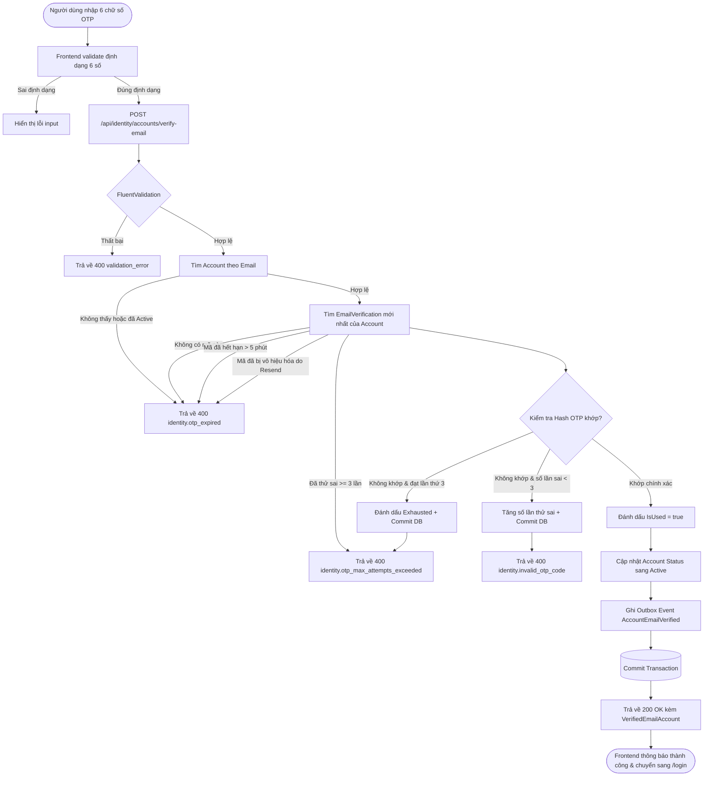
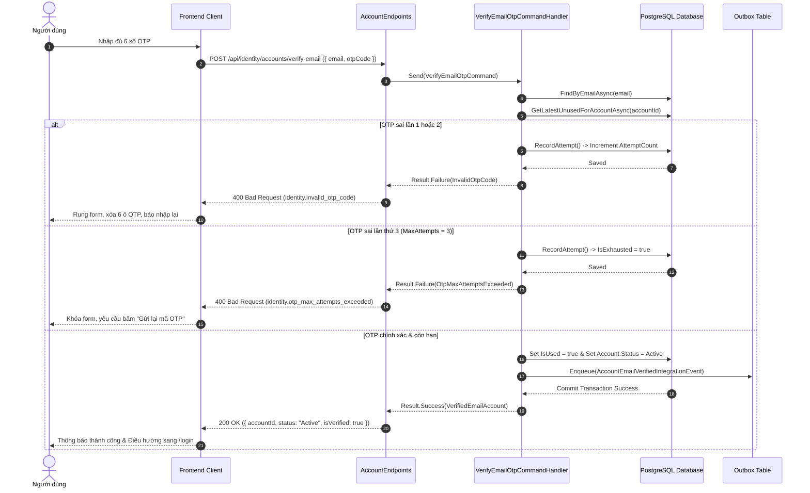

# Xác Thực Email Bằng Mã OTP — US-AUTH-003

## 1. Overview (Tổng quan)

Xác thực mã OTP 6 chữ số do người dùng nhập từ email sau khi đăng ký tài khoản.  
Khi xác thực thành công, tài khoản chuyển từ trạng thái `PendingVerification` sang `Active` (hoặc `EmailVerified`), đánh dấu quyền đăng nhập hợp lệ và phát hành Outbox Integration Event `identity.account-email-verified.v1`.

### Traceability (Tính truy vết):
- **Requirement:** `FR-AUTH-002`
- **User Story:** `US-AUTH-003 — Xác thực email bằng OTP`
- **Main Flow:** `MF-01 — Đăng ký & Kích hoạt tài khoản`
- **Owner:** Identity Service / BE-1

---

## 2. API Specification (Thông số API)

| Thuộc tính | Chi tiết |
| :--- | :--- |
| **HTTP Method** | `POST` |
| **API URL** | `/api/identity/accounts/verify-email` |
| **Permission** | `N/A — Public / Anonymous` (Không yêu cầu đăng nhập) |
| **Content-Type** | `application/json` |
| **Accept** | `application/json` |

---

## 3. Request Sample & Schema (Yêu cầu đầu vào)

### 3.1. Request Body Mẫu
```json
{
  "email": "user@example.com",
  "otpCode": "123456"
}
```

### 3.2. Bảng Đặc Tả Chi Tiết Từng Trường (Request Body Schema)

| Tên trường (Field) | Kiểu dữ liệu | Phân loại | Giá trị mặc định | Ràng buộc Validation & Quy tắc kiểm tra (Source of Truth) |
| :--- | :---: | :---: | :---: | :--- |
| `email` | `string` | 🔴 **BẮT BUỘC** | *Không có* | - Địa chỉ email của tài khoản cần kích hoạt.<br>- Không được để trống hoặc `null`.<br>- Tối đa **254 ký tự**.<br>- Hệ thống tự động `Trim()` và chuyển thành chữ thường (`ToLowerInvariant`).<br>- *Thông báo lỗi:* `"Email là bắt buộc, không được để trống."` / `"Email không đúng định dạng hợp lệ."` |
| `otpCode` | `string` | 🔴 **BẮT BUỘC** | *Không có* | - Chuỗi mã xác thực gồm **đúng 6 chữ số ASCII** (`^[0-9]{6}$`).<br>- Không được để trống, không chứa chữ cái, khoảng trắng hoặc ký tự đặc biệt.<br>- Không chấp nhận chữ số Unicode (VD: chữ số Ả Rập `١٢٣٤٥٦`).<br>- *Thông báo lỗi:* `"Mã OTP là bắt buộc, không được để trống."` / `"Mã OTP phải là một dãy số gồm đúng 6 chữ số."` |

---

## 4. Response Sample & Schema (Dữ liệu trả về)

### 4.1. HTTP Status: `200 OK`

```json
{
  "accountId": "a3bb108e-17d4-4a6c-9f87-2a54e9912345",
  "email": "user@example.com",
  "status": "Active",
  "isVerified": true,
  "message": "Xác thực email thành công. Bạn có thể đăng nhập ngay."
}
```

### 4.2. Bảng Thuộc Tính Phản Hồi (Response Schema)

| Trường (Field) | Kiểu dữ liệu | Phân loại | Ý nghĩa & Ví dụ |
| :--- | :---: | :---: | :--- |
| `accountId` | `string (UUID)` | 🟢 **LUÔN CÓ** | Định danh duy nhất của tài khoản đã được kích hoạt (`"a3bb108e-17d4-4a6c-9f87-2a54e9912345"`) |
| `email` | `string` | 🟢 **LUÔN CÓ** | Email của tài khoản (`"user@example.com"`) |
| `status` | `string` | 🟢 **LUÔN CÓ** | Trạng thái mới của tài khoản: `"Active"` (hoặc `"EmailVerified"`) |
| `isVerified` | `boolean` | 🟢 **LUÔN CÓ** | Luôn mang giá trị `true` |
| `message` | `string` | 🟢 **LUÔN CÓ** | Thông báo thành công: `"Xác thực email thành công. Bạn có thể đăng nhập ngay."` |

---

## 5. Validation & Testcase Scenarios (Ma trận Kiểm thử Đầy Đủ)

Đối soát trực tiếp từ bộ kiểm thử `EmailOtpTests.cs` và `AccountEndpointsHttpTests.cs`:

| Mã Test Case | HTTP Status | Mã lỗi (`errorCode`) | Điều kiện kích hoạt (Given - When) | Phản hồi thực tế (Then) |
| :--- | :---: | :--- | :--- | :--- |
| `TC-VER-01` | `200 OK` | *None* | `email` và `otpCode` chính xác, mã còn hạn (< 5 phút), số lần sai < 3. | Trả về `VerifiedEmailAccount`, cập nhật tài khoản sang `Active`, đánh dấu `IsUsed = true`, gửi event Outbox. |
| `TC-VER-02` | `200 OK` | *None* | `email` có khoảng trắng thừa hoặc lẫn chữ hoa (`"  User@Example.COM "`). | Backend tự chuẩn hóa `Trim().ToLowerInvariant()`, xác thực thành công bình thường. |
| `TC-VAL-01` | `400 Bad Request` | `validation_error` | `email` để trống hoặc sai định dạng RFC 5322. | `"Email là bắt buộc, không được để trống."` / `"Email không đúng định dạng hợp lệ."` |
| `TC-VAL-02` | `400 Bad Request` | `validation_error` | `otpCode` ít hơn 6 ký tự (VD: `"12345"`) hoặc để trống `""`. | `"Mã OTP phải là một dãy số gồm đúng 6 chữ số."` |
| `TC-VAL-03` | `400 Bad Request` | `validation_error` | `otpCode` nhiều hơn 6 ký tự (VD: `"1234567"`). | `"Mã OTP phải là một dãy số gồm đúng 6 chữ số."` |
| `TC-VAL-04` | `400 Bad Request` | `validation_error` | `otpCode` chứa chữ cái hoặc ký tự đặc biệt (VD: `"abcdef"`). | `"Mã OTP phải là một dãy số gồm đúng 6 chữ số."` |
| `TC-VAL-05` | `400 Bad Request` | `validation_error` | `otpCode` chứa chữ số Unicode Ả Rập-Ấn Độ (`"١٢٣٤٥٦"`). | `"Mã OTP phải là một dãy số gồm đúng 6 chữ số."` (Chỉ chấp nhận ASCII `0-9`). |
| `TC-ERR-01` | `400 Bad Request` | `identity.invalid_otp_code` | Mã OTP nhập vào không khớp và số lần sai hiện tại < 3. | `"Mã OTP không chính xác. Vui lòng kiểm tra lại."` (Hệ thống ghi nhận tăng 1 lần thử sai). |
| `TC-ERR-02` | `400 Bad Request` | `identity.otp_expired` | Mã OTP đã quá thời hạn 5 phút kể từ lúc gửi, hoặc tài khoản không tồn tại, hoặc tài khoản đã kích hoạt rồi. | `"Mã OTP đã hết hạn hoặc không còn hiệu lực. Vui lòng yêu cầu mã OTP mới."` |
| `TC-ERR-03` | `400 Bad Request` | `identity.otp_max_attempts_exceeded` | Người dùng đã nhập sai liên tiếp **3 lần** (`MaxAttempts = 3`). Mã OTP lập tức bị vô hiệu hóa vĩnh viễn. | `"Bạn đã nhập sai mã OTP 3 lần nên mã này không còn dùng được. Vui lòng yêu cầu mã mới."` |
| `TC-ERR-04` | `400 Bad Request` | `identity.otp_expired` | Người dùng bấm "Gửi lại mã OTP" và nhập lại mã OTP cũ trước đó. | `"Mã OTP đã hết hạn hoặc không còn hiệu lực. Vui lòng yêu cầu mã OTP mới."` (Mã cũ đã bị thay thế). |

---

## 6. Activity Diagram (Sơ đồ luồng hoạt động)



---

## 7. Sequence Diagram (Sơ đồ tuần tự tương tác)



---

## 8. Frontend Integration Guide (Hướng dẫn Tích hợp)

### 8.1. TypeScript Interface Definitions

```typescript
export interface VerifyEmailRequest {
  // 🔴 [BẮT BUỘC]
  email: string;
  otpCode: string; // Đúng 6 chữ số: ^[0-9]{6}$
}

export interface VerifiedEmailResponse {
  accountId: string;          // 🟢 [LUÔN CÓ] UUID
  email: string;              // 🟢 [LUÔN CÓ]
  status: 'Active';           // 🟢 [LUÔN CÓ]
  isVerified: true;           // 🟢 [LUÔN CÓ]
  message: string;            // 🟢 [LUÔN CÓ]
}
```

### 8.2. Axios Calling Function Mẫu

```typescript
import axios from 'axios';

export const verifyEmailOtp = async (payload: VerifyEmailRequest): Promise<VerifiedEmailResponse> => {
  const response = await axios.post<VerifiedEmailResponse>(
    `${process.env.NEXT_PUBLIC_API_URL || 'http://localhost:5000'}/api/identity/accounts/verify-email`,
    payload,
    {
      headers: {
        'Content-Type': 'application/json',
      },
    }
  );
  return response.data;
};
```

### 8.3. UI/UX Checklist Cho Màn Hình Nhập OTP (`/verify-otp`)

- [ ] **Component 6 ô OTP:**
  - Tự động nhảy con trỏ sang ô tiếp theo khi người dùng gõ xong 1 chữ số.
  - Tự động lùi về ô trước khi người dùng nhấn `Backspace`.
  - Hỗ trợ sự kiện `Paste`: Khi dán chuỗi 6 số từ clipboard, tự động phân tách điền đầy đủ cả 6 ô.
  - Tự động trigger hàm gọi API ngay khi ô thứ 6 vừa được nhập xong (không cần bắt người dùng bấm nút Submit).
- [ ] **Xử lý mã lỗi `identity.invalid_otp_code`:**
  - Hiệu ứng rung nhẹ (Shake animation) cả cụm 6 ô nhập.
  - Tự động xóa trắng dữ liệu và focus lại ô đầu tiên.
- [ ] **Xử lý mã lỗi `identity.otp_max_attempts_exceeded`:**
  - Vô hiệu hóa (disable) cả 6 ô nhập.
  - Hiển thị thông báo cảnh báo màu đỏ: *"Bạn đã nhập sai 3 lần. Mã OTP này đã bị hủy. Vui lòng bấm 'Gửi lại mã OTP' để nhận mã mới."*
- [ ] **Thành công (`200 OK`):**
  - Hiển thị Toast xanh: *"Kích hoạt tài khoản thành công! Đang chuyển hướng..."*.
  - Điều hướng sang trang `/login` sau 1.5 giây.
