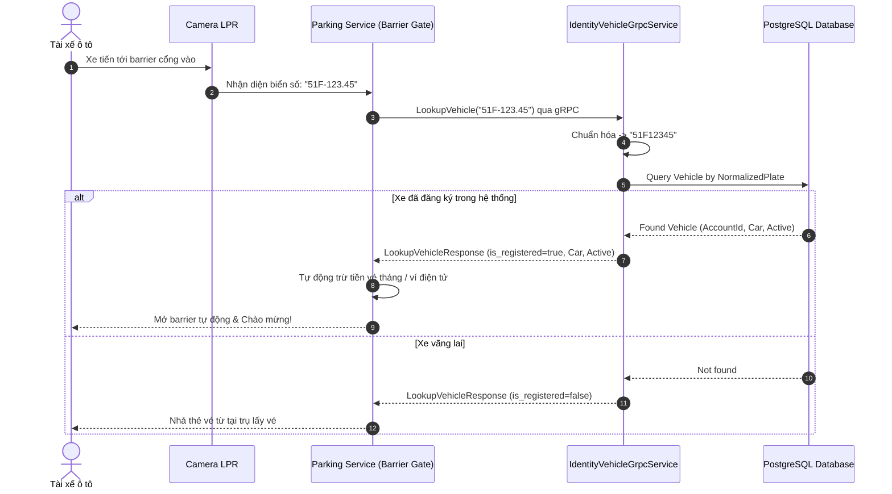

# Tra Cứu Xe Qua Biển Số (gRPC Vehicle Lookup) — gRPC Inter-Service Contract

## 1. Overview (Tổng quan)

Hợp đồng giao tiếp nội bộ qua giao thức **gRPC (HTTP/2 Binary Protocol)** giữa các microservices (đặc biệt là **Parking Service** khi xe ra vào cổng bãi đỗ) và **Identity Service**.  
Cung cấp khả năng tra cứu tức thời thông tin chủ phương tiện và loại phương tiện từ chuỗi ký tự biển số quét được qua camera nhận diện biển số (ANPR / LPR).

### ⚙️ Cơ Chế Chuẩn Hóa Biển Số (License Plate Normalization):
- Biển số gửi lên sẽ được đi qua bộ chuẩn hóa `ILicensePlateNormalizer`:
  - Loại bỏ toàn bộ dấu chấm (`.`), gạch nối (`-`), khoảng trắng (` `).
  - Chuyển toàn bộ thành chữ in hoa (`ToUpperInvariant()`).
  - Ví dụ: `"51F-123.45"` $\rightarrow$ `"51F12345"`, `"29A 888.88"` $\rightarrow$ `"29A88888"`.
- Giúp việc khớp dữ liệu giữa camera OCR và cơ sở dữ liệu luôn chính xác 100%.

### Traceability (Tính truy vết):
- **Requirement:** `FR-VEH-002`
- **Use Case:** Tra cứu xe vào/ra bãi đỗ tự động (Smart In-Out Gate)
- **Callers:** `Parking Service`, `Booking Service`
- **Owner:** Identity Service / BE-1

---

## 2. Service Specification (Thông số gRPC Service)

| Thuộc tính | Chi tiết |
| :--- | :--- |
| **Giao thức** | `gRPC (HTTP/2 with Protobuf)` |
| **Package** | `smartparking.identity.vehicle.v1` |
| **Service Name** | `IdentityVehicleContract` |
| **RPC Method** | `LookupVehicle(LookupVehicleRequest) returns (LookupVehicleResponse)` |
| **Port triển khai** | `8081` (HTTP/2 không TLS), chỉ trong mạng `parking-network`; không publish ra host |
| **Bảo mật** | Mạng nội bộ; header `X-Service-Key` khi `ServiceAuth:ServiceKey` có giá trị (thiếu hoặc sai khóa: HTTP 403) |

---

## 3. Protobuf Definition (Định nghĩa Protobuf Schema)

```protobuf
syntax = "proto3";

package smartparking.identity.vehicle.v1;

option csharp_namespace = "SmartParking.Contracts.Identity.Vehicle.V1";

service IdentityVehicleContract {
  rpc LookupVehicle(LookupVehicleRequest)
      returns (LookupVehicleResponse);
}

message LookupVehicleRequest {
  // Raw plate as read at the gate; Identity normalizes it (trim, uppercase,
  // remove whitespace, '-' and '.'). Empty or malformed -> INVALID_ARGUMENT.
  string license_plate = 1;
}

// Unknown but well-formed plate -> OK with is_registered = false (never NOT_FOUND).
message LookupVehicleResponse {
  bool is_registered = 1;

  // Canonical lowercase UUID "D" format (36 chars) when registered.
  // Empty string ("") when is_registered == false.
  string account_id = 2;

  // Canonical lowercase UUID "D" format (36 chars) when registered.
  // Empty string ("") when is_registered == false.
  string vehicle_id = 3;

  // Field 4 was owner_full_name; dropped (Parking only needs ids, personal data stays in Identity).
  reserved 4;
  reserved "owner_full_name";

  VehicleType vehicle_type = 5;

  // true only when the owner account status is EmailVerified; false when the
  // account is PendingEmailVerification, Suspended, Disabled or is_registered == false.
  // Identity only reports the state; Parking decides what to do with it.
  bool is_account_active = 6;
}

enum VehicleType {
  VEHICLE_TYPE_UNSPECIFIED = 0;
  VEHICLE_TYPE_CAR = 1;
  VEHICLE_TYPE_MOTORBIKE = 2;
}
```

Nguồn chuẩn là `contracts/grpc/identity_vehicle.proto`; khi lệch nhau thì file đó đúng.

---

## 4. Response Mapping Rules (Quy tắc Ánh xạ Phản hồi)

### 4.1. Trường Hợp Xe ĐÃ ĐĂNG KÝ Trong Hệ Thống (`is_registered = true`)
- `is_registered`: `true`
- `account_id`: `"a3bb108e-17d4-4a6c-9f87-2a54e9912345"` (Chuỗi UUID 36 ký tự viết thường)
- `vehicle_id`: `"c9b578e2-f472-4b2a-8bc2-a1b948f93e12"`
- `vehicle_type`: `VEHICLE_TYPE_CAR` (1) hoặc `VEHICLE_TYPE_MOTORBIKE` (2)
- `is_account_active`: `true` nếu tài khoản `EmailVerified`, `false` nếu tài khoản `PendingEmailVerification`, `Suspended` hoặc `Disabled`.

### 4.2. Trường Hợp Xe CHƯA ĐĂNG KÝ (Khách vãng lai chưa cài App):
- `is_registered`: `false`
- `vehicle_type`: `VEHICLE_TYPE_UNSPECIFIED` (0)
- Các trường `account_id`, `vehicle_id` trả về rỗng `""`.
- Cổng bãi đỗ sẽ tự động chuyển sang chế độ phát vé thẻ từ cho khách vãng lai.

---

## 5. Error Code Matrix (Bảng Mã Lỗi gRPC)

| gRPC Status Code | Mã lỗi nội bộ (`ErrorCode`) | Điều kiện kích hoạt | Xử lý khuyến nghị phía Caller (Parking Service) |
| :--- | :--- | :--- | :--- |
| `INVALID_ARGUMENT` (3) | `identity.empty_license_plate` | Tham số `license_plate` gửi lên rỗng hoặc toàn khoảng trắng. | Parking: mở phiên không gắn tài khoản, xem mục 8. |
| `INVALID_ARGUMENT` (3) | `identity.invalid_license_plate_format` | Biển số chứa các ký tự đặc biệt không thể chuẩn hóa thành biển số Việt Nam. | Parking: mở phiên không gắn tài khoản, xem mục 8. |
| `CANCELLED` (1) | *N/A* | Timeout / Caller chủ động hủy request do xe đã di chuyển. | Ghi log hủy request. |
| `INTERNAL` (13) | `identity.vehicle_lookup_failed` | Lỗi kết nối DB hoặc lỗi không xác định trên Identity Service. | Parking: không retry vì cổng không chờ được; mở phiên không gắn tài khoản, xem mục 8. |

---

## 6. Sequence Diagram (Sơ đồ tương tác gRPC)



---

## 7. Client Integration Guide (Ví dụ Gọi gRPC từ .NET C#)

Đoạn mã mẫu sử dụng gRPC Client được inject qua HttpClient Factory:

```csharp
using Grpc.Core;
using SmartParking.Contracts.Identity.Vehicle.V1;

public class ParkingBarrierService(
    IdentityVehicleContract.IdentityVehicleContractClient vehicleClient,
    ILogger<ParkingBarrierService> logger)
{
    public async Task ProcessVehicleEntryAsync(string rawPlate, CancellationToken cancellationToken)
    {
        try
        {
            var request = new LookupVehicleRequest { LicensePlate = rawPlate };
            var response = await vehicleClient.LookupVehicleAsync(
                request, 
                deadline: DateTime.UtcNow.AddSeconds(2), 
                cancellationToken: cancellationToken);

            if (response.IsRegistered && response.IsAccountActive)
            {
                logger.LogInformation("Xe đã đăng ký của chủ xe {AccountId}. Mở barrier!", response.AccountId);
                // Mở thanh chắn tự động
            }
            else
            {
                logger.LogInformation("Xe vãng lai {Plate}. Kích hoạt trụ phát thẻ từ.", rawPlate);
                // Phát thẻ từ
            }
        }
        catch (RpcException ex) when (ex.StatusCode == StatusCode.InvalidArgument)
        {
            logger.LogWarning("Biển số không hợp lệ: {Message}", ex.Status.Detail);
        }
    }
}
```

---

## 8. Parking client (hợp đồng 1)

Cài đặt thật nằm ở `src/Services/Parking/Parking.WebAPI/Grpc/IdentityVehicleGrpcClient.cs`, gắn vào cổng `IPlateOwnerLookup` của Parking Application. `OpenParkingSessionCommand` gọi nó trước khi mở transaction mở phiên.

| Mục | Hành vi |
| :--- | :--- |
| Cấu hình | `IdentityService:GrpcEndpoint` (mặc định `http://identity-api:8081`) và `IdentityService:TimeoutSeconds` (mặc định 2, từ 1 đến 30). Cấu hình sai thì host không khởi động. |
| Khóa dịch vụ | Gửi header `X-Service-Key` khi `ServiceAuth:ServiceKey` có giá trị. |
| Khớp | Chỉ khi `is_registered` và `is_account_active` cùng `true` và cả hai mã là UUID khác rỗng. Phiên đỗ được gắn `UserId` và `VehicleId` để ghi lịch sử và tính phí (BR-05.f); đây không phải xác thực. |
| Không khớp | Biển chưa đăng ký, chủ xe chưa xác thực email, bị khóa hoặc vô hiệu, hoặc phản hồi thiếu mã: phiên đỗ mở không gắn tài khoản (BR-05.e) và nhân viên đưa vé in QR (BR-11.b). |
| Lỗi | Mọi lỗi gRPC và quá hạn: mở phiên không gắn tài khoản, không retry. Mức log: `INVALID_ARGUMENT` là Information, `UNAVAILABLE` và `DEADLINE_EXCEEDED` là Warning, còn lại là Error (ví dụ `PERMISSION_DENIED` do sai khóa dịch vụ). Phiên đã mở không được gắn lại sau đó. |
| Hủy | Request bị caller hủy thì use case dừng, không mở phiên. |
| Dữ liệu cá nhân | Biển số, mã tài khoản và mã xe không được ghi log; chỉ ghi mã trạng thái gRPC. |
