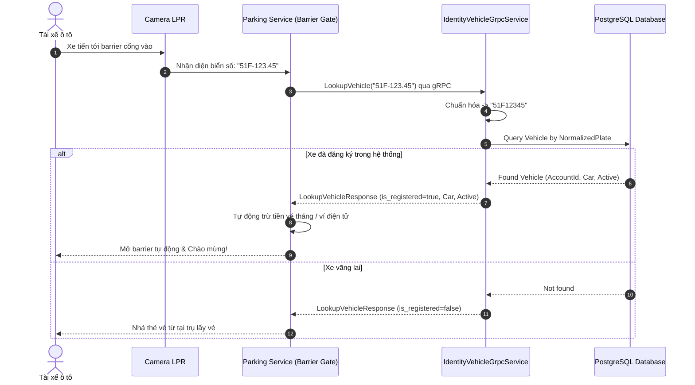

# Tra Cứu Xe Qua Biển Số (gRPC Vehicle Lookup) — gRPC Inter-Service Contract

## 1. Overview (Tổng quan)

Hợp đồng giao tiếp nội bộ qua giao thức **gRPC (HTTP/2 Binary Protocol)** giữa các microservices (đặc biệt là **Parking Service** khi xe ra vào cổng bãi đỗ) và **Identity Service**.  
Cung cấp khả năng tra cứu tức thời thông tin chủ phương tiện và loại phương tiện từ chuỗi ký tự biển số quét được qua camera nhận diện biển số (ANPR / LPR).

### ⚙️ Cơ Chế Chuẩn Hóa Biển Số (License Plate Normalization):
- Biển số gửi lên sẽ được đi qua bộ chuẩn hóa `ILicensePlateNormalizer`:
  - Loại bỏ toàn bộ dấu chấm (`.`), gạch nối (`-`), khoảng trắng (` `).
  - Chuyển toàn bộ thành chữ in hoa (`ToUpperInvariant()`).
  - Ví dụ: `"51F-123.45"` $\rightarrow$ `"51F12345"`, `"29A 888.88"` $\rightarrow$ `"29A88888"`.
- Giúp việc khớp dữ liệu giữa camera OCR và cơ sở dữ liệu luôn chính xác 100%.

### Traceability (Tính truy vết):
- **Requirement:** `FR-VEH-002`
- **Use Case:** Tra cứu xe vào/ra bãi đỗ tự động (Smart In-Out Gate)
- **Callers:** `Parking Service`, `Booking Service`
- **Owner:** Identity Service / BE-1

---

## 2. Service Specification (Thông số gRPC Service)

| Thuộc tính | Chi tiết |
| :--- | :--- |
| **Giao thức** | `gRPC (HTTP/2 with Protobuf)` |
| **Package** | `smartparking.identity.vehicle.v1` |
| **Service Name** | `IdentityVehicleContract` |
| **RPC Method** | `LookupVehicle(LookupVehicleRequest) returns (LookupVehicleResponse)` |
| **Port triển khai** | Nội bộ Cluster (`5001` / gRPC Port) |
| **Bảo mật** | Internal mTLS / Service-to-Service Network |

---

## 3. Protobuf Definition (Định nghĩa Protobuf Schema)

```protobuf
syntax = "proto3";

package smartparking.identity.vehicle.v1;

option csharp_namespace = "SmartParking.Contracts.Identity.Vehicle.V1";

// Hợp đồng dịch vụ tra cứu xe của Identity Service
service IdentityVehicleContract {
  // Tra cứu thông tin xe và chủ sở hữu dựa trên biển số xe
  rpc LookupVehicle (LookupVehicleRequest) returns (LookupVehicleResponse);
}

// Request tra cứu xe
message LookupVehicleRequest {
  // Biển số xe quét được từ camera hoặc nhập tay (VD: "51F-123.45" hoặc "51F12345")
  string license_plate = 1;
}

// Loại phương tiện trong hệ thống
enum VehicleType {
  VEHICLE_TYPE_UNSPECIFIED = 0;
  VEHICLE_TYPE_CAR = 1;        // Xe ô tô
  VEHICLE_TYPE_MOTORBIKE = 2; // Xe máy
}

// Response thông tin phương tiện
message LookupVehicleResponse {
  // Xe đã được đăng ký trong hệ thống hay chưa
  bool is_registered = 1;

  // ID của tài khoản chủ sở hữu xe (Guid định dạng "D" - 36 ký tự)
  string account_id = 2;

  // ID của xe trong cơ sở dữ liệu
  string vehicle_id = 3;

  // Phân loại xe (Ô tô hoặc Xe máy)
  VehicleType vehicle_type = 4;

  // Trạng thái tài khoản của chủ xe có đang hoạt động hay không
  bool is_account_active = 5;
}
```

---

## 4. Response Mapping Rules (Quy tắc Ánh xạ Phản hồi)

### 4.1. Trường Hợp Xe ĐÃ ĐĂNG KÝ Trong Hệ Thống (`is_registered = true`)
- `is_registered`: `true`
- `account_id`: `"a3bb108e-17d4-4a6c-9f87-2a54e9912345"` (Chuỗi UUID 36 ký tự viết thường)
- `vehicle_id`: `"c9b578e2-f472-4b2a-8bc2-a1b948f93e12"`
- `vehicle_type`: `VEHICLE_TYPE_CAR` (1) hoặc `VEHICLE_TYPE_MOTORBIKE` (2)
- `is_account_active`: `true` nếu tài khoản `EmailVerified`, `false` nếu tài khoản bị `Suspended` / `Disabled`.

### 4.2. Trường Hợp Xe CHƯA ĐĂNG KÝ (Khách vãng lai chưa cài App):
- `is_registered`: `false`
- `vehicle_type`: `VEHICLE_TYPE_UNSPECIFIED` (0)
- Các trường `account_id`, `vehicle_id` trả về rỗng `""`.
- Cổng bãi đỗ sẽ tự động chuyển sang chế độ phát vé thẻ từ cho khách vãng lai.

---

## 5. Error Code Matrix (Bảng Mã Lỗi gRPC)

| gRPC Status Code | Mã lỗi nội bộ (`ErrorCode`) | Điều kiện kích hoạt | Xử lý khuyến nghị phía Caller (Parking Service) |
| :--- | :--- | :--- | :--- |
| `INVALID_ARGUMENT` (3) | `identity.empty_license_plate` | Tham số `license_plate` gửi lên rỗng hoặc toàn khoảng trắng. | Báo lỗi camera OCR không nhận dạng được chuỗi ký tự. |
| `INVALID_ARGUMENT` (3) | `identity.invalid_license_plate_format` | Biển số chứa các ký tự đặc biệt không thể chuẩn hóa thành biển số Việt Nam. | Yêu cầu nhân viên bảo vệ chụp lại hoặc nhập tay. |
| `CANCELLED` (1) | *N/A* | Timeout / Caller chủ động hủy request do xe đã di chuyển. | Ghi log hủy request. |
| `INTERNAL` (13) | `identity.vehicle_lookup_failed` | Lỗi kết nối DB hoặc lỗi không xác định trên Identity Service. | Retry với cơ chế Polly Exponential Backoff (3 lần). |

---

## 6. Sequence Diagram (Sơ đồ tương tác gRPC)



---

## 7. Client Integration Guide (Ví dụ Gọi gRPC từ .NET C#)

Đoạn mã mẫu sử dụng gRPC Client được inject qua HttpClient Factory:

```csharp
using Grpc.Core;
using SmartParking.Contracts.Identity.Vehicle.V1;

public class ParkingBarrierService(
    IdentityVehicleContract.IdentityVehicleContractClient vehicleClient,
    ILogger<ParkingBarrierService> logger)
{
    public async Task ProcessVehicleEntryAsync(string rawPlate, CancellationToken cancellationToken)
    {
        try
        {
            var request = new LookupVehicleRequest { LicensePlate = rawPlate };
            var response = await vehicleClient.LookupVehicleAsync(
                request, 
                deadline: DateTime.UtcNow.AddSeconds(2), 
                cancellationToken: cancellationToken);

            if (response.IsRegistered && response.IsAccountActive)
            {
                logger.LogInformation("Xe đã đăng ký của chủ xe {AccountId}. Mở barrier!", response.AccountId);
                // Mở thanh chắn tự động
            }
            else
            {
                logger.LogInformation("Xe vãng lai {Plate}. Kích hoạt trụ phát thẻ từ.", rawPlate);
                // Phát thẻ từ
            }
        }
        catch (RpcException ex) when (ex.StatusCode == StatusCode.InvalidArgument)
        {
            logger.LogWarning("Biển số không hợp lệ: {Message}", ex.Status.Detail);
        }
    }
}
```
