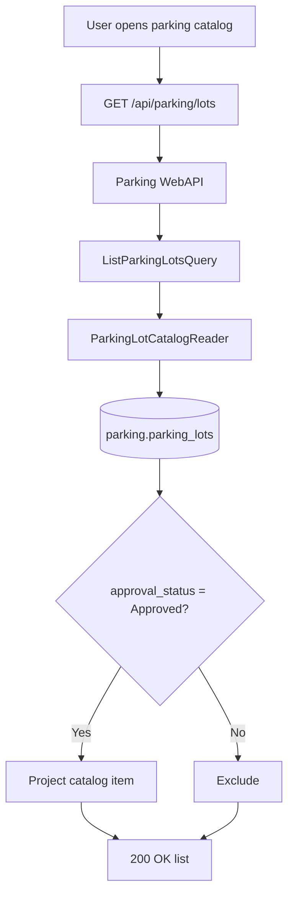
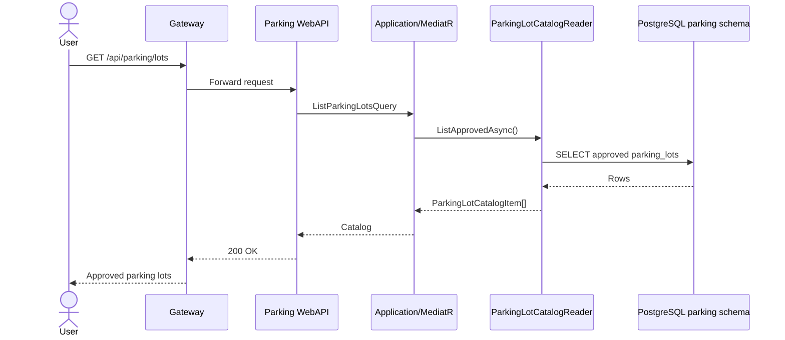

# Parking Catalog API — US-SEARCH-001

## Overview

Returns the parking-lot catalog that a user can browse before choosing a parking lot.
Only parking lots approved by an administrator are returned. Authentication is not required.

Traceability:

- Requirement: `FR-PARK-001`
- User Story: `US-SEARCH-001 — Xem danh sách bãi`
- Main Flow: `MF-05`
- Owner: Parking Service / BE-2

This endpoint is deliberately limited to the catalog. Radius search, vehicle-group filtering,
Nominatim, OSRM, availability, AI recommendation, and parking detail are separate features.

## API Specification

### API URL

`GET /api/parking/lots`

### Permission

N/A — public / anonymous.

## Request sample

No request body and no query parameters.

## Response sample

```json
[
  {
    "id": "10000000-0000-0000-0000-000000000001",
    "name": "Bãi đỗ Trung tâm A",
    "address": "01 Đường Mẫu, TP. Hồ Chí Minh",
    "latitude": 10.776530,
    "longitude": 106.700981,
    "type": "MultiStorey"
  }
]
```

| Field | Description | Data type | Example |
| --- | --- | --- | --- |
| `id` | Parking lot identifier | UUID | `10000000-0000-0000-0000-000000000001` |
| `name` | Parking lot name | string | `Bãi đỗ Trung tâm A` |
| `address` | Parking lot address | string | `01 Đường Mẫu, TP. Hồ Chí Minh` |
| `latitude` | Parking lot latitude | decimal | `10.776530` |
| `longitude` | Parking lot longitude | decimal | `106.700981` |
| `type` | Parking lot type from Context | string | `MultiStorey` |

## Validation

There is no request validation because this endpoint has no body or query input.

| Status code | Description | Example |
| --- | --- | --- |
| `200` | Approved parking lots are returned. An empty array is valid when no approved lot exists. | `[]` |
| `500` | Unexpected infrastructure/server error. Shared ProblemDetails handling applies. | `application/problem+json` |

Pending or rejected parking lots are not returned; they are not reported as an error.

## Activity Diagram



## Sequence Diagram



## Dependency note

The Parking endpoint itself is implemented in this feature. Browser traffic still depends on the
separate Gateway service-route workstream that proxies `/api/parking/{**catch-all}` to Parking.
