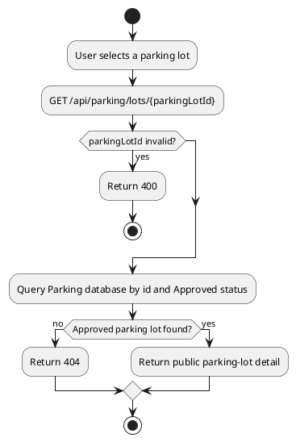
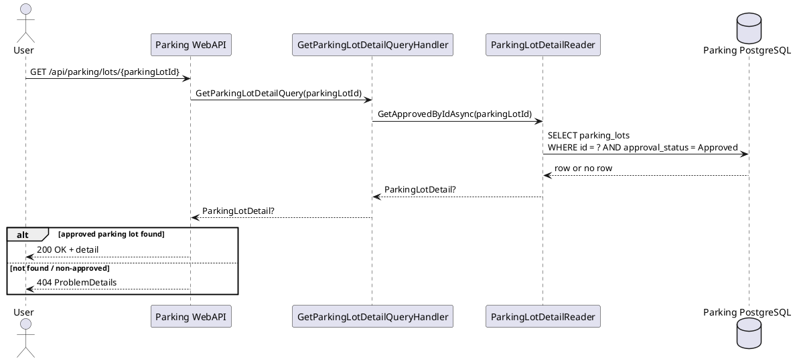

# Parking Detail API — US-SEARCH-005

## Overview

Returns the public S1 detail projection for one parking lot selected by the user.
Only parking lots approved by an administrator are exposed, and authentication is not required.

Traceability:

- Requirement: `FR-PARK-001`
- User Story: `US-SEARCH-005 — Xem thông tin bãi`
- Main Flow: `MF-05`
- Owner: Parking Service / BE-2

The S1 endpoint exposes the parking-lot master data that is currently owned and persisted by the Parking service:
identifier, name, address, coordinates and parking-lot type.

US-SEARCH-005 also requires dynamic decision data such as remaining walk-in capacity, predicted availability,
price, distance, driving time and a 3D-map entry point. Those values are not fabricated in this slice because
they depend on separate Parking/Booking/AI/OSRM/layout/pricing work and, for held reservations, a cross-service
contract that the Context marks as not yet specified. Later feature branches can enrich the detail response once
those authoritative sources and contracts are available.

## API Specification

| API | URL |
| --- | --- |
| GET | `/api/parking/lots/{parkingLotId}` |
| Permission | N/A — public / anonymous |

## Request sample

```http
GET /api/parking/lots/10000000-0000-0000-0000-000000000001
```

No request body is required.

| Field | Description | Data Type | Example |
| --- | --- | --- | --- |
| `parkingLotId` | Parking lot identifier from the catalog | UUID | `10000000-0000-0000-0000-000000000001` |

## Response sample

```json
{
  "id": "10000000-0000-0000-0000-000000000001",
  "name": "Bãi đỗ Trung tâm A",
  "address": "01 Đường Mẫu, TP. Hồ Chí Minh",
  "latitude": 10.776530,
  "longitude": 106.700981,
  "type": "MultiStorey"
}
```

| Field | Description | Data Type | Example |
| --- | --- | --- | --- |
| `id` | Parking lot identifier | UUID | `10000000-0000-0000-0000-000000000001` |
| `name` | Parking lot name | string | `Bãi đỗ Trung tâm A` |
| `address` | Parking lot address | string | `01 Đường Mẫu, TP. Hồ Chí Minh` |
| `latitude` | Parking lot latitude | decimal | `10.776530` |
| `longitude` | Parking lot longitude | decimal | `106.700981` |
| `type` | Parking lot type | string | `MultiStorey` |

## Validation

| Status code | Description | Example |
| --- | --- | --- |
| `200` | The parking lot exists and is approved for public display. | Response sample above |
| `400` | `parkingLotId` is not a valid non-empty UUID. | `application/problem+json` |
| `404` | The parking lot does not exist, or exists but is not approved for public display. | `application/problem+json` |
| `500` | Unexpected infrastructure/server error. | `application/problem+json` |

Pending and rejected parking lots intentionally use the same public `404` behavior as an unknown identifier.
This prevents a public endpoint from exposing non-public parking-lot records.

## Activity Diagram



## Sequence Diagram


